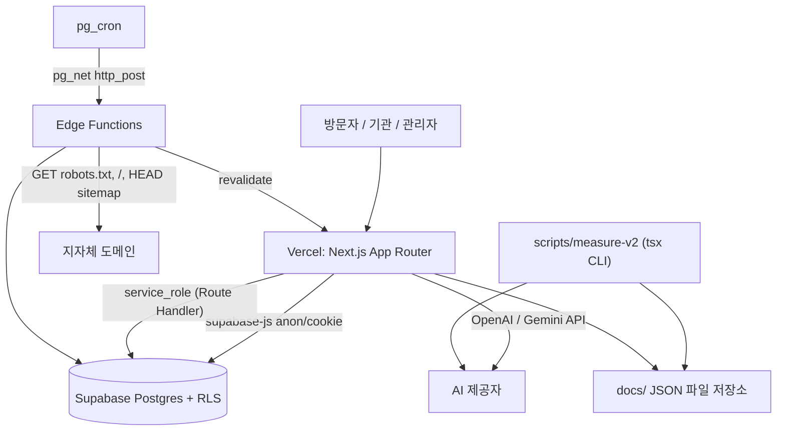
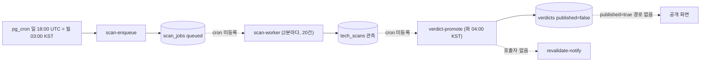
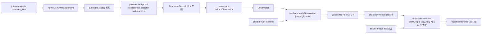

# ARCHITECTURE-SPEC — kplacelab 시스템 아키텍처 및 기능 명세 (AI 에이전트용)

| | |
|---|---|
| 대상 독자 | **AI 코딩 에이전트** (Claude Opus 5.5 등) · 신규 개발자 |
| 기준 시점 | 2026-10-08, 작업 트리 기준 (커밋되지 않은 변경·미추적 파일 포함) |
| 성격 | **기술(記述) 문서 — as-is.** 코드가 *실제로* 어떻게 되어 있는지 적는다. 규범(무엇이 *옳은가*)은 이 문서가 아니라 아래 우선순위 문서에 있다 |
| 작성 방법 | `git ls-files` + `git status` 로 파일 목록을 얻고, 하위 시스템별로 소스·마이그레이션·테스트를 정적으로 읽어 정리. **빌드·실행·DB 접속은 하지 않았다** |

---

## 0. 이 문서를 읽는 법

### 0.1 문서 우선순위 (충돌 시 위가 이긴다)

1. [`AGENTS.md`](../AGENTS.md) — 절대 불변식 INV-1~INV-12. **어떤 작업이든 시작 전에 읽는다.**
2. [`docs/knowledge/`](./knowledge/) — 판정 기준·문항·법령·용어의 원본 (K01~K16)
3. [`docs/EVIDENCE.md`](./EVIDENCE.md) — 사실 주장의 상태 대장 (C-1~C-11)
4. [`docs/PRD.md`](./PRD.md) — 무엇을 만드는가 (FR-1~FR-79, NFR-1~8)
5. [`docs/SDD.md`](./SDD.md) — 어떻게 만드는가 (**설계 의도**. 실제 코드와 다른 곳이 많다 → §19)
6. [`docs/adr/`](./adr/) — ADR-0001~0012
7. **이 문서** — 실제 코드 상태 지도

### 0.2 상태 표기

| 표기 | 의미 |
|---|---|
| ✅ 구현 | 코드가 존재하고 의도대로 연결되어 있음 (정적 분석 기준) |
| 🟡 부분 | 일부만 구현되었거나 연결이 끊김 |
| 🧪 목업 | 화면은 있으나 하드코딩/시드/메모리 데이터 |
| ⛔ 미구현 | 스키마·문서만 있거나 아무것도 없음 |
| ⚠️ 위험 | 불변식 위반 또는 보안·데이터 무결성 문제 |

> [!IMPORTANT]
> §19 "알려진 결함"은 정적 분석 결과다. 수정 작업 전에는 해당 파일을 직접 열어 재확인한다. 이 문서의 줄 번호·개수는 시간이 지나면 틀어진다.

---

## 1. 제품 한 줄 요약

**kplacelab = 전국 지방자치단체(와 자체 도메인을 가진 특별구역)에 대해 "생성형 AI가 무엇이라고 답하는가"와 "기관 누리집이 AI 수집기에 열려 있는가"를 측정·시계열 추적·공표하는 웹 플랫폼.** 수요처는 공공기관이며, 잘못된 숫자 하나가 신뢰 붕괴로 이어지는 제품이다. 그래서 **불변식이 성능·우아함보다 우선**한다.

### 1.1 레이어 모델 (PRD §04)

| 레이어 | 이름 | 수집 | 편향 | 공개 | 과금 | 코드상 주 위치 |
|---|---|---|---|---|---|---|
| L0 | 공개 표면 (공유 카드·지역 URL·보도 키트) | 없음 | — | 전면 | 무료 | `app/(public)/*`, `app/api/og` |
| L1 | 기술 접근성 (robots/sitemap/JSON-LD/TLS) | 자동·전수 | **없음** | 전면 | 무료 | `supabase/functions/scan-*`, `verdict-promote` |
| L2 | 셀프체크 (이용자 제출) | 수동·자발 | 자기선택 | 집계만 | 무료 | `app/(public)/selfcheck`, `submit`, `api/submit` |
| L3 | 통제 측정 (API 반복 측정) | 자동·통제 | 조건 고정 | 기관 전용 | 유료 | `lib/measurement/*`, `lib/aeo/*`, `scripts/measure-v2/*` |
| L4 | 진단·정비 (사람) | 사람 | — | 발주기관 | 유료 | 코드 없음 (산출물은 `docs/` 리포트) |

### 1.2 두 모집단 (INV-1)

- `local_gov` — 자치단체 243 (광역 16 + 기초 227). 행정시 2는 분리.
- `special_zone` — 특별구역. **측정 단위는 A형(독립 도메인) 6곳뿐.** B형(시·도 도메인 종속) 3곳은 L1 단독 판정 불가, C형은 L2 무지명 질문만.
- **두 모집단은 절대 합산하지 않는다.** 모든 집계 함수는 `population` 을 필수 인자로 받는다.

---

## 2. 불변식 ↔ 코드 강제 지점 ↔ 실제 상태

| INV | 요지 | 강제 지점 (있는 것) | 실제 상태 |
|---|---|---|---|
| INV-1 | 두 모집단 합산 금지 | `units.population` enum, `v_layer1_coverage` 가 population을 행으로 출력, `getUnitsByPopulation(population)` 필수 인자, `aggregateReports({population})` 미지정 시 예외, `unit_domains_scannable_host_idx` (한 호스트를 두 단위가 스캔 불가) | ✅ 코어는 준수. ⚠️ `cite/page.tsx` 에 "전국 249곳" 문자열, `aeo_measurements`·`audience_comparisons`·measurement-spec 등록부에 population 없음 |
| INV-2 | 4분 판정 + undetermined 사유 필수 | DB CHECK `tech_scans_undetermined_needs_reason`, `verdicts_undetermined_needs_reason`; `parseRobotsTxt` | ✅ DB 강제. ⚠️ `/api/export/layer1` 이 미측정(null)을 `undetermined`(사유 공란)로 내보냄; `lib/db/units.ts::calculateCoverage` 가 blocked_all/selective 병합; `lib/measurement/collector.ts::checkRobotsAccess` 가 네트워크 오류를 차단으로 처리 |
| INV-3 | 점수 정렬 금지 | `lib/validators/sort-allowlist.ts::parseSort` (허용: `sgg_code`,`name`,`population`), `FORBIDDEN_WORDS` | ✅ 코어. ⚠️ AEO `analyzeSoV` 경쟁 도시 언급순 정렬, 리포트 카탈로그의 도시 간 비교 |
| INV-4 | L2를 전국으로 말하지 않음, L1/L2 타입 분리 | `lib/types/layers.ts` 브랜드 타입 `Layer1Stat`/`Layer2Stat`/`Layer2ReportStat`, `v_layer2_participation` 에 분모 없음 | 🟡 타입은 정의되었으나 **컴포넌트가 사용하지 않음**; `report-aggregator` 가 `as unknown as` 캐스트로 우회. ⚠️ 플랫폼이 API로 돌린 AEO 측정 산출물 파일명이 `docs/L2-*` (실제로는 L3 성격) |
| INV-5 | 차단 우회 금지, 단일 UA | `lib/constants/scanner.ts::SCANNER_UA`, `SCAN_MIN_INTERVAL_MS=5000` | 🟡 `scan-worker` 가 UA를 **복제**해 씀, 리다이렉트 무제한, robots가 막아도 sitemap HEAD 수행. ⚠️ `lib/aeo/crawl-unit.ts` 는 경로별 Disallow 무시·최대 50페이지 본문 수집(NG-5 긴장) |
| INV-6 | AI 응답 원문을 공개 경로로 내보내지 않음 | `observations`/`item_results` 에 원문 컬럼 없음 | ⚠️ `aeo_observations.response NOT NULL`, `docs/aeo-measurements/*.json`·`docs/person-measurements/*.json` 에 원문 전문이 커밋됨, `/api/reports/[slug]/download?format=json` 이 측정 JSON을 공개 제공, 시민 제보 스크린샷 공개 버킷 |
| INV-7 | 측정 조건 NOT NULL, 기본값 금지 | `observations` NOT NULL + 트리거 `enforce_named_total` | 🟡 `observations.language DEFAULT 'ko'`, `aeo_measurements.web_search DEFAULT 'on'`·`method_version DEFAULT 'v2.1'`, `citizen_reports.measured_on DEFAULT current_date`·`method_version` 컬럼 없음 |
| INV-8 | 2주 연속 승격분만 공개 | `verdicts_needs_two_weeks CHECK (consecutive_weeks >= 2)`, `published DEFAULT false` | 🟡 `verdict-promote` 는 **`published=true` 를 설정하는 경로가 없음**; 공개 판정은 전부 `seed.sql` 직접 삽입분 |
| INV-9 | 회차별 저장 + Floor Risk 동반 | `item_results` PK에 `rep`, `floor_risk_of()` 함수, 증상군 CHECK | ✅ 스키마. ⚠️ AEO VIP 리포트·measurement-spec `report-renderer`·Theme Lab·K-Brand Lab 화면이 **정확도만 단독 표시** |
| INV-10 | 강건성 미통과 문항 미공표, 8블록 조립 | `question_robustness.sensitive` 생성 컬럼, `question_bank.block_*` 8컬럼 | 🟡 스키마만. `/selfcheck`·AEO·Theme Lab 문항이 자연어 하드코딩 |
| INV-11 | 사전 등록 없는 측정 미공표 | `prereg_published_before_start` CHECK, `observations.prereg_id`, `audience_comparisons.prereg_id NOT NULL` | 🟡 DB 강제는 있음. AEO VIP 리포트는 "탐색적" 표기 강제(`report-checklist`). 구로 측정은 `PREREG-guro-ko-oai-ws.md` 로 사전 등록 |
| INV-12 | 대장에 없는 주장 금지 | `inv-12` 테스트(EVIDENCE.md에 C-2·미검증 문자열 존재 여부만) | ⚠️ 카탈로그·리포트 렌더러·Theme Lab에 대장 미등록 수치/인과 주장 하드코딩 |

---

## 3. 기술 스택 및 런타임 토폴로지

| 영역 | 선택 (실제 `package.json`) |
|---|---|
| 프런트엔드 | Next.js **14.2** App Router, React 18, TypeScript 5.7, Tailwind 3.4, lucide-react, marked |
| 검증 | zod 3 |
| DB/인증 | Supabase Postgres (RLS), `@supabase/ssr`, `@supabase/supabase-js` |
| 배치 | Supabase Edge Functions (Deno) + `pg_cron` + `pg_net` |
| 큐 | Postgres 테이블 + `FOR UPDATE SKIP LOCKED` (`scan_jobs`, `measure_jobs`) |
| AI SDK | `openai` ^7 (chat.completions + **Responses API**), `@google/genai` ^2 (Gemini + `googleSearch` grounding) |
| 스크립트 실행 | `tsx` |
| 패키지 매니저 | pnpm |
| 배포 | Vercel (Next.js) + Supabase. **세 번째 인프라 추가는 ADR 선행** (ADR-0001) |



> [!NOTE]
> L3 성격의 측정(AEO, measurement-spec, 구로)은 현재 **대부분 CLI 스크립트 + `docs/` 파일 저장소**로 돌아간다. 관련 DB 테이블(`aeo_*`, `spec_*`)은 존재하지만 거의 쓰이지 않는다 (§15).

---

## 4. 저장소 구조 지도

```
kplacelab/
├─ AGENTS.md                      불변식 (최우선)
├─ README.md                      제품 소개·문서 지도
├─ K_Brand_Lab_PRD_v3_KO.md       별도 제품 K-Brand Lab PRD
├─ Policy_Theme_Lab_PRD_v3_*.md   정책 테마 랩 PRD
├─ kbizlab/                       ⚠️ 독자 .git 을 가진 별도 Next.js 앱 골격 (.gitmodules 없음, 참조 없음)
├─ middleware.ts                  세션 갱신만 (라우트 보호 없음)
├─ app/
│  ├─ (public)/                   로그인 없는 공개 화면 (L0/L1/L2 + 위성 모듈)
│  ├─ (org)/                      기관 화면 (dashboard, aeo, kbrandlab) — 인증 없음
│  ├─ (admin)/                    운영 화면 (review, scans, correction-mgmt, admin/*) — 인증 없음
│  ├─ api/                        Route Handlers
│  ├─ robots.ts, sitemap.ts, layout.tsx
├─ components/                    charts/, ui/, dashboard/, units/, reports/
├─ lib/
│  ├─ constants/                  scanner.ts, measurement.ts
│  ├─ db/units.ts                 단위 조회 (+ 폴백 목업)
│  ├─ types/                      layers.ts, measurement-spec.ts, source-analysis.ts, citizen-report.ts
│  ├─ validators/sort-allowlist.ts
│  ├─ utils/coverage.ts
│  ├─ supabase/                   client.ts, server.ts, middleware.ts
│  ├─ measurement/                measurement-spec 파이프라인 (+ collector-websearch.ts)
│  ├─ aeo/                        3-Tier AEO 진단·VIP 리포트
│  ├─ crowdsource/                Floor Hunter 시민 제보·승격
│  ├─ theme-lab/                  정책 테마 랩
│  ├─ kbrandlab/                  K-Brand Lab (브랜드 측정)
│  └─ reports/diagnostic-reports.ts  공개 리포트 카탈로그
├─ supabase/
│  ├─ migrations/                 24개 + combined_migration.sql
│  ├─ functions/                  _shared/, scan-enqueue, scan-worker, verdict-promote, revalidate-notify, measure-l3
│  └─ seed/seed.sql
├─ scripts/                       측정·검증 CLI (measure-v2/, theme-lab/, sync-spec-questions.ts …)
├─ tests/                         invariants/, measurement/, kbrandlab/  (프레임워크 없이 tsx 실행)
├─ docs/
│  ├─ PRD.md, SDD.md, EVIDENCE.md, adr/, knowledge/
│  ├─ measurement-spec/           측정 규격 저장소 (spec, schema, data, policy, sealed, tools)
│  ├─ ground-truth/               정답 원장 JSON
│  ├─ aeo-questions/, aeo-measurements/, aeo-reports/   AEO 파일 저장소
│  ├─ person-*/, political-strategy/                    인물·정무 측정 (PRD 범위 밖)
│  └─ L2-*.md, L1-*.md            단위별 진단 리포트 산출물
└─ .github/workflows/             ci.yml, cd.yml, edge-functions.yml
```

---

## 5. 하위 시스템 지도

| # | 하위 시스템 | 대상 | 관련 FR | 성숙도 | 주 데이터 저장 |
|---|---|---|---|---|---|
| S1 | **코어 L1 스캐너 + 판정 승격** | 자치단체·A형 특별구역 도메인 | FR-1~3, NFR-1·4 | 🟡 스캐너 실재, 파이프라인 미연결 | DB |
| S2 | **공개 표면 L0 + 신뢰 장치** | 일반·기자·의원 | FR-8·9·22~24·42~50 | 🟡/🧪 | DB(+폴백 목업) |
| S3 | **셀프체크 L2** | 공무원·주민 | FR-4~7·25 | 🟡 | DB |
| S4 | **measurement-spec 파이프라인** (규격 기반 통제 측정) | 기초 226 (`AG-xxxx` 핸들) | FR-15~21·76~79 | 🟡 라이브러리 실재, DB 미사용 | 파일 + 메모리 |
| S5 | **AEO 3-Tier 진단 / VIP 리포트** | 단위별 (수원·증평·화성·제주 등) | (FR 번호 없음) | 🟡 CLI 실동작 | 파일 |
| S6 | **구로구 OpenAI 웹검색 측정** (ADR-0012) | 구로구 232문항 | FR-76~79 | ✅ CLI 파이프라인 | `.private/` JSONL (gitignore) |
| S7 | **Floor Hunter** 시민 오답 제보·승격 | 주민 | FR-69~75 | 🟡/⚠️ DB 저장 실패 | 메모리(+시드) |
| S8 | **정책 테마 랩** | 주민·연구자 | FR-60~68 | 🧪 | 시드 |
| S9 | **K-Brand Lab** | **브랜드·상품** (지자체 아님) | 별도 PRD FR-01~20 | 🧪 | 메모리 |
| S10 | **대상군 형평성 (K16)** | 문항 대상군 태깅 | C-10 | 🟡 스키마+읽기 API | DB |
| S11 | **인물·정무 측정** | 정치인 1명 | **PRD 범위 밖** | ⚠️ | 파일 |

---

## 6. S1 — 코어 L1 스캐너와 판정 승격

### 6.1 처리 흐름 (설계 의도 vs 실제)



점선 = **현재 연결되지 않은 구간.** `20260905000017_cron_schedules.sql` 에는 `weekly-scan-enqueue` 하나만 등록되어 있다.

### 6.2 Edge Functions (`supabase/functions/`)

| 함수 | 인증 | 동작 | 상태 |
|---|---|---|---|
| `_shared/auth.ts` | — | `requireAuth(req)`: 헤더 `x-edge-secret` == env `EDGE_SHARED_SECRET` (`!==` 단순 비교) | ✅ |
| `_shared/robots-parser.ts` | — | `parseRobotsTxt(content, httpStatus) → {verdict, reason?, aiAgents, sitemapDeclared?, sitemapUrl?}` | ✅ |
| `scan-enqueue` | secret | KST 월요일을 `scheduled_week` 로, `unit_domains where scannable and active` 를 `scan_jobs` 에 bulk INSERT | 🟡 upsert 아님 → 같은 주 재실행 시 유니크 위반으로 전체 실패 |
| `scan-worker` | secret | `reclaim_stale_jobs` → `claim_scan_jobs(20)` → 호스트당 5초 간격 → ① `GET /robots.txt` (10s) ② 허용 시 `GET /` (meta robots, JSON-LD, hreflang 추출) ③ Sitemap 선언 시 HEAD → `tech_scans` INSERT (`raw_hash`=sha256) | 🟡 cron 없음, UA 상수 복제, `tls_expires_at` 미설정, 20건×순차 대기로 실행 시간 제한 초과 가능 |
| `verdict-promote` | secret | 도메인별 최근 2개 스캔 비교 → 같으면 `verdicts` upsert(`consecutive_weeks+1`), 다르면 `change_pending=true`; 판정 변경 시 `verdict_changelog` 기록 | 🟡 `published=true` 설정 없음; 스키마에 없는 `notice_until` 기록; 두 스캔이 다른 주인지·같은 method_version인지 미확인 |
| `revalidate-notify` | secret | `GET {SITE}/api/revalidate?secret=…&tag=verdicts` | ⛔ 호출자 없음, 태그된 fetch도 없음 |
| `measure-l3` | secret | 필수 필드 검사 후 **항상 501** | ⛔ 스텁 |

실패 처리 (scan-worker): DNS → `undetermined/dns_fail`; timeout·5xx·기타 오류(TLS 포함) → `undetermined/timeout` (attempts<3이면 +10분/+60분 재큐); 404 제외 4xx → `undetermined/timeout`.

### 6.3 robots 4분 판정 알고리즘 (실제 구현)

1. HTTP 404 → `no_file`
2. HTTP ≥500 → `undetermined/timeout`; 기타 non-200 → `undetermined/other`
3. 본문 첫 1KB에 HTML 태그 → `undetermined/malformed`
4. 비어있지 않은 줄 중 유효 지시어(user-agent/allow/disallow/sitemap/crawl-delay) < 50% → `undetermined/parse_fail`
5. 대상 에이전트별로 정확 그룹 → 없으면 `*` 그룹 → 없으면 allow. `Disallow: /` 또는 `/*` 이고 루트 Allow 없음 → `disallow_all`, 그 외 disallow → `disallow_partial` (차단 아님)
6. 전부 `disallow_all` **또는 `KPlaceLabBot` 이 disallow_all** → `blocked_all`; 하나라도 → `blocked_selective`; 아니면 `open`

`TARGET_AGENTS`: GPTBot, OAI-SearchBot, ChatGPT-User, ClaudeBot, Claude-Web, anthropic-ai, Google-Extended, Gemini, PerplexityBot, Bytespider (+ 내부 평가용 KPlaceLabBot). 기준 원본은 `K03-measurement-spec.md` 이다. 목록을 바꾸면 K03과 `method_version` 을 함께 올린다.

`shared_domain` 사유는 스캐너가 만들지 않는다. B형 단위는 `units.domain_form='B'` 이므로 스캔 대상이 아니다. 트리거 `unit_domains_form_guard` 가 이를 강제한다.

### 6.4 상수 (`lib/constants/scanner.ts`)

`SCANNER_UA='KPlaceLabBot/1.0 (+https://kplacelab.kr/bot; …)'`, `SCAN_TIMEOUT_MS=10000`, `SCAN_MIN_INTERVAL_MS=5000`, `SCAN_MAX_REDIRECTS=3`, `SCAN_BATCH_SIZE=20`, `SCAN_MAX_ATTEMPTS=3`, `PROMOTION_REQUIRED_WEEKS=2`, `FIRST_PUBLICATION_NOTICE_DAYS=14`, `CHANGE_NOTICE_DAYS=7`.
**Edge Functions는 이 파일을 import하지 않는다.** Deno 런타임이라 상수를 따로 복제해 둔 상태다.

---

## 7. 데이터 모델 — 코어 (`supabase/migrations/20260905000001~018`)

SDD §5 의 DDL과 거의 일치한다. 차이점만 따로 적는다.

### 7.1 열거형 (001)

`population`, `unit_type`(metro/basic/special_city/admin_city/fez/rfz/odz/other), `domain_form`(A/B/C), `domain_role`, `robots_verdict`(5), `undetermined_reason`(timeout/malformed/parse_fail/shared_domain/dns_fail/other), `accuracy`(accurate/partial/inaccurate/absent), `submitter_type`, `review_status`, `correction_status`, `job_status`, `failure_syndrome`(confabulation/stale_fact/generic_drift/cross_unit/hypersensitivity/unstable_skeleton), `floor_risk`(low/moderate/high/critical), `variant_axis`(original/punct/polite/order/frame), `notice_kind`, `notice_channel`, `citation_kind`, `prereg_status`.

### 7.2 테이블

| 테이블 | 마이그레이션 | 핵심 제약 | 비고 |
|---|---|---|---|
| `units` | 002 | `units_b_needs_parent`, `units_sgg_only_local`, `units_c_has_no_own_domain` | id 규칙: `lg-{행정표준코드}`, `sz-{제도}-{약칭}`. 삭제 금지 → `active=false`. `updated_at` 없음 |
| `unit_domains` | 003 | UNIQUE(unit_id,host,role); 부분 유니크 `(host) where scannable`; 트리거 `enforce_scannable_by_form` (A형만 scannable) | |
| `scan_jobs` | 004 | UNIQUE(domain_id, scheduled_week) = 도메인당 주 1회 | RPC `claim_scan_jobs(p_limit)`, `reclaim_stale_jobs()` (15분 리스) |
| `tech_scans` | 005 | `tech_scans_undetermined_needs_reason`; `raw_hash NOT NULL` | L1 관측 |
| `verdicts` | 006 | `consecutive_weeks >= 2`; undetermined⇔reason | + `verdict_changelog`. `notice_until` 컬럼 없음 |
| `method_versions` | 007 | — | seed: `v1.0` (named 12 / unnamed 8) |
| `question_bank` | 008 (+018) | UNIQUE(method_version, kind, seq); 8블록 `block_actor/situation/task/knowledge/workflow/format/language/output` | 018에서 `audience audience_tag[]` 추가 |
| `observations` | 009 (+013) | 조건 NOT NULL; 트리거 `enforce_named_total` (지명 4단계 합 = `method_versions.named_count`) | `language DEFAULT 'ko'` ⚠️; 013에서 `prereg_id` 추가 |
| `item_results` | 010 | PK(observation_id, question_id, **rep**); `syndrome_only_on_failure`; `confabulation_consistent` | 함수 `floor_risk_of(obs, q)`: confabulated→critical, inaccurate→high, absent→moderate, else low |
| `robustness_runs`, `question_robustness` | 011 | `sensitive GENERATED (divergence > threshold)` | |
| `questions` | 012 | `approved ⇒ pii_checked` | 자유 질문 코퍼스. ⚠️ Theme Lab이 같은 이름으로 `create table if not exists` (§12) |
| `statements` | 012 | — | 설명 게재권 (FR-22). 컬럼: body, author_verified, published_at |
| `corrections` | 012 | — | 정정 요청 (FR-23). 컬럼: **`claim`, `contact`**, status, resolution |
| `notifications` | 013 | `responded ⇒ responded_at`; `body_hash NOT NULL` | 사전 통지 이력 (FR-44) |
| `citations` | 013 | `term is null or used_our_term is true` | 인용·용어 채택 추적 (FR-45·50) |
| `preregistrations` | 013 | `prereg_published_needs_time`, `prereg_published_before_start` | `claim_id` → EVIDENCE.md 의 C-n |
| `audience_taggings`, `audience_comparisons` | 018 | comparisons: `prereg_id NOT NULL`, n>0, tag_a≠tag_b | floor_risk_a/b nullable ⚠️, population 없음 |

### 7.3 뷰 (014)

- `v_layer1_coverage` — `group by population, robots_verdict, undetermined_reason`. 대상은 published, role='main', active. 모집단이 **행**으로 나온다.
- `v_layer2_participation` — accepted L2 관측을 단위·모집단·버전별로 묶는다. **전국 분모 컬럼이 없다** (INV-4 구조적 보장).
- `v_unit_latest_verdict` — units ⟕ main 도메인 ⟕ published verdict. **UI의 주 데이터원.**
- 뷰에 `security_invoker` 가 없으므로 소유자 권한으로 실행된다.

### 7.4 RLS (015, 016)

- 공개 SELECT: `units`(active), `unit_domains`(active), `verdicts`(published), `statements`(published_at not null), `method_versions`, `question_bank`, `preregistrations`(status≠draft), `citations`.
- 공개 INSERT: `corrections` (`with check (true)` — status까지 임의 지정 가능).
- anon 정책 없음 (service_role 전용): `tech_scans`, `observations`, `questions`, `scan_jobs`, `notifications`, `item_results`, `robustness_*`, `verdict_changelog`.
- 셀프체크 제출은 Route Handler가 검증한 뒤 `service_role` 로 INSERT한다 (SDD §5.8).

### 7.5 시드 (`supabase/seed/seed.sql`)

- `method_versions` v1.0
- 단위: 광역 16 + 기초 10 = **자치단체 26곳** (243 전부가 아님), A형 특별구역 6 (scannable), B형 3 (scannable=false)
- `question_bank` 20행 (8블록), 대상군 태깅
- **published 판정 8건이 직접 삽입됨** (consecutive_weeks=2) — 승격 파이프라인을 거치지 않았다
- 사전 등록 `prereg-2026-c1`

---

## 8. S2·S3 — 웹 라우트와 API (코어)

### 8.1 공개 페이지 `app/(public)/`

| 경로 | 렌더 | 데이터 | FR | 상태 |
|---|---|---|---|---|
| `/` | ISR 3600 | `getUnitsByPopulation` ×2 → `DashboardClient` (모집단 탭, 4분 요약, 도넛, 목록) | FR-2 | 🟡 DB 오류·빈 결과 시 `FALLBACK_UNITS` 목업 |
| `/units` | ISR 3600 | 동일, `UnitsClient` | FR-1 | 🟡 |
| `/units/[unitId]` | ISR (cookies로 사실상 동적) | `getUnitById`, `tech_scans`(없는 `is_latest` 컬럼 + anon 정책 없음), `statements`(없는 `content`/`published` 컬럼) | FR-3·22·23 | ⚠️ 이력·설명이 항상 비어 있음 |
| `/[slug]` | ISR | `getUnitBySlug` (name/name_en) → 단위 상세 재사용 | FR-48 | 🟡 ⚠️ `.or()` 필터에 미이스케이프 입력 |
| `/method` `/cite` `/bot` `/press` `/evidence` | 정적 | 하드코딩 | FR-8·9·49·43, NFR-4 | 🟡 `/evidence` 는 EVIDENCE.md 사본(파일을 읽지 않음) |
| `/prereg` | ISR | `preregistrations` + fallbackData | FR-42 | 🟡 |
| `/corrections` | 클라이언트 | → `POST /api/corrections` | FR-23 | ⚠️ API 실패 (§8.2) |
| `/selfcheck` | 정적+클라이언트 치환 | **하드코딩 12+8 문항** (seed `question_bank` 과 문구 다름) | FR-4 | ⚠️ INV-10 |
| `/submit` | 클라이언트 | 7개 단위 하드코딩, 폼 기본값 6/3/2/1 | FR-5~7 | 🟡 |
| `/equity` | ISR | `question_bank.audience` + 하드코딩 맵 | C-10 | 🟡 |
| `/reports`, `/reports/[slug]` | — | `lib/reports/diagnostic-reports.ts` 카탈로그 → md 렌더 | — | ⚠️ §19 |
| `/measure/**`, `/report`, `/dashboard/reports`, `/theme-lab/**`, `/krole/[entityId]`, `/reviewer/adjudication` | — | 위성 모듈 | §9~§13 | |

### 8.2 API `app/api/`

| 엔드포인트 | 메서드 | 검증 | 쓰기 | 상태 |
|---|---|---|---|---|
| `/api/units` | GET | `population` 필수(400), `order`/`sort` → `parseSort` | — | ✅ INV-1·3 |
| `/api/submit` | POST | zod: unitId, aiService, webSearch(필수), language(기본 ko ⚠️), named×4, 지명 합=12 (**하드코딩**), PII 정규식 | service_role → `observations`(layer=2, pending) + `questions`(pii_checked=false) | 🟡 레이트 리밋·봇 차단 없음 |
| `/api/corrections` | POST | zod: unit_id, description, contact_email, evidence_url | anon → `corrections` | ⚠️ **스키마 컬럼명 불일치**(`claim`/`contact`) → 항상 500 |
| `/api/export/layer1` | GET | `population` 필수 | — | ⚠️ null 판정을 `undetermined` 로 출력; `/press` 링크에 population 누락 |
| `/api/og/[unitId]` | GET (edge) | — | — | ✅ 미공표 시 "공표 전" 카드 (L0 게이트) |
| `/api/revalidate` | GET | `?secret` | `revalidateTag(tag)` | 🟡 태그된 fetch 없음 |
| `/api/audience` | GET | `prereg_id` 필수 | — | ✅ |

### 8.3 운영·기관 화면

`app/(admin)/review`, `scans`, `correction-mgmt`, `app/(org)/dashboard` 는 모두 🧪 **목업 배열 + 로컬 상태**다. **인증·`force-dynamic`이 없다.** 실명 지자체에 대한 가상의 부정 사례가 들어 있어 K13 §3에 저촉된다.

### 8.4 컴포넌트 `components/`

- `ui/FourWayVerdictSummary` — "개방 · 전체 차단 · 선별 차단 · 파일 없음 · 판정 불가" 문장 + 막대 (INV-2 공개 문장)
- `ui/VerdictBadge` — null → "미측정", undetermined는 사유 라벨
- `ui/PopulationTabs` — 243/6 기본값
- `ui/UnitList` — 검색·필터·B형 병기 문구, 정렬 UI 없음
- `ui/SourceNote` — 기준일·방법론 버전 표기 (NFR-5)
- `charts/VerdictBar`, `charts/VerdictDonut` — 4세그먼트 (blocked 병합)
- `dashboard/DashboardClient`, `units/UnitsClient`
- `reports/ReportsGalleryClient`, `reports/SpecOutputViewer` (measurement-spec 5절 렌더)
- `ui/Navbar`, `ui/Footer`, `ui/DataCard`, `ui/SectionHeader`

### 8.5 lib 핵심 함수

| 함수 | 파일 | 역할 |
|---|---|---|
| `getUnitsByPopulation(population)` | `lib/db/units.ts` | `v_unit_latest_verdict` 를 `sgg_code` 순으로 조회. 실패·빈 결과면 `FALLBACK_UNITS` |
| `getUnitById(id)`, `getUnitBySlug(slug)` | 동 | 단건 조회 |
| `calculateCoverage(units, population)` | `lib/utils/coverage.ts` | 5버킷 집계 (대시보드가 사용) |
| `calculateCoverage` (동명) | `lib/db/units.ts` | blocked 병합판 ⚠️ 중복·불일치 |
| `parseSort(field)` | `lib/validators/sort-allowlist.ts` | 허용 목록 밖이면 "이 서비스는 순위를 제공하지 않습니다" 예외 |
| `createClient()` / `createAdminClient()` | `lib/supabase/server.ts` | anon+쿠키 / service_role |

---

## 9. S4 — measurement-spec 파이프라인 (규격 기반 통제 측정)

### 9.1 규격 저장소 `docs/measurement-spec/`

이 저장소는 자기완결적이다. "무엇을 관측·기록하는가"를 정의한다.

- **4대 규칙**
  1. 산식·가중치·임계값을 저장소에 두지 않는다. 이것들은 gitignore된 `sealed/` 에 둔다.
  2. 총점·순위·등급·빈칸 개수·예측을 금지한다.
  3. **LLM은 추출만 하고 판정하지 않는다.** `verdict.judged_by` 는 상수 `'rule'` 이다.
  4. 원문은 요약하지 않고 전량 보존한다.
- `spec/00_용어.md` ~ `05_산출물.md`: 용어, 대상 모집단, 질문 필지 규격, 관측 실행, 판정 규칙, 산출물.
- `schema/*.schema.json`: question, response_record, observation, verdict, grid, project_record, output.
- `data/codes/`: actor_roles, difficulty_codes(D0~D3), grid_cell_values, layers, mismatch_codes, nonresponse_codes, sensitivity_flags, value_nature.
- `data/registries/`
  - `population_frame.json`: 기초 **226곳**, `AG-0001~0226`.
  - `run_profile.json`: 관측 판본 (동결 조건).
  - `run_profile.draft.guro.json`
  - `archetype_assignment.json`: 계열 5종. 공개 가능한 것은 depopulation뿐이다.
  - `ledger_sources.json`
  - `condition_label_errata.json`: ADR-0012 정오표 13건.
- `data/questions/`: `core_common.json` (30문항), `archetype_*.json` (각 5문항), `project_template.json` (역점사업 6슬롯).
- `policy/`: `banned_terms.json`, `forbidden_keys.json`, `retention.md`, `robots_policy.md`.
- `sealed/interface.md`: 봉인 함수 4종 `population_band`, `peer_group`, `band_of`, `residual_spread`. 실제 구현은 저장소에 없다.
- `tools/validate.py`: JSON 문법·스키마·금지 키·금지어·문항 무결성·계열 게이트·산식 누출 검사. `pnpm lint:spec` 으로 돌린다.

### 9.2 핵심 개념

| 개념 | 정의 |
|---|---|
| agency handle | `AG-xxxx`. 레코드에는 실명 대신 핸들만 넣는다 (익명화 가능하도록). 구로구=AG-0017, 수원=AG-0076, 화성=AG-0080 |
| 질문 필지 | 질문 하나가 덮는 사실 범위. 지번(영구 ID, 재사용 금지). 6요건(배타성·경계·영속성·정본 소유자·동일 입도·출처 근거)과 5관문(출처→원장→소유→입도→ID) |
| type | `value` 는 ledger(원장) 필수, `descriptive` 는 ledger null이고 accuracy 레이어 없음 |
| sensitivity | `public` / `agency_only` (개별 확장·역점사업) / `restricted` (어떤 공표 경로에도 나가지 않음) |
| run profile | 모델·파라미터·반복 수·언어·앞말·창을 개시 시점에 동결. 모든 레코드에 `run_profile_id` |
| 비응답 코드 | N1 기술 차단 · N2 내용 부재 · N3 형식 미비 · N4 경쟁 배제(기관이 고칠 수 없음) · N5 엔진 회피 |
| 불일치 코드 | C0 대조 불가 · C1 값 불일치 · C2 출처 부적절 · C3 시점 어긋남 · C4 대상 혼동 |
| grid | 행=질문, 열=공적 주체(5역할). 셀: published/partial/not_applicable/blank. 행 판정 `canon_absent` 이면 `ownership{owner_role, tier}` 필수 |
| output | **정확히 5절, 고정 순서**. 1 `canon_absence_and_ownership`, 2 `entity_existence`, 3 `nonresponse_distribution`, 4 `public_source_citation`, 5 `residual_spread`. 채널은 3종: `national_report` (사전 통지 `notified_at`+`review_closed_at` 필수), `agency_notice`, `anonymized_dataset` (min_cell_size 5) |

### 9.3 코드 흐름 (`lib/measurement/`)



| 모듈 | 주요 export | 비고 |
|---|---|---|
| `registries.ts` | `getPopulationFrame`, `getRunProfileRegistry`, `findAgencyByHandle/Display` | 호출마다 동기 fs 읽기 |
| `questions.ts` | `getCoreCommonQuestions`, `getAllActiveQuestions` | runner는 restricted를 걸러내지 않는 전자만 사용 ⚠️ |
| `ground-truth-loader.ts` | `loadGroundTruth`, `saveCustomGroundTruth` | 이름→파일 하드코딩 맵, 3종 포맷 |
| `provider-bridge.ts` | `collectWithAdapter` | `lib/kbrandlab/adapters` 재사용 |
| `collector.ts` | `collectSingleResponse`, `extractBodyUrls`, `checkRobotsAccess` | chat.completions, 도구 없음 |
| **`collector-websearch.ts`** | `buildRequestParams`, `parseWebSearchResponse`, `collectWebSearchOnce`, `RunGuard` | ADR-0012 (§9.4) |
| `extractor.ts` | `extractObservation` | LLM 추출(client 주입 시) 또는 규칙 폴백. runner는 client를 넘기지 않음 → 항상 규칙 |
| `verifier.ts` | `verifyObservation` | 판정 순서: unstable→stale→descriptive→비응답 N-코드→C0→C4→C3→match→C2/C1 |
| `grid-analyzer.ts` | `buildGrid` | ⚠️ `cellInputs` 미전달 시 모든 행이 canon_absent |
| `output-generator.ts` | `buildOutput`, `anonymizeHandle`, `resetAnonymization`, `PROXY_NOTICE_DEFAULT` | 채널 게이트 예외 |
| `project-tracker.ts` | `createProjectRecord`, `generateProjectQuestions` | 역점사업 6물음 (템플릿 파일을 읽지 않고 하드코딩) |
| `sealed-bridge.ts` | `populationBand`, `peerGroup`, `bandOf`, `residualSpread` | ⚠️ **가짜 구현** (유형 기반·해시 기반·상수) |
| `runner.ts` | `runMeasurement(config)` | providers `gemini`/`openai`, run_profile_id를 job이 아니라 제공자로 결정 ⚠️ |
| `job-manager.ts` | `createMeasureJob`, `getMeasureJob`, `updateJobProgress`, `completeJob` | 메모리 Map + Supabase 동기화 시도 (uuid 불일치로 실패 추정) |
| `report-renderer.ts` | `renderVIPReportText`, `renderTechnicalReportText` | ⚠️ Floor Risk 없이 정확도 출력 |

### 9.4 OpenAI 웹검색 수집기 (ADR-0012, FR-76~79)

- **왜 만들었나.** 과거 OpenAI 경로가 chat.completions에 도구를 넘기지 않고도 `web_search:'on'` 으로 기록했다.
- **D-1 요청 방식.** **Responses API + `web_search` 도구만** 쓴다. `tool_choice:'auto'`, 도메인 필터 금지, `web_search_preview` 금지. `include:['web_search_call.action.sources']`.
- **D-2 라벨 3값.** `on_verified` (도구 전달 + 회차별 발동 기록) / `off` / `unverified` (과거 데이터 전부, 오류 레코드).
- **D-3 저장 필드.** 레코드에 `search_enabled`, `search_triggered`, `search_calls[{query,sources}]`, `citation_urls`, `body_urls`, `model_returned`, `usage`, `retries[]`, `raw_hash`(SHA-256)을 각각 따로 둔다.
- **D-4 정오표.** 옛 파일은 수정하지 않는다. `condition_label_errata.json` 에 정오표로 등록한다.
- **D-5 모델·버전.** 모델 `gpt-6-luna`, 반환 문자열을 고정한다. `method_version v2.3` 은 v2.2와 비교하지 않는다.
- **`RunGuard`** — 다음 중 하나면 중단한다.
  - `model_string_changed`
  - `budget_calls`
  - `budget_search_calls`
  - `error_rate` (minSample 이후)
  - 가드는 프로세스 단위라서 여러 번 나눠 실행하면 누적되지 않는다.
- **재시도.** 상태코드 없음·408·409·429·5xx만 재시도한다. 실패는 `retries[]` 에 전량 남긴다.

### 9.5 DB (사용률 낮음)

- `20260914000001_measurement_spec_core.sql`
  - 테이블: `spec_response_records` (raw_text NOT NULL, ADR-0012 컬럼 없음), `spec_observations`, `spec_verdicts` (`judged_by check = 'rule'`), `spec_grids`, `spec_projects`, `spec_outputs` (national 게이트 CHECK).
  - 공개 SELECT는 `national_report` 이면서 `review_closed_at ≤ now()` 인 경우만 허용한다.
  - **어떤 코드도 `spec_*` 에 쓰지 않는다.**
- `20260915000001_create_measure_jobs.sql`
  - `measure_jobs` (id uuid), `claim_measure_jobs()`.
  - 워커 없음, **RLS 없음**.

### 9.6 API·페이지

| 경로 | 역할 | 상태 |
|---|---|---|
| `POST /api/measure/run` | 측정 잡 등록 → `stream_url` | ⚠️ 인증 없음, 유료 API 호출 유발 |
| `GET /api/measure/stream/[jobId]` | SSE. 잡이 done이 아니면 **요청 안에서 `runMeasurement` 실행** | ⚠️ 재연결 시 중복 실행 |
| `POST /api/measure/spec` | 규격 파이프라인 진입 (simulation 기본) | 🟡 |
| `POST /api/measure/start`, `GET status/[id]`, `GET report/[id]` | 레거시 v2 (파일 읽기) | ⚠️ `params.id` 경로 결합 미검증 |
| `GET /api/reports/[slug]/download` | 카탈로그 md/json 공개 다운로드 | ⚠️ INV-6 |
| `/measure`, `/measure/spec-[agencyId]` | 측정 실행 UI, SSE 뷰어 | 🟡 일부 하드코딩 수치 |
| `/measure/[measurementId]`, `/measure/[measurementId]/report` | 데모 | 🧪 |

### 9.7 스크립트

- `scripts/sync-spec-questions.ts` (`pnpm sync:questions`) — 문항 JSON 검증. DB upsert는 TODO.
- `scripts/generate-spec-types.ts` (`pnpm verify:types`) — 스키마 required ↔ TS 타입 부분 문자열 검사.
- `scripts/run-spec-e2e-suwon.ts`, `run-spec-seogwipo-development.ts`, `measure-v2/run-spec-{dongjak-election,nonsan-development,yeongdeungpo-development}.ts` — Gemini로 규격 파이프라인을 돌려 `docs/measurement-spec/outputs/OUT-*.json` 을 생성한다.

---

## 10. S6 — 구로구 232문항 측정 워크플로 (ADR-0012 적용 사례)

모든 원자료는 `.private/guro/<phase>/` (gitignore)에 둔다. phase는 `pilot` / `main` / `explore-*`.

1. **저작**
   - `fetch-guro-pages.ts`: SCANNER_UA, 1.5초 간격.
   - `guro-author/gen.ts`: `gpt-5.4` 가 페이지 본문으로 문항·원장 후보를 만든다. `evidence_quote` 가 페이지에 그대로 있어야 채택한다.
   - `validate-guro-questions.ts --merge` 로 `docs/aeo-questions/guro/all.json` + `docs/ground-truth/guro.json` 에 병합한다.
   - 규칙: `docs/aeo-questions/guro/_AUTHORING_RULES.md`
2. **스모크** — `smoke-openai-websearch.ts`. 저장하지 않는다.
3. **사전 등록** — `docs/aeo-measurements/guro/PREREG-guro-ko-oai-ws.md`
   - 측정 조건: 231문항, gpt-6-luna + web_search, 3회.
   - 가설은 H1~H4. 임계값을 파일럿 뒤에 정했기 때문에 **탐색적**으로 표기했다.
4. **수집** — `run-guro-collect.ts --phase=… --reps --max-calls --max-search-calls`
   - main은 개시된 run profile과 stop_rules 한도를 지켜야 한다.
   - 출력은 `responses.jsonl` 이다. 중간에 끊겨도 이어서 실행할 수 있다.
5. **추출** — `extract-guro.ts` (`gpt-5.4-mini`, 원장을 보지 않음): stance + stated_value(≤150자).
6. **판정** — `judge-guro.ts`
   - 규칙 매칭으로 판정하고, 사람 검토(`review-decisions.jsonl`)가 판정을 덮어쓴다.
   - Floor Risk 심각도 맵을 쓴다. 통계는 Wilson 구간과 클러스터 부트스트랩이다.
7. **2차 의견** — `adjudicate-guro.ts` (`gpt-5.4-mini`, 불일치 건만) → 판정을 다시 돌린다.
   - ⚠️ `partial` 판정이 verdict를 직접 바꾼다. 사전 등록의 "review only" 약속과 어긋난다.
8. **리포트** — `render-guro-report.ts` → `docs/aeo-reports/guro/INTERNAL-guro-ko-oai-ws.md`
   - 원문을 넣지 않고 Floor 분포를 함께 내며, 주민·대외·프로브를 분리한다.
   - 공표 약속은 **내부 전용**이다.

> 구로 판정 어휘(match/partial/mismatch/absence/review/confabulation_candidate …)는 measurement-spec의 3값 verdict 스키마와 **다르다.** 구로 산출물은 규격 스키마 레코드가 아니다.

---

## 11. S5 — AEO 3-Tier 진단 / VIP 리포트 (`lib/aeo/`)

### 11.1 Tier 모델

| Tier | 내용 | 문항 원천 | 판정 |
|---|---|---|---|
| T1 | 기본 행정 15문항 B-01~B-15 (`{unit}` 치환) | `lib/aeo/tier1-questions.ts` (+마이그레이션 시드) | accurate/partial/wrong/absent (실질적으로 응답 유무) |
| T1-V | T1 사실 검증 (`V1-B04-01`, errorType numeric/name/date/url/procedure) | `docs/aeo-questions/{unit}-t1v.json` | correct/outdated/wrong_value/wrong_procedure/absent + FailureSyndrome |
| T2 | 단위 고유 정보 (7범주) | `crawlUnit` → `generateTier2Candidates` → 사람 승인 | accurate_relevant/accurate_generic/partial/wrong/absent |
| T3 | 대외 홍보·SoV 템플릿 14종 V-A1~V-F2 | `lib/aeo/tier3-templates.ts` | mentioned_positive/neutral/negative/not_mentioned |
| T3-C / T3-D / T4 | 경쟁 매핑 / 부정 평판 / 출처 추적 | `-t3c`, `-t3d`, `-t4` JSON | 키워드·도메인 집계 |
| Deep | 단위별 40~50 프로브 (axis, probe_type, lang) | `docs/aeo-questions/{x}-deep.json` | Gemini grounding 통계 |

⚠️ "T3-C/T3-D" 라는 이름이 `source-analysis.ts` (keyword_entry/scenario)와 확장 프로브 (competitive/reputation)에서 서로 다른 뜻으로 쓰인다.

### 11.2 흐름

1. 크롤 — `crawlUnit` → `docs/aeo-corpus/{id}.json`
2. T2 후보 생성 — `generateTier2Candidates` (OpenAI JSON 모드)
3. 큐레이션 — `/api/aeo/tier2-questions`, `app/(org)/aeo/[unitId]/questions/page.tsx`
4. 측정 — `scripts/measure-v2/measure-3tier.ts` (OpenAI `gpt-5.6-luna`, 검색 도구 없음, v2.2, `web_search:'unverified'`) → `docs/aeo-measurements/m-{yyyymmdd}-{code}.json`
5. 채점 — `scorer.ts` (`scoreTier1/2/3`, `calculateFloorRisk`), `verification-scorer.ts`, `sov-analyzer.ts`
6. 인사이트·다이아몬드 — `insight-extractor.ts`, `diamond-analyzer.ts`
7. 렌더 — `vip-renderer.ts` → 검사 — `report-checklist.ts` (정규식 12항, 실패 시 `_DRAFT`)
8. 오케스트레이터 — `scripts/measure-v2/generate-vip-report.ts` → `docs/aeo-reports/vip-{unitId}-{date}[_DRAFT].md/.json`

Deep 스크립트(`measure-{wando,yeosu,gwangyang,mokpo,nonsan}-deep.ts`, `measure-jeju*.ts`)는 Gemini `gemini-3.5-flash-lite` + `googleSearch` 를 쓴다.

### 11.3 DB (`20260906000019_aeo_diagnosis.sql`) — **미사용**

`tier1_questions`, `tier2_questions`, `tier3_questions`, `unit_crawl_corpus`, `tier2_candidates`, `aeo_measurements` (⚠️ 기본값 `web_search 'on'`, `method_version 'v2.1'`), `aeo_observations` (⚠️ `response text NOT NULL`, `tier` CHECK가 T1/T2/T3만 허용). RLS·population·language가 없다.

### 11.4 주요 위험

- VIP 리포트에 Floor Risk가 없다 (INV-9).
- T1-V·확장 프로브는 rep 1만 쓴다.
- 채점이 휴리스틱이다 (전화번호를 숫자로 오파싱, 응답 전체에 감성 키워드 적용).
- 시스템 프롬프트가 단위마다 달라 비교 가능성이 깨진다.
- `/api/aeo/*` 에 인증이 없다 (파일 쓰기 + 유료 호출).
- API는 `{unit}.json` 에 쓰는데 스크립트는 `{unit}-tier2.json` 을 읽어서 큐레이션 결과가 측정에 반영되지 않는다.
- 크롤 라우트는 base_url이 없으면 **어느 단위든 수원 URL로 대체**한다.

---

## 12. S7·S8 — Floor Hunter / 정책 테마 랩

### 12.1 Floor Hunter (FR-69~75)

- 데이터
  - `20260915000002_create_citizen_reports.sql`: `citizen_reports`, `promotion_queue`.
  - enum `report_syndrome` 은 SDD `failure_syndrome` 과 값이 다르다.
- 로직: `lib/crowdsource/report-aggregator.ts`
  - `createCitizenReport`: PII 정규식 검사를 통과하면 `pii_checked=true` 로 **자동 공개**한다 ⚠️.
  - `aggregateReports({population})`: INV-1 준수, "참여한 N곳".
- 로직: `promotion-engine.ts`
  - 승격 조건: 작화 1건 또는 같은 단위·같은 증상 3건 이상 → Layer 3 탐색 프로브. 실행은 `runMeasurement` 로 한다.
- 라우트
  - `POST/GET /api/report`, `/api/report/aggregate`, `/api/report/upload` (공개 버킷).
  - `/api/admin/reports`, `/api/admin/promotions` (⚠️ 인증 없음, `submitter_email` 노출).
  - 화면: `app/(public)/report`, `app/(public)/dashboard/reports`, `app/(admin)/admin/{reports,promotions}`.
- ⚠️ ID가 uuid 컬럼에 문자열로 들어가 INSERT가 조용히 실패한다. 결국 메모리에만 남고, DB가 비어 있으면 **가상의 시드 제보(실명 지자체)**가 공개 화면에 나온다.

### 12.2 정책 테마 랩 (FR-60~68)

- 데이터: `20260907000020_policy_theme_lab.sql`
  - `collection_missions`, `submissions` (raw_text 비공개), `submission_contexts`, `questions` (⚠️ 코어 `questions` 와 **이름 충돌**), `question_clusters`, `policy_themes`.
- 로직
  - `lib/theme-lab/context-enricher.ts::generateNeutralFollowupQuestions` — 규칙 기반, 최대 3개.
  - `followup-generator.ts` — 미연결.
  - `seed-data.ts` — 수원·증평 테마 8건.
- 화면: `app/(public)/theme-lab/{,submit,map,themes,themes/[themeId],studio}` — 전부 시드 기반 🧪.
- API: `POST /api/theme-lab/submissions` — anon INSERT 후 `.select()` 를 하는데 SELECT 정책이 없어 실패한다. 그런데도 `success:true` 를 반환한다 ⚠️.
- 내보내기: `scripts/theme-lab/export-probes.ts` → `docs/aeo-questions/{unit}-themelab.json`

---

## 13. S9·S10·S11 — K-Brand Lab / 대상군 형평성 / 인물·정무

### 13.1 K-Brand Lab (별도 제품, 같은 앱·같은 DB)

- **대상은 한국 브랜드·상품·POI다.** 지자체가 아니다. 자체 PRD `K_Brand_Lab_PRD_v3_KO.md` 의 INV-01~12가 AGENTS.md와 함께 적용된다.
- DB: `20260910000021_kbrandlab_core.sql` — `kb_` 접두 테이블 24개, enum 12개. RLS는 service_role 전용이고 published만 공개한다. 테넌트 격리 정책이 없다.
- 로직
  - `lib/kbrandlab/adapters/` — `ProviderAdapter` 인터페이스, `gemini-sg.ts` (googleSearch), `openai.ts` (chat, 검색 없음), `adapter-registry.ts`. **measurement-spec의 `provider-bridge` 도 이 어댑터를 재사용한다.**
  - `measurement/slot-manager.ts` — 슬롯 수 = 프로브×언어×제공자×반복. 예산 초과 시 취소한다.
  - `analysis/metrics.ts` — `MetricsCalculator` M-01~M-16. 분모가 0이면 rate null.
  - `questions/{journey,issue}-classifier.ts` — 키워드·정규식 분류.
  - `questions/probe-builder.ts` — branded / open / h2h / fact_check 프로브.
  - `reports/templates.ts` — D-01, D-03, D-04만 있다.
- 화면: `app/(org)/kbrandlab/{,questions,canonical,measurement}` — 🧪 전부 하드코딩. `/krole/[entityId]`, `/reviewer/adjudication` 도 목업이다.
- 테스트: `pnpm test:kbrandlab` (metrics, questions, measurement).

### 13.2 대상군 형평성 (K16)

- 마이그레이션 018: `audience_tag` enum (general/older/disability/child_care/low_income/migrant/youth/small_business), `question_bank.audience`, `audience_taggings`, `audience_comparisons`.
- `GET /api/audience?prereg_id=` (필수), `/equity` 설명 페이지.
- 비교 계산기와 태깅 작성기는 아직 없다. 관련 주장 C-10은 `미검증` 이다.

### 13.3 인물·정무 측정 (PRD 범위 밖)

- 스크립트: `scripts/measure-v2/measure-person*.ts`
- 데이터: `docs/person-gt/`, `docs/person-questions/`, `docs/person-measurements/`
- 문서: `docs/political-strategy/*.md`
- 정치인 1명에 대한 AI 서술을 측정한다.

> [!WARNING]
> 인물·정무 측정은 PRD에 해당 FR이 없다. PRD §03 "도구는 중립을 유지"와 NG-7 기준으로 긴장이 있다. 정답 원장(`person-gt`)의 `verifiedBy` 는 전부 `"ai-generated"` 다. 이 영역을 확장하는 작업은 **사용자에게 범위를 먼저 확인**한다.

---

## 14. AI 제공자와 모델 (코드에 하드코딩된 문자열)

| 경로 | 제공자 / 방식 | 모델 문자열 | 검색 |
|---|---|---|---|
| `lib/aeo/measure-engine.ts`, `measure-3tier.ts`, `measure-unit.ts`, `quick-measure.ts`, `measure-person.ts` | OpenAI chat.completions | `gpt-5.6-luna` (`V2_DEFAULT_MODEL`) | 없음 → 라벨 `unverified` |
| `lib/measurement/collector-websearch.ts`, 구로 수집 | OpenAI **Responses API** + `web_search` | `gpt-6-luna` (run profile) | `on_verified` |
| 구로 추출·2차 의견 / 저작 | OpenAI | `gpt-5.4-mini` / `gpt-5.4` | — |
| `lib/kbrandlab/adapters/gemini-sg.ts`, `*-deep.ts`, `run-spec-*` | `@google/genai` | `gemini-3.5-flash-lite`, `gemini-2.5-flash` | `googleSearch` grounding |
| `lib/measurement/runner.ts` 기본값 | gemini / openai | `gemini-2.5-flash` / `gpt-5.6-luna` | 어댑터 따름 |

> 모델 문자열을 바꾸면 측정 조건이 바뀐다. **`method_version` 과 run profile을 함께 갱신**하고, 다른 버전 간에는 비교하지 않는다 (INV-7, ADR-0012 D-5).

---

## 15. 데이터 저장소 지도 — DB vs 파일

| 데이터 | 실제 저장 위치 | DB 테이블 (존재 여부 / 사용 여부) |
|---|---|---|
| 단위·도메인·L1 관측·판정 | DB | ✅ 사용 |
| L2 셀프체크 | DB (`observations`, `questions`) | ✅ 사용 |
| measurement-spec 문항·등록부·코드 | `docs/measurement-spec/data/` | `question_bank` 동기화는 TODO |
| measurement-spec 산출물 | `docs/measurement-spec/outputs/OUT-*.json` | `spec_*` 존재, 미사용 |
| 정답 원장 | `docs/ground-truth/*.json` (AEO 형식 `_schema.json` + 규격 형식 `*-core30.json` 혼재) | 없음 |
| AEO 문항·측정·리포트 | `docs/aeo-questions/`, `docs/aeo-measurements/`, `docs/aeo-reports/` | `aeo_*`, `tier*_questions` 존재, 미사용 |
| 구로 원자료 | `.private/guro/` (gitignore) | 없음 |
| 측정 잡 | 프로세스 메모리 (`job-manager`) | `measure_jobs` 존재, INSERT 실패 추정 |
| 시민 제보 | 프로세스 메모리 + 시드 | `citizen_reports` 존재, INSERT 실패 |
| 테마 랩 | 시드 (`lib/theme-lab/seed-data.ts`) | 테이블 존재 |
| K-Brand Lab | 하드코딩 / 메모리 | `kb_*` 존재, 미사용 |

### 15.1 ID 체계 (혼재 주의)

| 체계 | 형식 | 사용처 | 예 |
|---|---|---|---|
| 단위 ID | `lg-{5자리 시군구코드}`, `sz-{제도}-{약칭}` | 코어 DB, AEO, ground-truth | `lg-41110` 수원시, `lg-41590` 화성시, `lg-43745` 증평군, `lg-50000` 제주특별자치도, `sz-fez-ifez` |
| 기관 핸들 | `AG-0001`~`AG-0226` | measurement-spec, 구로, Floor Hunter 폼 | `AG-0017` 구로구, `AG-0076` 수원시 |
| 문항 ID | 규격: `CORE-001`, `TOU-001`, `GUR-ADM-001`, `PRJ-{handle}-{seq}-{slot}` / AEO: `B-01`, `V1-B04-01`, `S-C1-01`, `V-A1` | | |

⚠️ 알려진 불일치가 있다.
- AEO 문항 편집 UI는 증평을 `lg-43770` 으로 쓴다 (다른 곳은 `lg-43745`).
- 일부 하드코딩 목록의 `AG-` 번호가 `population_frame.json` 과 맞지 않는다.
- `AG-` 핸들은 `units(id)` FK를 만족하지 못한다.

---

## 16. 테스트·검증·CI/CD

### 16.1 명령

| 명령 | 내용 |
|---|---|
| `pnpm test:invariants` | `tests/invariants/run-all.ts` — 17개 검사 (INV-1~12, 시민 제보 분리, 자가 준수, spec 린트, spec 파이프라인, ADR-0012 수집기) |
| `pnpm test:kbrandlab` | `tests/kbrandlab/run-all.ts` |
| `pnpm lint:spec` | `python docs/measurement-spec/tools/validate.py` |
| `pnpm sync:questions` | 규격 문항 검증 (`--verify-only`) |
| `pnpm verify:types` | 스키마↔타입 검사 |
| `pnpm dev / build / lint` | Next.js |

테스트는 **프레임워크 없이** export된 async 함수를 `tsx` 로 실행한다. 대부분은 **파일 문자열 검사(grep)**이고, DB·RLS·Edge Function 동작·API 라우트를 실제로 실행하는 테스트는 없다. 런타임 검사는 `parseRobotsTxt`, `parseSort`, `calculateCoverage`, `aggregateReports`, measurement-spec 파이프라인 함수, `collector-websearch` (가짜 클라이언트)뿐이다.

### 16.2 CI/CD (`.github/workflows/`)

- `ci.yml`: tsc, lint, build, `test:invariants`, 금지어 grep, 마이그레이션 grep.
  - ⚠️ 금지어 grep은 `-E` 가 빠져 있어 `|` 가 리터럴로 처리되고, 결과적으로 아무것도 잡지 못한다.
- `cd.yml`: Vercel 배포 + `supabase db push`.
  - ⚠️ `needs: []` 라서 CI를 기다리지 않는다. Edge Functions는 배포하지 않는다.
- `edge-functions.yml`: `deno check … || true` 라서 실패하지 않는다.
- `tsconfig.json` 은 `supabase/functions`, `tests` 를 타입 검사에서 제외한다.

---

## 17. 환경 변수

| 위치 | 변수 |
|---|---|
| Next.js | `NEXT_PUBLIC_SUPABASE_URL`, `NEXT_PUBLIC_SUPABASE_ANON_KEY`, `SUPABASE_SERVICE_ROLE_KEY` (서버 전용), `SITE_URL`, `REVALIDATE_SECRET`, (SDD) `TURNSTILE_SECRET_KEY` |
| Edge Functions | `SUPABASE_URL`, `SUPABASE_SERVICE_ROLE_KEY`, `EDGE_SHARED_SECRET`, `NEXT_PUBLIC_SITE_URL`, `REVALIDATE_SECRET` |
| AI | `OPENAI_API_KEY`, `GOOGLE_AI_API_KEY`/Gemini 키, (SDD) `ANTHROPIC_API_KEY` |
| Postgres GUC | `app.settings.edge_function_url`, `app.settings.edge_shared_secret` |
| CI | `VERCEL_ORG_ID`, `VERCEL_PROJECT_ID`, `VERCEL_TOKEN`, `SUPABASE_PROJECT_REF`, `SUPABASE_ACCESS_TOKEN` |

`.env.example` 에는 `EDGE_SHARED_SECRET`, `NEXT_PUBLIC_SITE_URL` 이 빠져 있다. 반대로 거기 적힌 `SCANNER_UA` 같은 항목은 어떤 코드도 읽지 않는다. 스크립트는 `.env.local` 을 직접 파싱한다.

---

## 18. FR 구현 상태 매트릭스 (요약)

| FR | 내용 | 상태 |
|---|---|---|
| FR-1·2 | 단위 검색·전국 집계 | 🟡 (폴백 목업 위험) |
| FR-3 | 시계열 | ⚠️ 쿼리 오류로 빈 화면 |
| FR-4 | 셀프체크 프롬프트 | 🟡 하드코딩 문항 |
| FR-5~7 | 제출·조건 강제·자유 질문 | 🟡 |
| FR-8·9 | 방법론·인용 가이드 | ✅ 정적 (일부 문구가 코드와 불일치) |
| FR-10 | Layer 1 내려받기 | 🟡 |
| FR-11~14 | 기관 계정·대시보드·알림 | 🧪 / ⛔ |
| FR-15~21 | L3 통제 측정 | 🟡 라이브러리·CLI, `measure-l3` 스텁 |
| FR-22 | 설명 게재권 | ⚠️ 컬럼 불일치 |
| FR-23 | 정정 요청 | ⚠️ API 항상 실패 |
| FR-24·44 | 사전 통지·이력 | 🟡 테이블만 |
| FR-25·26 | 검수 큐·운영 집계 | 🧪 |
| FR-31 | 강건성 검사 | ⛔ 스키마만 |
| FR-32~34 | 회차 저장·골격/세부·Floor Risk | 🟡 스키마 ✅, 화면 ⚠️ |
| FR-36 | 8블록 조립 | ⛔ 조립기 없음 |
| FR-42·43·46 | 사전 등록·증거 대장·탐색적 표시 | 🟡 |
| FR-45·50 | 인용·용어 추적 | 🟡 테이블만 |
| FR-47·48·49 | 공유 카드·지역 URL·보도 키트 | ✅ / 🟡 |
| FR-53~59 | 콘텐츠 생산 | ⛔ |
| FR-60~68 | 정책 테마 랩 | 🧪 / ⛔ |
| FR-69~75 | Floor Hunter | 🟡 / ⚠️ |
| FR-76·77 | OpenAI 웹검색 수집기·라벨 정오표 | ✅ |
| FR-78 | 구로 232문항 | ✅ CLI |
| FR-79 | 비용 상한·중단 규칙 | ✅ `RunGuard` (프로세스 단위) |

---

## 19. 알려진 결함과 위험 (우선순위순)

### P0 — 보안

1. **`scripts/test-supabase.ts` 에 Supabase 프로젝트 URL과 `service_role` JWT가 하드코딩되어 git에 커밋되어 있다.**
   - 즉시 키를 교체(rotate)하고 파일을 환경 변수 방식으로 바꾼다.
   - git 이력 정리 여부도 검토한다.
2. 인증 없는 운영·기관 경로
   - `app/(admin)/*`, `app/(org)/*`, `/api/admin/*`, `/api/aeo/*`, `/api/measure/run|spec|stream`
   - 유료 AI 호출, 파일 쓰기, 개인정보(`submitter_email`) 노출이 가능하다.
3. 기타 보안 결함
   - `citizen_reports` 공개 RLS가 모든 컬럼(이메일 포함)을 노출한다.
   - `measure_jobs` 에 RLS가 없다.
   - `lib/db/units.ts::getUnitBySlug` 가 `.or()` 필터에 입력을 이스케이프하지 않는다.
   - 레거시 `/api/measure/status|report/[id]` 가 `params.id` 를 검사 없이 경로에 결합한다.

### P1 — 불변식 위반

4. **INV-6**: AI 원문 전문이 `docs/aeo-measurements/`, `docs/person-measurements/`, `vip-*.json` 에 커밋되어 있고, `/api/reports/[slug]/download` 로 공개 제공된다.
5. **INV-9**: AEO VIP, `report-renderer`, Theme Lab, K-Brand Lab 화면이 Floor Risk 없이 정확도를 낸다.
6. **INV-12 / K13 §3**
   - 카탈로그(`lib/reports/diagnostic-reports.ts`), 운영 목업, Floor Hunter 시드, Theme Lab에 **실명 지자체의 부정 사례**와 대장에 없는 수치가 있다.
   - 목업이 공개 경로에서 색인될 수 있다.
7. **INV-7**: `observations.language`, `aeo_measurements.web_search/method_version`, `citizen_reports.measured_on` 에 기본값이 있다. `citizen_reports.method_version` 은 컬럼 자체가 없다.
8. **INV-10**: `/selfcheck`·AEO·Theme Lab 문항이 하드코딩되어 있고, 8블록 조립기가 없다.
9. **INV-2**: `/api/export/layer1` 이 미측정을 `undetermined` 로 낸다.

### P2 — 파이프라인 단절·스키마 불일치

10. L1 cron이 enqueue 하나뿐이다 (worker, promote, revalidate 없음). `verdict-promote` 는 published를 설정하지 않고, 없는 컬럼 `notice_until` 을 쓴다.
11. 코드와 스키마의 컬럼 불일치
    - `/api/corrections`: `description` vs `claim`
    - 단위 상세 `statements`·`tech_scans` 쿼리
    - `sitemap.ts`: `units.unit_id/updated_at`
12. `FALLBACK_UNITS` 목업이 DB 오류뿐 아니라 **빈 결과**에서도 쓰인다. ISR 빌드에서 `cookies()` 예외를 삼켜 목업이 프리렌더될 가능성이 있다 (빌드로 확인 필요).
13. 문자열 ID가 uuid 컬럼에 들어가 조용히 실패한다 (`measure_jobs`, `citizen_reports`, `promotion_queue`). 오류도 삼킨다.
14. Theme Lab `questions` 가 코어 `questions` 와 테이블 이름이 충돌한다.
15. measurement-spec 산출물의 품질 문제
    - `buildGrid` 에 관측이 들어가지 않아 모든 행이 canon_absent가 된다.
    - `sealed-bridge` 가 가짜 구현이라 5절 값과 `band_of` 도 가짜다.
    - 거절 응답이 N5가 아니라 N2로 분류된다.
16. CI의 금지어 grep이 무력하다. CD가 CI를 기다리지 않는다. Edge Functions는 배포되지 않는다.
17. 문서와 코드가 다르다.
    - `/method` 는 타임아웃 3초라고 쓰지만 코드는 10초다.
    - `/method`·`/prereg` 는 "원문 무손실 보존"이라고 쓰는데, 이는 INV-6과 상충한다.
    - `/bot` 의 TLS 만료 검사는 구현되어 있지 않다.
    - 홈의 "243 전수" 표현과 달리 시드는 26곳뿐이다.

---

## 20. AI 에이전트 작업 지침 (이 저장소에서)

1. **작업 순서** (AGENTS.md §2)
   1. PRD에서 FR 번호를 찾는다. 없으면 PRD에 먼저 추가한다.
   2. `docs/knowledge/` 를 읽는다.
   3. 스키마를 바꿀 때는 **새 마이그레이션**을 만든다. 기존 파일은 수정하지 않는다.
   4. 되돌리기 어려운 결정이면 ADR을 먼저 쓴다.
   5. 구현한다.
   6. `pnpm test:invariants` 를 돌린다.
2. **사실의 원본은 지식 파일이다.** 문항·판정 기준·정답 원장·법령 문구를 코드에 하드코딩하지 않는다. 기준을 바꿀 때는 지식 파일 + `method_version` 을 함께 올린다.
3. **집계 함수 시그니처**: `population` 을 필수 인자로 받고, 기본값을 두지 않는다. L1/L2 통계는 브랜드 타입(`Layer1Stat`/`Layer2Stat`/`Layer2ReportStat`)으로 반환한다. `as unknown as` 캐스트를 쓰지 않는다.
4. **정렬**: 단위 목록 정렬은 `parseSort` 허용 목록(`sgg_code`·`name`·`population`)만 쓴다. 기본은 행정구역 코드순이다.
5. **정확도를 낼 때는 Floor Risk를 반드시 함께** 내는 응답 타입을 만든다. 작화는 `critical` 이다.
6. **새 측정 코드의 조건 기록**: `method_version`, `ai_service`, `web_search` 라벨(`on_verified/off/unverified`), `language`, `measured_on` 을 기본값 없이 명시한다. OpenAI 검색 조건은 Responses API로만 측정한다 (ADR-0012).
7. **원문 취급**: AI 응답 원문은 비공개 저장소(`.private/` 또는 service_role 전용 테이블)에만 둔다. 공개 API·페이지·내보내기·커밋되는 `docs/` 파일에는 판정과 최소 인용구만 둔다.
8. **스캐너**: `SCANNER_UA` 하나만 쓴다. robots가 막으면 기록만 하고 추가 요청을 하지 않는다. 우회 수단(프록시, UA 위장, 헤드리스)은 금지다.
9. **문구**: AGENTS.md §4의 금지어(순위·랭킹·1위·전국 평균(L2)·세계 최초·환각 등)를 쓰지 않는다. `docs/measurement-spec/policy/banned_terms.json` 도 참조한다. 실명 지자체를 나쁜 사례로 지목하지 않는다.
10. **목업·폴백**: 공개 경로에 가짜 데이터 폴백을 새로 추가하지 않는다. 데이터가 없으면 "아직 공표 전 / 데이터 없음"을 렌더한다.
11. **범위 확인이 필요한 영역**: K-Brand Lab(별도 제품), 인물·정무 측정, `kbizlab/` 은 코어 제품과 성격이 다르다. 손대기 전에 사용자 의도를 확인한다.
12. **커밋 형식**: `feat(scanner): …`, `fix(api): … (INV-3)`, `chore(db): …`. PR에는 FR 번호, 건드린 불변식, 마이그레이션 파일명과 되돌리는 법을 적는다.

---

## 21. 빠른 용어집

| 용어 | 뜻 |
|---|---|
| 지명 / 무지명 질문 | 단위명이 들어간 질문(정확성 측정) / 단위명이 없는 경쟁형 질문(등장 여부 측정) |
| 관측 / 판정 | `tech_scans` (주간 스캔) / `verdicts` (2주 연속 동일 시 승격) |
| Floor Risk | 반복 회차 중 **최악** 등급 (critical > high > moderate > low). 평균 대신 함께 보고 |
| 증상군 | confabulation(작화)·stale_fact·generic_drift·cross_unit·hypersensitivity·unstable_skeleton |
| 8블록 | actor·situation·task·knowledge·workflow·format·language·output. 프롬프트는 블록에서 조립 |
| 강건성 검사 | 변형 4축(punct·polite·order·frame)으로 문항 민감도 측정. 미통과·미검사 문항은 공표 제외 |
| 사전 등록 | 가설·방법·판정 기준·반증 조건·중단 규칙·공표 약속을 측정 전에 공개 |
| 정본 (canonical) | 기관이 확정·게시한 표준 정보 |
| run profile / 판본 | 측정 조건 동결 묶음 (`run_profile_id`) |
| 정오표 (errata) | 과거 파일을 고치지 않고 라벨 정정을 별도 등록한 레지스트리 |
| A/B/C형 | 단위의 도메인 보유 형태: 독립 / 상위 기관 도메인 종속 / 누리집 없음 |
| 세 개의 시계 | C0 첫 칼럼 · T0 첫 전수 스캔 · P0 첫 전수 공표 |
