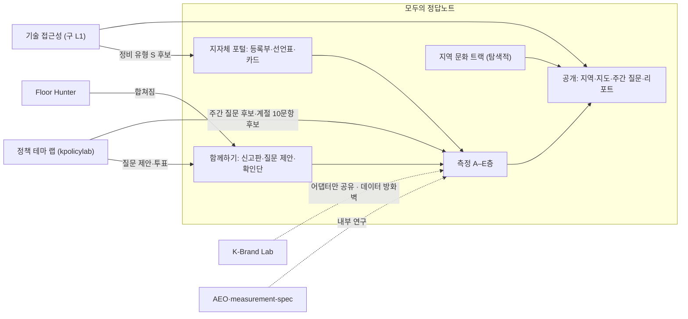
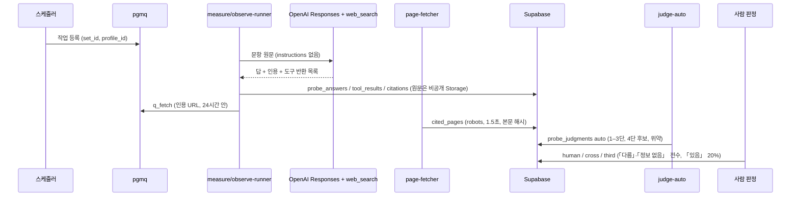
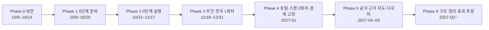

# 모두의 정답노트 — 개편·고도화 구현 계획 (v0.2)

> 작성 2026-10-09 · 대상: 사람 + AI 코딩 에이전트
> 입력:
> - `jeongdap-note-repo-docs-v1.1/` 전체. 방법론 01–04, 제품 05–07, 결정 로그 D72–D110, 배경 문서를 포함한다.
> - 현행 명세 [`docs/ARCHITECTURE-SPEC.md`](./ARCHITECTURE-SPEC.md)
> - 저장소 규칙 [`AGENTS.md`](../AGENTS.md)
>
> 상태: **계획이다. 코드는 아직 바꾸지 않았다.** Phase 0(보안)은 바로 착수할 수 있다. 나머지는 §17의 남은 결정과 ADR 확정 뒤에 착수한다.

### 변경 이력

| 판 | 날짜 | 내용 |
|---|---|---|
| v0.1 | 10-09 | 초안. 방법론·제품 문서와 결정 로그가 없는 상태에서 작성 |
| v0.2 | 10-09 | **정본 반영.** 방법론 01–04, 제품 05–07, 결정 로그 D72–D110을 반영했다. 사용자 결정 5건을 확정했다(§0.3). 바뀐 내용: 층 문자(A–E), 출처 4단 정의, 피해 위험 산식, 창 상태, 0단계 규모, 11/17 공개 범위, 구간 이름, 유형 코드 뜻, 일정 |

---

## 0. 이 문서를 읽는 법

### 0.1 우선순위

jeongdap 문서끼리 충돌하면 아래 순서로 따른다.

1. `CHANGES-v1.1.md` (D103·D106–D110 반영)
2. 방법론 정본 `docs/methodology/01–04`
3. 제품 `docs/product/05`
4. SDD·knowledge (10/04 기준)

방법론 01에는 "14일 통지", 05에는 "통지함"이 남아 있다. 이 부분은 **D103 자체 사업 측정에 따라 폐기된 것으로 읽는다.**

### 0.2 표기

- `[재사용]` `[신규]` `[퇴역]` `[결정]`
- 문서 약칭
  - M01–A04: 방법론. M01 방법론, P02 사전 등록, G03 골디락스, A04 능동 성과.
  - P05–P07: 제품. P05 데모·포털, P06 지역 문화 트랙, P07 사업 전략.
  - CH: CHANGES.
  - LOG: 결정 로그.
- `INV-n`: kplacelab 불변식. `D-nnn`: jeongdap 결정. `ADR-00nn`: kplacelab ADR.

### 0.3 확정된 사용자 결정 (2026-10-09)

| # | 결정 | 확정 내용 | 반영 위치 |
|---|---|---|---|
| U-1 | 영문명·도메인·UA | **바꾼다.** 영문 "Jeongdap Note". `SCANNER_UA` 를 `JeongdapNoteBot/1.0` 으로 바꾸고 12주 동안 두 UA 를 함께 안내한다. 도메인 이전과 301 리다이렉트 | §4 |
| U-2 | 인천 2026-07 행정구역 개편 | **반영한다.** 모집단을 광역 16 · 기초 227 로 본다 (행안부 고시 대조 뒤 확정) | §5 R1, §9 |
| U-3 | 실명 공개 | **승인한다.** 구간 지도에서 실명을 공개하는 것을 K13 §3의 예외로 둔다 | §5 R4 |
| U-4 | 유료 L3/L4·AEO VIP 의 기관 판매 | **중단한다.** A원칙(D76) 전체 범위를 적용한다 | §5 R3, §6 |
| U-5 | 0단계 측정 도구 | **권고안대로 한다.** jeongdap Python 패키지를 패치해 쓰고, TS 수집기는 그림자 실행으로 검증한 뒤 12월부터 TS 로 바꾼다 | §11 |

---

## 1. 요약 (TL;DR)

1. **제품 정체성**
   - kplacelab 을 **「모두의 정답노트」(Jeongdap Note)**로 바꾼다.
   - 측정 질문: "AI가 우리 지역을 답할 때 **공식 문서를 첫 근거로 쓰는가**, 그리고 **행동 피해를 줄 수 있는 답이 몇 건인가**."
2. **공개 머리 지표는 두 개다 (D93, M01).**
   - **공식 근거율**: 첫 인용이 공식 출처인 회차의 비율. 분모는 공급 공백과 '해당 없음'을 뺀 지명 문항 회차다.
   - **피해 위험 건수**: 고위험 문항 가운데 가장 나쁜 회차가 「행동 피해 가능」인 문항 수. 2출처 원장과 대조해 사람이 판정한다.
   - 출처 4단 깔때기와 분포는 이 두 지표의 **분해**로만 낸다.
   - 정확도·정답률·종합 점수·순위는 없다.
3. **측정 층 (G03, D109)**
   - **A 전국 스캔**: 광역 16 · 기초 227 × 코어 60 × 3회.
   - **B 피해 위험 정밀**
   - **C 주간**: 방어판 1문항 전국 + 상시 관측 주 513회.
   - **D 기준 단위 패널**: 5곳 × 550 × 9회.
   - **E 능동 성과**: 정비·알리기 사건.
4. **운영 원칙 (D103·D76)**
   - 사전 통지·엠바고·기관 확인을 하지 않는다.
   - **측정 대상에는 정비 상품을 팔지도, 무상으로 주지도 않는다.** 측정 데이터를 영업에 쓰지 않고, 이해관계를 공시한다.
   - 그래서 kplacelab 의 사전 통지 게이트와 유료 L3/L4·AEO VIP 를 퇴역시킨다 (U-4).
5. **첫 측정 (0단계) 범위 (P02)**
   - 구로·수원·화성 3곳의 축소판으로 약 2,500회를 돈다. 증평·광주 서구는 파일럿에만 들어간다.
   - **목적은 도구 검증이다.** 11/17에는 H1–H5 결과와 일치도만 공개하고, 단위 값과 구간은 내지 않는다.
   - 이름 붙은 값은 2027-03에 처음 공개한다.
6. **기존 기능의 새 자리**
   - **kpolicylab(정책 테마 랩)** → 「함께하기 › 질문 제안」 엔진이 된다. 주간 질문 후보와 투표, 상시 관측의 계절 문항 후보를 낸다.
   - Floor Hunter → 신고판
   - L1 robots 스캐너 → 「기술 접근성」. 결과 변화는 정비 유형 **S(사이트 접근성)** 후보가 된다.
   - K-Brand Lab → 별도 랩 (측정 데이터 방화벽 적용)
   - AEO·measurement-spec → 내부 연구 도구
   - 정치·인물 모듈 → 보관
7. **아키텍처**
   - 단일 Next 앱을 유지하고 `lib/jeongdap/*` 와 `workers/*` 를 더한다. 큐는 `pgmq` 를 쓴다.
   - **인용 페이지 수집기**를 새로 만든다. robots 를 지키고, 1.5초 간격을 두고, 본문 해시를 남긴다.
   - 모노레포는 2027-Q2 이후로 미룬다.
8. **일정**
   - 10/15 패널 확정 → 10/20 사전 등록과 트랙 공개 → 10/24 확인단 작업대 → 10/27–29·11/3–5 블록 → 11/17 방법 검증 공개
   - → 12월 전국 스캔 1회차(비공개)·주간 질문 → 2027-01 포털·스캔 2회차·구간 경계 고정 → 2027-03 공식 근거 지도.

---

## 2. 근거 자료

| 자료 | 상태 | 쓰는 곳 |
|---|---|---|
| CH | 최우선 | 지표, 층, 운영 원칙 |
| M01 방법론 v1.0 | 정본 | 정의, 경계, 구간, 이중차분, 문항 규칙 |
| P02 1차 사전 등록 | 정본 | 0단계 범위, H1–H8, 중단 규칙, 공표 약속, 일정 |
| G03 골디락스 | 정본 | A–E 층, 공개 형식, 사람 판정 우선순위 |
| A04 능동 성과 | 정본 | 노력→도달→성과, 판정 5항목, 알리기 사건, 상시 관측, 창 상태 |
| P05 데모·포털 수정 설계 | 제품 기준 | 화면, 포털, **정비 유형 코드 뜻** |
| P06 지역 문화 트랙 | 제품 기준 | 트랙 운영, 신고판, 이해충돌 규칙 7 |
| P07 초기 사업 전략 | 회사 계획 | WS1–5. 정답노트는 WS4의 일부 |
| LOG D72–D110 | 정본 | 결정 근거와 대체 관계 |
| `measurement/*` | 실행 패키지 v1.1 | Python 파이프라인, 데이터 |

**정본에도 정의가 없는 것** (사전 등록이나 ADR 로 정해야 한다):
- 95% CI 방법, 반올림, 최소 셀 임계값
- 창 상태 '드묾', 1–2회 처리
- '평소'(모델 변동 차단 기준)
- 알리기 사건 폼 필드의 세부, 알리기 쪽 코드 6개와 유형 7개의 대응
- 2% 표본 층화 방식

---

## 3. 목표 제품 모델

### 3.1 판정 체계 (M01, P02)

**출처 4단** — 화면 문구: "검색에 뜸 → AI가 읽음 → 첫 근거가 됨 → 내용이 맞음"

| 단 | 정의 | 판정 | 필요한 기록 |
|---|---|---|---|
| 1단 검색에 뜸 | **도구 반환 목록**에 공식 도메인이 있다 | 자동 | web_search 도구 반환 목록 전체 (`include: web_search_call.action.sources`). 검색 콘솔 연결 시 색인 병기 |
| 2단 AI가 읽음 | 공식 인용이 있다 | 자동 | 인용 목록 (순서 보존) |
| 3단 첫 근거가 됨 | 첫 인용이 공식이다 | 자동 | 〃 |
| 4단 내용이 맞음 | 핵심 값을 **인용된 페이지**와 대조한다. 범주: 「있음/맞음」·「다름」·「정보 없음」·「원인 미확정 — 페이지는 정합」 | 「다름」·「정보 없음」은 사람이 전수 판정. 「있음」은 20% 교차 | 인용 페이지를 24시간 안에 수집. 본문 해시와 최종 수정 정보 |

**'공식'의 정의**
- 해당 기관, 소관 광역, 중앙, 연결(산하)기관을 모두 포함한다. 예: `guro.nid.or.kr`, `cartax.seoul.go.kr`.
- 자동 분류 범주: 해당 기관 · 소관 광역 · 중앙 · 연결기관 · 그 밖.

**판정 범주 추가**
- 「공식 간 상충」: 공식 문서끼리 값이 다르다.

**분모에서 빼는 것**
- **공급 공백**: 누리집 어디에도 답이 없는 문항. **원장 작성자가 판정한다.** 원장을 아직 안 쓴 것을 공급 공백으로 보지 않는다.
- **해당 없음** (D101): 템플릿이 그 단위에 맞지 않는 경우.
- 이중 분모: "정비 가능 문항"과 "작성 필요 문항"을 따로 집계한다.

**문항 단위 주 결과**
- 3회 중 2회 이상 공식 첫 인용이면 그 문항을 성공으로 본다. H1과 효과 추정이 이 값을 쓴다.

**안정성**
- 파일럿 기준: 9회 중 판정 변동이 2회 이하면 통과다.
- 미달 문항은 버리지 않고 '불안정 문항'으로 따로 집계한다.
- 경계값은 파일럿 뒤 **한 번만** 조정하고, 조정 전후를 사전 등록에 적는다.

**피해 위험**

| 층 | 산식 |
|---|---|
| D 패널 | 고위험 문항(기한·수수료·자격·연락처·운영 중단·재난)에서 **가장 나쁜 회차**가 「행동 피해 가능」인 문항 수 / 고위험 문항 수 |
| A·B 전국 | 고위험 15문항의 **최빈 답**을 사람이 판정 |

- 판정 근거는 **2출처 원장**(지자체 + 중앙)이다.
- 불일치나 귀속 문제는 제3자 1인이 2차 확인한다.
- **재난·안전은 공개하지 않고 해당 기관에만 알린다.**
- 자동 신호(고위험 ∧ ¬2단 ∧ 수치 포함)는 사람 판정 큐의 **우선순위 후보**로만 쓴다.

**위약 30** (M01, P02)
- 구성: 허구 개체 10, 타 권역 실재 개체 10, 이름이 비슷한 타 지역 개체 10. 한·영.
- 등장이나 귀속으로 잡히면 거짓 양성이다.
- 한 종류라도 5% 이상이면 해당 해석을 보류한다(H2). 10% 이상이면 등장 판정 전체를 보류한다.

**고정 20**
- 모델 변동 감시용이다. 분포가 급변하면 중단 규칙을 적용한다.

### 3.2 측정 층 (G03 정본 문자)

| 층 | 대상·규모 | 주기 | 사람 판정 | 첫 실행 |
|---|---|---|---|---|
| **A 전국 스캔** | 광역 16 · 기초 227 × 코어 60 × 3회 (≈43,740) | 분기 | 자동 + 무작위 2% (약 870건, 시민 확인단) | **12월 초 1회차·2027-01 2회차 (비공개)** → 2027-03 공개 |
| **B 피해 위험 정밀** | 고위험 15문항 최빈 답. 하위·경계 약 120단위 우선 | 분기 (짝수 분기 확대) | 1,800–3,600건 | 2027-01 |
| **C 주간** | ① **방어판**: 1문항 × 243단위 × 3 = 729회/주, 최빈 답 243건 사람 판정. ② **상시 관측**: 월·수·금 90문항(고정 40·계절 10·외국어 40) + 화요일 지명 한 줄 243, 주 513회 | 주간 (방어판·능동판 격주) | ① 243건/주 ② 30건/주 (신규·소멸 확인) | 12월 |
| **D 기준 단위 패널** | 구로·수원·화성·증평·광주 서구 × 550 × 9 (24,750) | 분기 (홀수 분기 사람 전수) | 「다름」·「정보 없음」 전수 | 0단계는 3곳 축소판 약 2,500회 (10/27) |
| **E 능동 성과** | 정비 사건(전달 확인 뒤 첫 분기 회차가 사후 시점), 알리기 사건(+2주·+6주·분기, 질문 10 × 3회) | 사건 기반 | 표본 | 2027-01 |

- **추가 관측**
  - 분기 확장 관측: 나머지 190문항 × 3 = 570회.
  - 지명 정체성: 243 × 5 × 3 = 3,645회/분기. 사람 표본 10%.
  - 연 1회 '전국 동시 측정의 날': 투표 상위 10문항 × 243.
- **관찰 측정 (CH L10, P02)**
  - OpenAI 밖의 서비스 2곳을 사람이 화면에서 기록한다. 분기 소표본이다.
  - "서비스 A·B" 라벨로만 공개하고 정밀 측정과 합산하지 않는다.
- **사람 판정 역량**
  - 분기 약 5,000건이고, 수요는 약 6,000건이다.
  - 초과하면 **C → B(하위·경계) → D 30% 표본** 순서로 줄인다.
- **243은 합산 표기가 아니다.** 공개 문장은 언제나 "광역 16 · 기초 227"로 나눈다 (R1).

### 3.3 kplacelab 층 → 정답노트 대응

| kplacelab | 정답노트 | 처리 |
|---|---|---|
| L1 robots 기술 접근성 | 「기술 접근성」 보조 모듈 + 정비 유형 S 자동 후보 | `[재사용]` INV-2 유지. 이름 충돌을 피하려고 코드명을 `tech_access` 로 바꾼다 (jeongdap '지명 사다리 L1–L3'과 겹침) |
| L2 자발 참여 | E층(포털 선언표·사건) | 분모 "등록한 N곳 중" (INV-4) |
| L3 measurement-spec·Guro | D층 엔진 | 수집기와 통계는 `[재사용]`. 판정은 출처 4단으로 바꾼다 |
| L4 원인 진단(유료), AEO VIP | — | `[퇴역]` U-4 |
| Floor Risk (INV-9) | 피해 위험 건수 | §5 R6 |

---

## 4. 리브랜딩 (U-1 확정)

| 항목 | 변경 |
|---|---|
| 제품명 | **모두의 정답노트** / **Jeongdap Note** (코드명 `jeongdap-note`) |
| 태그라인 | "AI가 말한 우리 동네, 정답을 함께 확인해요." |
| 원칙 문구 | "순위를 매기지 않습니다. 함께 고칩니다." |
| 서술 틀 (M01) | "공식 문서가 기계에 읽히는지 확인하는 체계가 없었다. 특정 기관의 소홀이 아니다." |
| metadata·OG·JSON-LD `Organization` | 일괄 교체 |
| `SCANNER_UA` | `JeongdapNoteBot/1.0 (+https://<새 도메인>/bot)`. **L1 스캐너와 인용 페이지 수집기가 이 UA 하나를 함께 쓴다** (INV-5) |
| UA 전환 | ① `/bot` 에 두 UA 를 12주 함께 안내한다. ② L1 판정은 `method_version` 을 올리고, 전환 전후 robots 판정을 비교하지 않는다(INV-7). ③ 전환 첫 2주 동안 차단으로 바뀐 도메인을 따로 표시한다 |
| 도메인 | 새 도메인으로 옮긴다. 옛 도메인은 전 경로 301, sitemap 을 다시 제출한다. **실제 도메인 문자열은 사용자 입력이 필요하다** (§17 N-1) |
| 저장소·패키지명 | `kplacelab` 유지 (내부명) |
| 금지어 합본 | AGENTS §4 + jeongdap web-copy(꼴찌, "AI가 틀렸어요!", 엉터리) + P06(망신, 최악의 지역, 방치, 공식 측정, 정부 인증) + **정답률·정확도·오답 비율** (§5 R11) |

---

## 5. 규칙 정합화 — AGENTS.md v2

| # | 충돌 | 해소 (확정/권고) | ADR |
|---|---|---|---|
| R1 | INV-1 의 두 모집단 vs 광역·기초 | **확정 (U-2):** 모집단 `metro`(16), `basic`(227), `special_zone`(기술 접근성 전용). 셋 사이 합산을 금지한다. "243곳 중" 표현(G03 L74)은 "광역 16곳 중 ○ · 기초 227곳 중 ○"로 바꾼다. 인천(제물포구·영종구·검단구 신설, 중구·동구 폐지)은 행안부 고시로 대조해 확정한다. jeongdap 문서의 226은 개편 이전 수치로 보고 기록한다 | 0014 |
| R2 | 사전 통지 게이트 (FR-24/44, `spec_outputs` CHECK) | D103 에 따라 지운다. 공표 게이트를 **사전 등록 존재 + 운영 승인 + 재난 비공개 검사**로 바꾼다. **요청 시 원본 기록 제공**, 제3자 감사 열람 절차를 새로 둔다 | 0015 |
| R3 | 유료 판매 vs A원칙 | **확정 (U-4).** D76 전체를 적용한다. ① 측정 대상(사실상 전 지자체)에 정비 상품을 팔지도 무상으로 주지도 않는다. ② 측정 데이터를 영업에 쓰지 않는다. **측정팀과 영업 쪽 접근 권한을 분리한다** (P06 L160). ③ 관계 매체를 표시한다. ④ 이해관계를 공시한다. ⑤ 공개경쟁 측정 용역 참여 가능성을 고지한다 | 0021 |
| R4 | K13 §3 vs 실명 구간 지도 | **확정 (U-3): 예외 승인.** 조건: 전수 목록일 것, 구간 이름은 M01 정본 **「공식 근거 많음 / 보통 / 공식 근거 적음」**에 경계값을 함께 쓸 것, 구간 안은 **가나다순**, 이동(올라감·내려감·그대로)과 이동 사유(정비 사건 등록 여부)를 표시할 것. 틀린 답은 유형으로만, 기관은 익명으로. 특정 단위를 나쁜 예로 드는 문구는 계속 금지한다 | 0017 |
| R5 | 금지어 "등급" | UI 는 "구간"(정본 "밴드"는 내부 용어)을 쓴다. "등급·A/B/C" 표기는 금지한다. 피해 위험 '등급 고'(M01)는 내부 속성명 `risk_level` 로 쓰고 UI 에서는 "고위험 문항"이라고 쓴다 | 0017 |
| R6 | INV-9 Floor Risk | "공식 근거율을 내는 모든 화면은 피해 위험 건수를 함께 낸다"로 바꾼다. 회차별 저장과 조회 시점 집계는 유지한다. 공표 재현은 `publications` 해시로 한다 | 0016 |
| R7 | INV-10 8블록 조립 vs 원문 그대로 넣기 | 문항은 템플릿 + 파라미터로 저장하고, 호출할 때는 **인스턴스 원문을 그대로** 넣는다. 강건성 게이트는 '파일럿 안정성 + 내용 타당도(카파 0.7 이상) + 동결 해시 포함'으로 바꾼다 | 0016 |
| R8 | ADR-0001 vs 워커 | 워커와 pgmq 를 허용한다 (§8) | 0018 |
| R9 | 테이블 이름 충돌 | 접두를 붙인다: `probe_*`, `observe_*`, `portal_*` | 0019 |
| R10 | ID 체계 셋 | `units.unit_id` 를 정본으로 두고 `unit_id_map` 으로 잇는다. 통합(전남광주)과 인천 개편은 `successor_unit_id` 로 기록한다 | 0020 |
| R11 | INV-14(지표 2개) vs 정본 공개물의 "정답률·오답 비율"(G03 L76–77, M01 L138–139) | 머리 지표는 두 개다. **두 지표의 분해**(4단 깔때기, 문항별 0–3 분포, 생활 영역·언어 분포)와 **품질 통계**(일치도, 거짓 양성률)는 허용한다. "정답률·오답 비율"은 "공식 근거율·피해 위험 유형"으로 바꾼다 `[권고, §17 N-4]` | 0016 |
| R12 | AGENTS §4 "무엇이 막고 있는지 알 수 없다" vs P05 의 공개 「끊긴 단」·포털 「다음 할 일」 | '끊긴 단'은 **관측된 단계**이지 원인이 아니다. 공개 단위 페이지에서는 허용하되, "원인은 이 측정으로 확정하지 않는다"는 문구를 병기한다. 「다음 할 일」은 해당 지자체 포털에서만 보이는 무료 공공 정보다. 특정 업체·상품으로 연결하지 않는다 `[권고, §17 N-5]` | 0022 |
| R13 | INV-5 "도메인당 주 1회" vs 인용 페이지 24시간 수집·미등록 변경 감시 | INV-5 를 개정한다. ① 도메인 전체 robots 스캔은 주 1회. ② **인용 페이지 확인 수집**은 측정에서 인용된 URL 만, robots 준수, 요청 간 1.5초 이상, 도메인당 하루 상한, `SCANNER_UA`. ③ **헤드리스 브라우저·스크린샷은 하지 않는다.** 본문 해시와 최종 수정 정보만 남긴다(P05의 "화면 자동 수집"은 해시로 대체한다) `[권고, §17 N-6]` | 0023 |

**유지하는 불변식**: INV-2, 3, 4, 5(개정), 6, 7, 8, 11, 12.

**INV-6 보강**
- 원문은 비공개 Storage 에 둔다.
- 기관 요청이나 제3자 감사 열람은 운영 승인을 거쳐 **기록이 남는 비공개 경로**로만 제공한다.

**추가 불변식**:
- **INV-13**: 정밀 측정 요청에는 `instructions`(system)나 앞말을 넣지 않는다. 위치 신호도 넣지 않는다. 근거: P02 도구와 조건, D104.
- **INV-14**: 머리 지표는 두 개다. 응답 스키마는 허용 목록 방식으로 둔다 (R11).
- **INV-15**: 미등장 지역 목록, 점유율, 'AI가 매긴 순서'(첫 셋 플래그)를 공개하지 않는다. 근거: A04, D107.
- **INV-16**: 재난·안전 문항 결과는 공개 경로에 나가지 않는다. 주간 질문에서도 뺀다. 근거: M01, G03.
- **INV-17**: 2027-03 전에는 이름 붙은 단위 값을 공개하지 않는다. 근거: P02 공표 약속.
- **INV-18**: 범위 제외(정부 입장 영역, 재난, 개별 업소)는 신고판 접수 단계에서 막는다. 근거: M01 L112, L226.

---

## 6. 제품 포트폴리오 연계

| 모듈 | 새 자리 | 연계 | 코드 처리 |
|---|---|---|---|
| **정책 테마 랩 (kpolicylab)** | 「함께하기 › 질문 제안」 + 푸터 「랩」 | ① **주간 질문의 다음 주 후보와 투표** (G03: "다음 주 질문은 신고판 투표로"), ② 상시 관측 계절 10문항 후보, ③ 연 1회 '전국 동시 측정의 날' 투표 상위 10, ④ 분기 리포트 「시민이 물은 것」. 지표와 섞지 않는다 (D96 수요 자료) | `lib/theme-lab/*` 를 `[locale]/join/suggest` 로 옮기고, `theme_lab_*` 테이블은 유지한다. 투표 테이블을 더한다 |
| **Floor Hunter** | 「함께하기 › 신고판」 | 필수 입력: 질문, AI 서비스·언어, AI 답, 신고자 유형. 선택 입력: 근거 링크, 연락처. 범위 제외는 접수 단계에서 막는다(INV-18). 처리: 재현 → 생활 영역 × 기능 층 자동 분류 → 수요 집계. 신고자에게는 재현 결과를 돌려준다. 연락처는 6개월 안에 지운다. 기관 통지·회신 단계는 없다 (D103) | `lib/crowdsource/*`, `citizen_reports` 재사용 |
| **기술 접근성 (구 L1)** | 지역 페이지 탭 + 포털 자체 점검표 | 판정이 바뀌면 `portal_repair_events` 에 **유형 S(사이트 접근성)** 자동 후보를 만든다 (지자체 확인 전에는 비공개) | Edge functions·크론 유지. UA 교체 (U-1) |
| **K-Brand Lab** | 「랩 › K-Brand Lab」 (조직 로그인) | 공통 수집기만 공유한다. **정답노트 단위별 데이터 읽기 권한이 없다** (R3 방화벽). 회사의 MAPS-에이전트(P07 WS1)와의 관계는 §17 N-8 | `lib/kbrandlab/**` 유지 |
| **AEO 3-tier / VIP** | 운영 콘솔 「연구」 | 문항 후보 발굴 보조. 판매 중단 (U-4) | 공개 라우트 `[퇴역]`, API 에 ops 인증 |
| **measurement-spec / Guro** | D층 엔진의 전신 | 수집기, 통계, 사전 등록, 원장 교차 검증 | §10 |
| **청중 형평 (equity)** | 「랩」 | 외국어 관측과 연계 | 이동 |
| **정치·인물 (`krole`, person-*)** | 보관 | 중립성 | 410 Gone, 스크립트는 `archive/` |
| **회사의 다른 제품** (P07: AI 뉴스룸, LOCALOG, 서귀포 스테이, CANON, AEOPress, AIHompy, AI 대변인) | 저장소 밖 | 정답노트 포털과 데이터를 연결하지 않는다. 「방법 › 이해관계 공시」에 관계를 적는다 | — |

---

## 7. GNB / IA 개편

### 7.1 원칙

- **지도보다 목록이다.** 모든 지도에 같은 데이터를 담은 표 보기가 있다.
- 단위 정렬, 순위, 구간 안 순서 매기기는 없다. 구간 안은 가나다순, 그 밖의 목록은 행정코드순이다.
- **회차 표기**는 "2027년 3월 회차 · 측정 3월 2·3·4일 · 모델 판본 ○○ · 방법론 v1.x · API 기준 관측 · 위치 신호 없음"처럼 쓴다 (P05, M01).
- 지도 제목에는 기준을 쓴다. 예: "생활 행정 핵심 60문항 기준"(구간 지도), "관측 질문 50 기준"(기상도).
- 피해 위험 건수 옆에는 "재난·안전 제외"를 명시한다.
- 2027-03 이전에는 이름 붙은 값을 공개하지 않는다 (INV-17). 그 전까지 공개 화면은 방법, 주간 질문(익명 집계), 트랙 집계, 신고판으로 구성한다.
- 앱은 넷이다: 공개 사이트, 참여자, 지자체 포털, 운영 콘솔.

### 7.2 공개 사이트 GNB (`/[locale]/…`)

| 순서 | 메뉴 | 하위 | 내용 | 공개 시점 |
|---|---|---|---|---|
| 1 | **홈** | — | **단계형.** 2027-03 전: 태그라인, 이번 주 질문, 사전 등록·측정 진행 상황, 원칙 문구. 2027-03부터: P05 대로 **전국 구간 지도**(광역/기초 토글), 두 지표, 생활 영역·언어 분포 | 10/20 → 2027-03 |
| 2 | **내 지역** | 지역 찾기 · 지역 페이지 | 지역 페이지 (P05 §2.2): 머리(구간·이동·회차) / 공식 근거율 + 문항별 0–3 분포 + 영역·언어 분포 / 끊긴 단 깔때기 / 피해 위험 **건수만** / 정비 사건(동의한 것만 전후 비교) / 기술 접근성 / 참여("이 지역 포털 열기", "AI 답 신고"). **다른 단위 값, 순위, 서비스별 값은 없다** | 2027-03 (그 전에는 「측정 전」) |
| 3 | **지도** | 공식 근거 지도(구간) · AI 추천 지도 12분야 · 전국 관측 기상도 | 기상도는 안정·신규만 표시하고, 표시하지 않은 지역은 회색이 아니라 **빈 땅**으로 둔다 | 기상도 12월(익명 집계) · 나머지 2027-03 |
| 4 | **주간 질문** | 이번 주 · 지난 질문 · 다음 주 투표 | 방어판·능동판 격주. "광역 16곳 중 ○ · 기초 227곳 중 ○" + 틀린 답 유형 3가지(기관 익명). 2027-03 전에는 지도 없이 집계만 낸다 | 12월 |
| 5 | **지역 문화** | 트랙 소개 · 신고 · 집계 · 이해관계 공시 | P06 트랙. 첫머리 고정 문구: "민간 공익 측정(탐색적). 시범사업의 공식 측정이 아님. 운영사는 향후 공개경쟁 측정 용역에 참여할 수 있음." 집계 분류는 4단 + 공급 공백 | 10/20 |
| 6 | **함께하기** | 신고판 · 질문 제안(정책 테마 랩) · 시민 확인단 | 신고판은 수요 자료라고 고지한다. 확인단 모집. 공개 문구: "시민 확인 ○건 · 2인 일치 ○% · 운영팀 일치 ○%" | 10/20 |
| 7 | **리포트·데이터** | 분기 리포트 · 정체성 유형 보고 · 피해 위험 유형 보고 · 관찰 측정(참고) · 공개 실험 보고서(반기) · 개선 사례 · 정정 사례 · 내려받기 · 인용 가이드 · 보도자료 | 관찰 측정은 "서비스 A·B" 분포만 내고 "정밀 측정과 합산하지 않습니다"를 고정 표기한다. 내려받기 파일은 모집단별로 나눈다 | 11/17(방법 검증) → 순차 |
| 8 | **방법** | 측정 방법 · 사전 등록 · 증거 대장 · **이해관계 공시** · 수집기 안내(/bot) · 정정·원본 기록 요청 · 우리 사이트 자기 측정 | 로그인 없이 읽힌다 (AGENTS §7) | 10/20 |

- **유틸리티 바**: 언어(ko · en · ja · zh-Hans · zh-Hant), 쉬운 말, 로그인(참여자 · 지자체 · 운영).
- **푸터**: 랩(정책 테마 랩 · K-Brand Lab · 기술 접근성 · 청중 형평), 원칙 문구, 운영 주체, 이해관계 공시.

### 7.3 별도 앱

| 앱 | 경로 | 메뉴 (순서) | 역할 |
|---|---|---|---|
| **참여자** | `/[locale]/crew` | 오늘의 과업 · 교육(30분) · 연습 5건(위약 포함) · 판정 작업대(맞음/다름/판단 불가, 단위명·개인정보 가림) · 원어민 검수 · 내 활동(건수 기준 보상) | citizen, crew, rater, native_reviewer (미성년 가드) |
| **지자체 포털** | `/portal/[region]` | **다음 할 일**(이번 주 0원 / 이번 분기 / 다음 예산) · 대조 쌍 · 끊긴 단 상세 · 피해 위험(비공개, 가장 나쁜 회차 내용·2출처 원장·공식 간 상충) · **정비 사건 등록부** · 알리기 사건 · 선언표(기본/등록) · 행사 일정(D-30·D-7·D+7 점검) · 도달표·주간 카드 · 자체 점검표(행안부 가이드라인 순 + 기술 접근성) · 협조 요청 서식 · 자료 연결(검색 콘솔 동의) | gov_official, gov_admin (go.kr 이메일 확인) |
| **운영 콘솔** | `/ops` | 회차 관리(사전 등록본·블록·모델 판본) · 문항 은행(작성자·선행 노출·해시 잠금·보류 20%·위약) · 판정 작업대(20% 교차, 제3자 2차) · 인용 대조 · 원장(2출처) · 구간·공개 승인(경계 사전 잠금, 재난 분리) · 등록부 감시(효과 추정 조건 "30건·10곳") · 수요 집계 · 관찰 측정 입력 · 번역 승인 · 연구(AEO) · 기술 접근성 스캔 · **감사**(보류 문항 접근 기록, 원본 기록·제3자 열람 요청) | ops_editor, ops_measure, ops_admin. **측정팀과 영업 분리** |

**정비 유형 코드** (P05 L64)

| 쪽 | 코드 |
|---|---|
| 지키는 쪽 | F 본문 형식 · T 제목·첫 문단 · Q 요약 · D 중복 정합 · U 갱신 · A 고정 주소 · S 사이트 접근성 · L 협조 요청 · N 신규 작성 |
| 알리는 쪽 | M 소개 메시지 · E 행사 페이지 · P 사업 페이지 · G 다국어 · R 포털 등재 · W 공개 지식 연결 |

**정비 사건 등록 7단계** (P05)
1. 대상 (인용된 자기 페이지 목록 또는 URL)
2. 유형 칩 (복수 선택)
3. 일시
4. 증빙: 전후 본문 해시 자동 (R13)
5. 전달 확인: 도구 반환 목록에 새 제목·요약이 보이는지, 검색 콘솔. 상태는 대기 / 확인됨 / 미확인 N일
6. 다음 회차 전후 비교
7. 공개 동의

### 7.4 라우트 이전 지도 (301)

| 현행 | 신규 |
|---|---|
| `/` | `/ko` |
| `/units`, `/units/[unitId]`, `[slug]` | `/ko/regions`, `/ko/regions/[regionId]` |
| `/method`, `/prereg`, `/evidence` | `/ko/method`, `/ko/method/prereg`, `/ko/method/evidence` |
| `/bot` | 유지 (UA 안내 필수 경로) + `/ko/method/bot` |
| `/cite`, `/press`, `/reports/**` | `/ko/data/cite`, `/ko/reports/press`, `/ko/reports/**` |
| `/corrections` | `/ko/reports/corrections` |
| `/submit`, `/theme-lab/**` | `/ko/join/suggest/**` |
| `/report`(신고), `/dashboard/reports` | `/ko/join/report` |
| `/selfcheck` | `/portal/[region]/checklist` + `/ko/labs/tech-access` |
| `/equity` | `/ko/labs/equity` |
| `/measure/**`, `/reviewer/**`, `(admin)/**` | `/ops/**` |
| `(org)/dashboard`, `(org)/aeo/**` | `/portal/[region]`, `/ops/research/aeo/**` |
| `(org)/kbrandlab/**` | `/labs/kbrand/**` |
| `/krole/**` | 410 |
| 옛 도메인 전체 | 새 도메인 같은 경로 (U-1) |

---

## 8. 아키텍처 결정

| 영역 | 결정안 | 근거 |
|---|---|---|
| 앱 구조 | 단일 Next 14 앱 + `app/[locale]/(public)`, `app/[locale]/crew`, `app/portal`, `app/ops` | 일정. 모노레포는 Phase 6 |
| 도메인 로직 | `lib/jeongdap/` 순수 함수 | 나중에 패키지로 뽑기 쉽다 |
| 워커 | `workers/measure-runner`, `observe-runner`, `judge-auto`, **`page-fetcher`**(인용 페이지·미등록 변경 해시) | 블록당 수천 회, 분기 수만 회. Edge 실행 시간으로는 부족하다 |
| 실행 환경 | GitHub Actions 예약 실행 + 수동 실행으로 시작하고, Phase 5에서 다시 본다 | 비용. 6시간 제한은 배치를 쪼개고 pgmq 로 재개해 해결한다 |
| 큐 | `pgmq`: `q_measure`, `q_observe`, `q_judge`, `q_fetch`, `q_l10n` | 재시도, 가시성 타임아웃 |
| 원문 | 비공개 Storage `raw-answers/` + `raw_hash`. 열람은 감사 기록을 남긴다 | INV-6, R2 |
| 수집 요청 | Responses API, `tools:[{type:"web_search"}]`, `include:["web_search_call.action.sources"]`, `instructions` 없음 | 1단 판정에 도구 반환 목록이 필요하다. INV-13 |
| i18n | `next-intl`, 5 locale + `ko.easy`. 원어민 2인 승인 전에는 noindex | — |
| 인증 | Supabase Auth + `user_roles` + JWT claim. 지자체는 go.kr 이메일 확인 | — |

---

## 9. 데이터 모델 (신규 마이그레이션)

> 기존 마이그레이션은 고치지 않는다. 파일명은 `2026101x0000NN_*.sql`.

| # | 파일(안) | 내용 |
|---|---|---|
| 01 | `units_levels_and_idmap` | `units` 에 `level(metro/basic/special)`, `admin_code`, `successor_unit_id`, `valid_from/to` 를 더한다. 새 population `metro`·`basic`. 전남광주 통합과 **인천 개편(U-2)**은 이력 행으로 넣고, 옛 행은 `active=false` 로 둔다. `unit_id_map(unit_id, scheme, external_id)` |
| 02 | `unit_aliases` | `alias, lang(ko/en/zh/ja), kind, min_context_required`. 짧은 동명 별칭(화성·세종·고양·광주 등)은 문맥이 필요하다고 표시한다 |
| 03 | `unit_domains_v2` | `domain_kind(self/metro/central/linked_agency/culture/tourism)`, `status(confirmed/needs_check)`, `verified_by/at`. **'공식'의 유일한 정의.** 243곳 목록을 10/20 사전 등록에 공개한다 (G03) |
| 04 | `attributes_and_facts` | 속성 사전(`risk_level`, `value_nature`, 생활 영역, 기능). `facts` 는 이중 시간축 + `source_urls[]`. **고위험은 2출처(지자체 + 중앙)를 갖춰야 confirmed** 가 된다 (CHECK). `supply_gap_judged_by`(원장 작성자) |
| 05 | `probe_questions` | `probe_templates` / `probe_instances`: category(국가대표/생활행정/지역문화/위약/고정), life_area, function(사실/연결/추천/위험), layer(core/expand/rotate), anchor, **holdout**(보류 20%), ladder_level(지명 사다리), placebo_kind, **disaster**, author_id, prior_exposure, 메타 7종, approved. `probe_sets`(method_version, frozen_at, content_hash). 동결 뒤 수정 금지. 교체율 검사(분기 10% 이하) 뷰 |
| 06 | `probe_expectations` | **기대표**(문항 × 단위 × 선언: 대표 자산/나올 만함/약함/해당 없음, 선언자 2인, 불일치면 「나올 만함」으로 강등)와 **귀속표**. 각각 해시를 남겨 사전 등록에 싣는다 |
| 07 | `ai_services_and_profiles` | `ai_services`(role precision/observe, `masked_label`), `request_profiles`(params, `has_instructions=false` CHECK for precision, hash) |
| 08 | `probe_rounds_runs_answers` | `probe_rounds`(회차·블록·사전 등록 id). `probe_runs`: method_version, **model_version, search_tool_version**, web_search, language, measured_on, location_signal=false. 모두 NOT NULL (INV-7). `probe_answers`: rep, status, error_code, retry_count, raw_hash, raw_path, 최소 인용. `probe_tool_results`(**도구 반환 목록**). `probe_citations`(ord, url, domain_kind 스냅숏) |
| 09 | `cited_pages` | 인용 페이지 수집 결과: url, fetched_at, http_status, body_hash, last_modified, robots_allowed. 측정 중 해시가 바뀌면 「측정 중 변경」 |
| 10 | `probe_judgments` | append-only. judge_type(auto/human/cross/third), stage1–3, stage4(present_match/differ/no_info/undetermined_page_ok), official_conflict, not_applicable, supply_gap, stable, harm(행동 피해 가능), placebo_fp, appearance·attribution |
| 11 | `verify_tasks` | 시민 확인단 배정(2인 독립, 위약 10%, 같은 단위 집중 금지), 운영팀 교차 |
| 12 | `observe_tables` | `weekly_questions`(방어판/능동판, 주차), `weekly_observations`, `observe_mentions`(unit_id, alias, context_20, resolution), `identity_checks`(판정 5항목). 창 상태는 조회 뷰로 계산한다 |
| 13 | `portal_registers` | `portal_declarations`(stage default/registered, kind 알릴/낡은/알리지 않을, keyword, source_url, hash, registered_by). `portal_repair_events`(codes[], page_url, occurred_at, before_hash, after_hash, delivery_status·method·checked_at, linked_instances[], publish_consent, unregistered_change, source auto/gov). `portal_publish_events`(kind 7종, target, url, published_on, remeasure 2주/6주/분기 상태, reach_lag_days). `portal_event_schedules`(행사 D-30·D-7·D+7) |
| 14 | `bands_and_publications` | `band_boundaries`(population, method_version, 정본 이름, lower/upper, **prereg_id 필수**, locked_at). 배정과 이동은 뷰로 계산한다. `publications`(쿼리 버전, 기준일, 결과 해시, 승인자). **집계값은 저장하지 않는다** (P05 의 `band` 저장 설계를 INV-9 에 맞게 바꾼 것) |
| 15 | `demand_and_votes` | `demand_stats` 뷰, `weekly_question_votes` (정책 테마 랩 연계) |
| 16 | `roles_rls_v2` | 10개 역할, `is_minor`, `has_role()`. **영업·랩 조직 역할은 jeongdap 측정 테이블에 접근할 수 없다** (R3) |
| 17 | `audit_log` | 보류 문항 접근, 원문 열람, 원본 기록 제공, 제3자 열람 요청 |
| 18 | `l10n_reviews` | 2인 승인. 승인자가 AI 이면 안 된다 (CHECK) |
| 19 | `relax_prenotification_gate` | `spec_outputs` CHECK 완화 (ADR-0015 뒤) |

**이관·퇴역**
- `observations`·`item_results`: 읽기 전용 이력으로 둔다.
- `question_bank`: `probe_templates` 로 옮긴다.
- `aeo_*`: ops 만 접근하게 한다.

**시드**
- `measurement/*.csv` 와 `instances.jsonl` 을 `scripts/jeongdap/import-*.ts` 로 넣는다.
- 원장은 `review_status=ai_draft` 로 넣는다. 구로 고위험 180행은 2출처 검토가 끝나기 전까지 판정에 쓰지 않는다.

---

## 10. 도메인 로직 (`lib/jeongdap/`)

| 모듈 | 원본 | 정본 기준 수정 |
|---|---|---|
| `official-domain.ts` | judge_auto, observe_weekly, `unit_domains` | '공식' 정의 셋을 하나로 합친다(§3.1 범주 5종). 공식 도메인 목록 누락은 2% 표본에서 찾아 고친다 |
| `source-stages.ts` | judge_auto | **1단은 도구 반환 목록 기준**, 2·3단은 인용 기준. 도구 반환 목록이 없는 회차가 5%를 넘으면 1단을 보류한다 (중단 규칙) |
| `page-match.ts` | 신규 | 4단: 인용 페이지 본문과 핵심 값을 대조한다. 한 자리 숫자는 단위 문맥 없이 매칭하지 않는다 |
| `ledger-match.ts` | judge_auto | 피해 위험용 2출처 대조. 「공식 간 상충」 판정 |
| `denominator.ts` | 신규 | 공급 공백(원장 작성자 판정)과 해당 없음(D101)을 빼고, 이중 분모를 계산한다. 회차가 3회 미만이면 원값 분포만 낸다 |
| `item-outcome.ts` | 신규 | 3회 중 2회 이상 공식 첫 인용 |
| `stability.ts` | judge_auto | 9회 중 변동 2회 이하. 상수 파일에 출처 주석을 단다 (M01 L286–290) |
| `harm.ts` | 신규 | D층은 최악 회차, A·B층은 최빈 답. 자동 신호는 큐 우선순위로만 쓴다. 재난은 비공개 플래그 |
| `placebo.ts` | 신규 | 종류별 거짓 양성률. 5%·10% 게이트 |
| `agreement.ts` | 신규 | 카파, 2인 일치, 자동-사람 일치, 확인단-운영팀 차이 |
| `stats.ts` | judge-guro `[재사용]` | **문항 군집 부트스트랩 95% CI** 를 권고한다. 방법·반올림·최소 셀은 10/20 사전 등록에 적는다. 적지 못하면 CI 를 '탐색적'으로 표시한다 |
| `band.ts` | M01 | 고정 경계, 광역·기초 분리, 가나다순, 이동 + 사유, 앵커 지표 병기, 교체율이 상한을 넘으면 비교를 중단한다 |
| `gazetteer-match.ts` | observe_weekly, make_gazetteer | 앞뒤 20자 문맥, 짧은 별칭 규칙, 외국어 별칭, 광주 서구 매칭 결함 수정, 인천 신설 구 별칭 |
| `window-state.ts` | observe_weekly | 정본(A04 L207): 안정 = 4주 12회 중 9회 이상, 가끔 = 3–8회, 신규 = 지난 4주 0회 → 이번 주 2회 이상, **소멸 = 안정이었다가 최근 2주 0회**. '드묾'과 1–2회는 §17 N-7 결정을 기다린다. 지명 한 줄(4주 4회)은 별도 기준을 쓴다. 전국 신규·소멸이 '평소'의 3배를 넘으면 그 주 카드 신호를 보류한다 |
| `identity.ts` | A04 | 판정 5항목. '첫 셋' 플래그는 비공개 (INV-15) |
| `did.ts` | M01 L178–194 | 페이지 단위 이중차분. 대조는 같은 회차·영역·기능의 미정비 문항. 효과 주장은 30건·10곳 이상일 때만 한다 |
| collector | `collector-websearch.ts` `[재사용]` | 프로필 `jeongdap-precision-v1`: `instructions` 키를 생략하고, `include` 로 도구 반환 목록을 받는다. 재시도(지수 백오프 3회), `model_version`·`search_tool_version` 을 기록한다. RunGuard 유지 |

---

## 11. 측정 운영

### 11.1 0단계 (U-5 확정: Python 패치 + TS 그림자 실행)

**범위**: 구로·수원·화성, 약 2,500회. 2블록 재검사는 구로·수원만 한다.

**Python 패치 목록** (10/17까지):
- `run_measure.py`
  - `include` 로 도구 반환 목록을 저장한다.
  - 모델·검색 도구 판본을 기록한다.
  - 오류 재시도를 넣는다.
- `judge_auto.py`
  - 1단 정의를 도구 반환 목록 기준으로 고친다.
  - 공식 정의를 하나로 합친다.
  - 한 자리 숫자를 처리한다.
  - 해당 없음과 공급 공백을 분리한다.
  - 위약 거짓 양성을 판정한다.
- 인용 페이지 수집 스크립트 (`fetch-guro-pages.ts` 를 일반화하고 `SCANNER_UA` 를 쓴다).

**도구 판본 고정**: 패치한 커밋 해시를 10/20 사전 등록 「도구와 조건」에 적는다.

**TS 그림자 실행**: 블록 1의 구로 일부(약 50문항 × 3회)를 TS 수집기로 동시에 돌려 1–3단 판정 일치율을 잰다.
- 결과는 **탐색적 내부 기록**으로만 쓰고 0단계 결과에 섞지 않는다.
- 12월 주간 측정을 TS 로 바꾸는 조건으로 쓴다.
- TS 로 바꾸는 것은 **도구 판본 변경**이다. 판정 규칙을 바꾸는 것이 아니다. 규칙을 바꾸려면 2차 사전 등록을 따로 낸다 (P02 L175).

**같은 블록에 함께 넣는 것**:
- 고위험 15문항 web_search 끔 비교 조건.
- 관찰 측정: 수원 10 × 한·영 × 2개 서비스. 사람이 화면에서 기록하고, `/ops` 입력 폼을 쓴다.

**중단 규칙** (P02 L141–149)을 워커와 운영 콘솔에 구현한다:
- 모델 판본이 바뀌면 그 블록을 다시 잡는다.
- 도구 반환 목록 누락이 5%를 넘으면 재측정한다.
- 위약 거짓 양성이 10% 이상이면 등장 판정을 보류한다.
- 측정 중 페이지가 바뀌면 그 문항을 주 결과에서 뺀다.
- 확인단이 15명 미만이면 H5 를 보류한다.

### 11.2 정기 작업

| 작업 | 주기 | 호출량 |
|---|---|---|
| C 방어판 주간 질문 | 화요일 발행 (격주 능동판) | 729/주 + 사람 243 |
| C 상시 관측 | 월·수·금 270 + 화 243 | 513/주 (약 $13) |
| 분기 확장 관측 | 분기 | 570 |
| 지명 정체성 | 분기 | 3,645 |
| A 전국 스캔 | 12월 초 · 2027-01 · 이후 분기 | ≈43,740 |
| B 피해 위험 정밀 | 분기 | 사람 1,800–3,600 |
| D 패널 | 분기 | 24,750 |
| E 알리기 사건 재측정 | 사건 +2주·+6주·분기 | 10 × 3 |
| 인용 페이지 확인 / 미등록 변경 | 측정 뒤 24시간 / 대기 페이지 주기 점검 | R13 상한 |
| 기술 접근성 | 주 1회 | 도메인 수 |

### 11.3 지역 문화 트랙 (P06)

- **규모**: 16개 시·도(D110) × 10 + 국가 대표 20, 약 180항목.
- **1차 측정**: 10/27–11/7, 한·영, 2회.
- **처리 방식**: 탐색적으로 표시한다 (INV-11). 같은 수집기를 쓴다.
- **미정 사항**: P06 의 "에이전트 3곳"과 D95(OpenAI 단일)가 충돌한다. 의원실에 약속한 "14일 확인"은 D103과 충돌한다. → §17 N-2, N-3.
- **의원실 제출**: 11/9–13, 기관을 특정하지 않은 집계 요약.

---

## 12. 프론트엔드

- **디자인 토큰 「노트와 펜」**: `--pen #127A4B`. `globals.css`·`tailwind.config` 에서 색 하드코딩을 걷어낸다.
- **배지**
  - `JudgmentBadge`: 4단 범주, 공급 공백, 해당 없음. 색 + 기호 + 글자를 함께 쓴다.
  - `BandBadge`: 정본 이름 + 경계값 + 이동 화살표 + 이동 사유.
  - 기술 접근성 4분 배지는 그대로 둔다.
- **타입**
  - `PublicMetricPair { officialSourceRate, harmRiskCount }` 를 강제한다.
  - `Layer1Stat`, `DeclarationStat`, `ObservationServiceStat`(관찰 측정)은 서로 호환되지 않는 타입으로 둔다.
- **공개 단위 상태**: 측정 전 / 측정 중 / 발행됨 / 정정됨. 엠바고와 기관 확인 상태는 없다.
- **필수 표기 컴포넌트**
  - `RoundStamp`: 회차·측정일·모델 판본·방법론·API 기준·위치 신호 없음.
  - `ScopeNote`: 재난·안전 제외, 원인 미확정.
  - `ExploratoryBanner`: 트랙·0단계용.
  - `InterestDisclosure`: 이해관계 공시.
- **쉬운 말**: `ko.easy`. 원어민·편집 승인 대상이다.
- **SEO·자기 준수**
  - hreflang 5종, JSON-LD 를 넣는다.
  - `robots.txt` 는 개방하고 Sitemap 을 선언한다.
  - 새 도메인을 기술 접근성 스캔과 상시 관측 대상에 넣고 결과를 공개한다.
- **목업 폴백 제거**: 데이터가 없으면 「측정 전」을 보여 준다.

---

## 13. API · 서버 액션

| 경로 | 용도 | 인증 |
|---|---|---|
| `GET /api/regions?population=` | 목록. population 필수. 정렬 허용 목록: admin_code, name | 공개 |
| `GET /api/regions/[id]/metrics` | `PublicMetricPair` + 분해 + `RoundStamp`. 2027-03 전에는 403 「측정 전」 (INV-17) | 공개 |
| `GET /api/maps/bands?population=` | 구간 배정 (가나다순) | 2027-03 |
| `GET /api/weekly/[week]` | 주간 질문 집계 (광역·기초 분리, 유형 3) | 12월 |
| `GET /api/maps/weather` | 안정·신규만 | 12월 |
| `GET /api/export/*` | 모집단별 파일. 원문·재난·보류 문항은 제외 | 공개 |
| `POST /api/join/report`, `/suggest`, `/vote` | 신고·제안·투표. 범위 제외 검사, 개인정보 검수, rate limit | 공개 |
| `POST /api/records/request` | 원본 기록 요청 → 운영 큐 + audit_log | 공개 |
| 서버 액션 `portal/*` | 선언표, 정비·알리기 사건, 행사 일정 | gov_* |
| 서버 액션 `ops/*` | 동결, 블록, 판정, 구간 잠금, 공표 승인, 관찰 측정 입력 | ops_* |
| `/api/measure/**`, `/api/aeo/**`, `/api/admin/**` | 기존 경로 | **Phase 0 에서 ops 인증** |

---

## 14. 테스트·불변식

- **기존 테스트 개정**: inv-1(3모집단), inv-5(R13), inv-9(지표 쌍), inv-10(동결·타당도).
- **신규 테스트**:
  - inv-13: 요청 객체에 `instructions` 가 없다.
  - inv-14: 공개 응답 스키마 허용 목록.
  - inv-15: 미등장 목록·점유율·첫 셋 필드가 없다.
  - inv-16: 재난 문항 결과가 공개 응답에 없다.
  - inv-17: 2027-03 전에 단위 값을 반환하지 않는다.
  - inv-18: 범위 제외 신고를 거부한다.
  - `banned-terms`: 금지어 합본.
  - `band-no-rank`: 구간 안 정렬 키가 가나다순만이다.
  - `firewall-rls`: 랩·영업 역할의 측정 테이블 접근을 거부한다.
- **도메인 테스트**: Python 골든 파일과 비교한다. 대상은 `instances.jsonl` 표본, `ledger_work/group_*_out.csv`.
- **회귀 테스트**: 소멸 상태, 한 자리 숫자, 광주 서구, 인천 신설 구 매칭, 도구 반환 목록 누락 5% 중단.
- **RLS 행렬**: 역할 10종 + 미성년 + 방화벽.
- **E2E**: GNB, locale, 301(옛 도메인 포함), 쉬운 말, 정비 사건 7단계.
- **CI**: `pnpm test:invariants`, lint, typecheck, gitleaks 를 필수로 둔다.

---

## 15. 단계별 로드맵 (정본 일정 정렬)

### Phase 0 — 보안·정리 (10/9–10/14)

- **비밀키**: `scripts/test-supabase.ts` 의 service_role 키를 **즉시 교체**하고 파일에서 지운다.
- **인증**: `(admin)`, `(org)`, `/api/admin|aeo|measure` 에 인증을 건다.
- **공개 경로 정리**
  - 목업 폴백을 지운다.
  - AI 원문을 공개 경로에서 비공개로 옮긴다.
  - `/api/corrections` 를 고친다.
  - 빠진 크론을 등록한다.
- **문서**
  - ADR-0013(제품 전환·U-1), 0014(모집단·U-2), 0015(D103), 0016(지표·INV-9/10/14), 0017(구간·실명·U-3), 0021(A원칙·U-4)을 쓴다.
  - AGENTS.md v2 와 PRD FR-80번대를 쓴다.
- **완료 기준**: 키 교체 확인, 비인증 401, `test:invariants` 통과.

### Phase 1 — 0단계 준비와 10/20 공개 (10/9–10/20)

- **10/9–11**: 파일럿 5곳 (Python, 진행 중).
- **10/12–15** (데이터 모델과 시드):
  - 마이그레이션 01–10, 17.
  - 가져오기 스크립트. gazetteer 에 인천 개편을 반영한다.
  - 공식 도메인 243곳 1차 정리.
- **10/15**: 패널·코어 60 확정. 해시, 기대표·귀속표 해시, 보류 20%.
- **10/17**: Python 패치(§11.1)와 인용 페이지 수집기 완료.
- **10/20 공개**
  - 사전 등록 공개본(P02 + G03 L88–93: 문항 해시, 기대표·귀속표 해시, 판정 규칙, H1–H8, 주 결과·분모, CI 방법, 중단 규칙, 공개 약속, 도구 판본, 코어 60 해시, 전국 스캔 일정, 공식 도메인 목록).
  - **브랜드 셸 최소판**: 새 이름·토큰·GNB 의 「방법」·「지역 문화」·「함께하기(신고판·확인단 모집)」, 이해관계 공시, 수원 익명화. ko 만 연다.
  - P07 의 캠페인 런칭과 날짜를 맞춘다.
- **완료 기준**: 파일럿 결과가 DB 에서 쿼리로 재현된다. 공개본이 게시된다. 금지어 테스트를 통과한다.

### Phase 2 — 0단계 실행 (10/21–11/17)

- **10/24**: 확인단 작업대. `/crew` 최소판으로 기존 `reviewer/adjudication` 을 재사용한다. 교육·연습 5건, 2인 배정, 위약 10%.
- **10/27–29 블록 1** (+ TS 그림자 실행, 끔 비교, 관찰 측정). 10/30–11/2 판정.
- **11/3–5 블록 2** (구로·수원 재검사). 11/6–7 판정.
- **트랙 1차**: 10/27–11/7. 11/9–13 의원실 요약.
- **11/10**: 내부 분석. 운영 콘솔에 회차·판정·감사 기능.
- 브랜드 셸 나머지: 전체 GNB, 301, 리포트·데이터.
- **11/17 방법 검증 공개**: H1–H5 결과(통과 여부와 관계없이), 일치도, 거짓 양성률, 지역 문화 언어별 분포(이름 없음). 단위 값과 구간은 공개하지 않는다.
- **완료 기준**: 11/17 수치가 저장 없이 쿼리로 재현된다. INV-17 테스트를 통과한다.

### Phase 3 — 주간·전국 1회차 (11/18–12/31)

- **11월 말**: 구간 경계안 (비공개).
- **11월 1·2주**: 기준 단위 5곳으로 주간 질문 시험 발행 2회 (내부).
- 마이그레이션 11–12, 15.
- **12월**
  - TS 수집기로 전환한다 (그림자 실행 통과가 조건).
  - **방어판 주간 질문 공개**: 익명 집계, 지도 없음 (INV-17).
  - 상시 관측과 기상도 (익명).
  - **전국 스캔 1회차 (비공개)**.
- 기본 선언표 추출 (11–12월, 알릴 요소 5개 + 근거 URL).
- 정책 테마 랩의 다음 주 질문 투표를 연결한다.
- **완료 기준**: 주간 작업이 4주 연속 끊기지 않는다. 미등장 목록 응답이 0건이다. 창 상태 정의가 확정된다 (N-7).

### Phase 4 — 포털·스캔 2회차·경계 고정 (2027-01)

- 마이그레이션 13, 16, 18.
- **지자체 포털**: 다음 할 일, 대조 쌍, 끊긴 단, 피해 위험(비공개), 정비 사건 등록부, 알리기 사건, 선언표 등록, 행사 일정, 도달표·주간 카드, 자체 점검표, 협조 요청 서식, 검색 콘솔 연결.
  - P05 의 "11/10 등록부"는 §17 N-9 결정에 따른다.
- **전국 스캔 2회차 → 구간 경계 고정**: 2차 사전 등록으로 잠근다.
- **B층 시작**.
- **완료 기준**: RLS 행렬과 방화벽 테스트를 통과한다. 포털 데이터가 "등록한 N곳 중"으로 표기된다.

### Phase 5 — 공식 근거 지도·다국어 (2027-02–03)

- 마이그레이션 14.
- **2027-03 공개**
  - 홈을 구간 지도로 바꾼다.
  - 지역 페이지, AI 추천 지도 12장, 피해 위험 유형 보고 1호, 관찰 측정 탭.
- **다국어**: en / ja / zh-Hans / zh-Hant 를 연다 (원어민 2인 승인).
- 자기 측정 결과를 공개한다.

### Phase 6 — 구조 정리·효과 추정 (2027-Q2~)

- 2027-05: 등록부 감시와 이중차분 효과 추정 (30건·10곳 조건).
- 모노레포 분리, K-Brand Lab 분리 배포 검토, 퇴역 테이블 보관.

---

## 16. 위험

| 위험 | 대응 |
|---|---|
| 일정 압박 (10/20 공개본 + 브랜드 셸 + 데이터 모델) | 10/20에는 셸 최소판만 낸다. 데이터 모델은 0단계에 필요한 01–10, 17만 만든다 |
| 사람 판정 초과 (수요 약 6,000 > 역량 약 5,000) | G03 순서(C→B→D 30%)를 사전 등록에 적는다. 확인단은 10/27부터 투입한다 |
| 구로 원장 180행 미검토 (AI 조사) | 2출처 검토 전에는 피해 위험 판정에 쓰지 않는다. 0단계 H 가설은 원장과 독립적인 1–3단 중심이다 |
| 인천 개편 사실 확인 (U-2) | 행안부 고시로 대조하기 전에는 227을 "잠정"으로 표기한다. jeongdap 문서(226)와의 차이를 ADR-0014 에 기록한다 |
| UA 전환 중 차단 증가 | 두 UA 를 함께 안내한다. 전환 전후 L1 비교를 금지한다. 전환 직후 차단으로 바뀐 도메인을 별도로 표시한다 |
| 정본 미정의 항목 (CI, 드묾, 평소, 반올림, 최소 셀) | 10/20 사전 등록에 넣는다. 넣지 못한 항목은 탐색적으로 표시한다 |
| 공개 문구 충돌 (정답률·오답 비율) | R11, N-4 |
| 회사 사업과의 이해충돌 (P07 WS3 서귀포 스폰서, WS4 지수 리포트 고객 제주) | U-4 에 따라 지자체 대상 지수 리포트는 중단한다. 스폰서 문제는 N-8 |
| 생활 영역 수 8 vs 12 (M01 L49 vs G03) | 10/15 패널 확정 전에 정리한다 (N-10) |

---

## 17. 남은 결정

| # | 결정 | 권고안 |
|---|---|---|
| N-1 | **새 도메인 문자열** (U-1 실행에 필요) | 사용자 입력 |
| N-2 | 지역 문화 트랙: 의원실·예산 보완안에 약속한 "14일 확인"을 어떻게 할지 (D103과 충돌) | 측정 게이트로는 두지 않는다. 대신 11/9 제출 전에 소관 기관에 **집계 사전 설명**(기관 특정 없음)을 하는 것으로 바꾸고 의원실에 알린다 |
| N-3 | 트랙 1차 "에이전트 3곳" vs D95 OpenAI 단일 | 자동 측정은 OpenAI 만 한다. 나머지 2곳은 관찰 측정처럼 사람이 소표본을 기록하고 별도 라벨을 단다 |
| N-4 | 정본 공개물의 "정답률·오답 비율" 문구 | 쓰지 않는다. 공식 근거율과 피해 위험 유형으로 바꾼다 (R11) |
| N-5 | 공개 「끊긴 단」·포털 「다음 할 일」 vs AGENTS §4 | 허용한다. 원인 미확정 문구를 병기하고, 업체·상품 연결은 금지한다 (R12) |
| N-6 | 인용 페이지 수집 빈도와 화면 캡처 | 인용 URL 만, 1.5초 간격, 일 상한, 본문 해시만. 헤드리스·캡처는 하지 않는다 (R13) |
| N-7 | 창 상태 '드묾'과 1–2회 처리 | 드묾 = 4주 1–2회 (지도에는 표시하지 않음). 지명 한 줄은 4주 4회 기준(안정 3회 이상)을 따로 둔다 |
| N-8 | K-Brand Lab ↔ MAPS-에이전트(WS1) 관계, WS3 서귀포시 스폰서 | K-Brand Lab 을 MAPS-에이전트의 구현체로 본다. 측정 대상 지자체의 스폰서는 받지 않는다 (A원칙) |
| N-9 | 포털 정비 사건 등록부 시점: P05 11/10 vs CH 2027-01 | CH 를 따라 2027-01로 한다. 11/10에는 운영 콘솔에서 대리 입력 베타만 연다 |
| N-10 | 생활 영역 수 8 vs 12 | 10/15 전에 원저자가 확인 |

> [!IMPORTANT]
> N-1(도메인)이 정해져야 UA 와 metadata 를 바꿀 수 있다. N-2·N-3·N-10은 10/15–10/20 공개본에 직접 영향을 준다. 이번 주 안에 결정이 필요하다.
