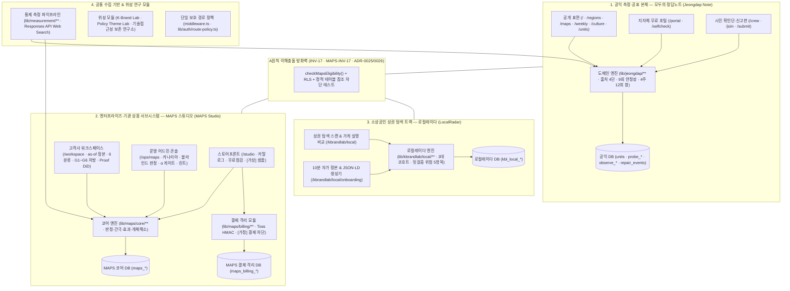

# 전체 서비스 아티팩트 통합 카탈로그 (모두의 정답노트 · MAPS 스튜디오 · 로컬레이다 · 기반 시스템)

본 문서는 `c:\Users\User\kplacelab` 모노레포에 구현된 **공익 측정 본체(모두의 정답노트)**, **상용 정본·간극 서브시스템(MAPS 스튜디오)**, **소상공인 상권 탐색 트랙(로컬레이다)**, 그리고 **기반 측정·위성 연구 모듈**의 모든 서비스 아티팩트(화면, API, 도메인 엔진, DB 스키마, 거버넌스 문서, CLI 및 불변식 테스트)를 체계적으로 정리한 정본 카탈로그입니다.

---

## 1. 시스템 포트폴리오 및 방화벽 아키텍처 지형도

---

## 2. 서브시스템별 웹 화면(UI Pages) 아티팩트 요약

- **모두의 정답노트(공익 본체)**: `/` ([page.tsx](file:///c:/Users/User/kplacelab/app/%28public%29/page.tsx)), `/regions` ([regions/page.tsx](file:///c:/Users/User/kplacelab/app/%28public%29/regions/page.tsx)), `/maps` ([maps/page.tsx](file:///c:/Users/User/kplacelab/app/%28public%29/maps/page.tsx)), `/weekly` ([weekly/page.tsx](file:///c:/Users/User/kplacelab/app/%28public%29/weekly/page.tsx)), `/culture` ([culture/page.tsx](file:///c:/Users/User/kplacelab/app/%28public%29/culture/page.tsx)), `/join` ([join/page.tsx](file:///c:/Users/User/kplacelab/app/%28public%29/join/page.tsx)), `/crew` ([crew/page.tsx](file:///c:/Users/User/kplacelab/app/%28public%29/crew/page.tsx)), `/portal` ([portal/page.tsx](file:///c:/Users/User/kplacelab/app/%28org%29/portal/page.tsx)), `/ops` ([ops/page.tsx](file:///c:/Users/User/kplacelab/app/%28admin%29/ops/page.tsx)), `/disclosure` ([disclosure/page.tsx](file:///c:/Users/User/kplacelab/app/%28public%29/disclosure/page.tsx)), `/labs/tech-access` ([labs/tech-access/page.tsx](file:///c:/Users/User/kplacelab/app/%28public%29/labs/tech-access/page.tsx))
- **MAPS 스튜디오(상용 정본·간극 서브시스템)**: `/studio` ([studio/page.tsx](file:///c:/Users/User/kplacelab/app/%28public%29/studio/page.tsx)), `/workspace` ([workspace/page.tsx](file:///c:/Users/User/kplacelab/app/%28org%29/workspace/page.tsx)), `/ops/maps` ([ops/maps/page.tsx](file:///c:/Users/User/kplacelab/app/%28admin%29/ops/maps/page.tsx))
- **로컬레이다(소상공인 3대 상권 트랙)**: `/kbrandlab/local` ([local/page.tsx](file:///c:/Users/User/kplacelab/app/%28org%29/kbrandlab/local/page.tsx)), `/kbrandlab/local/onboarding` ([onboarding/page.tsx](file:///c:/Users/User/kplacelab/app/%28org%29/kbrandlab/local/onboarding/page.tsx))
- **위성·기반 모듈**: `/kbrandlab` ([kbrandlab/page.tsx](file:///c:/Users/User/kplacelab/app/%28org%29/kbrandlab/page.tsx)), `/theme-lab` ([theme-lab/page.tsx](file:///c:/Users/User/kplacelab/app/%28public%29/theme-lab/page.tsx)), `/measure` ([measure/page.tsx](file:///c:/Users/User/kplacelab/app/%28public%29/measure/page.tsx)), `/reviewer/adjudication` ([adjudication/page.tsx](file:///c:/Users/User/kplacelab/app/%28public%29/reviewer/adjudication/page.tsx))

---

## 3. 도메인 엔진 · DB 스키마 · 테스트 실행 명령 요약

- **코어 도메인 모듈**:
  - `lib/jeongdap/**` — 출처 4단(`s1~s4`), 9회 블록 안정성, 4주 12회 창 상태, 3구간 밴드 지도, 동명이인 지명 사전, 발행·신고 게이트
  - `lib/maps/core/**` & `lib/maps/billing/**` — 이원 시간(`as-of`) 정본 대장, 6분류 판정(`asserted` 분리), 개체 해소($\tau, \delta$), `G1~G6` 간극 및 6단계 소거 처방전(`P1~P6`), 카나리아 드리프트, 대조군 DiD 효과 추정, Krippendorff's $\alpha$, Toss 결제·견적 격리
  - `lib/kbrandlab/local/**` — 서귀포·강남·은평구 코호트 가게 실명(가나다순) 추출, 5대 헛걸음 위험 사실 점검, Schema.org JSON-LD 생성기
- **핵심 실행 스크립트**:
  - `pnpm test:invariants` — 22개 불변식·골든 시나리오 통합 테스트
  - `pnpm stage0:shadow` — 모두의 정답노트 0단계 도구 검증 섀도 런
  - `pnpm localradar:scan` — 로컬레이다 3대 상권 15개 매장 탐색 스캔
  - `pnpm maps:audit` — MAPS 스튜디오 코어 파이프라인 CLI 감사
