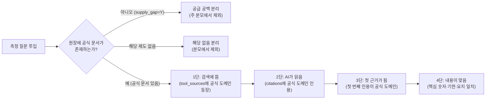
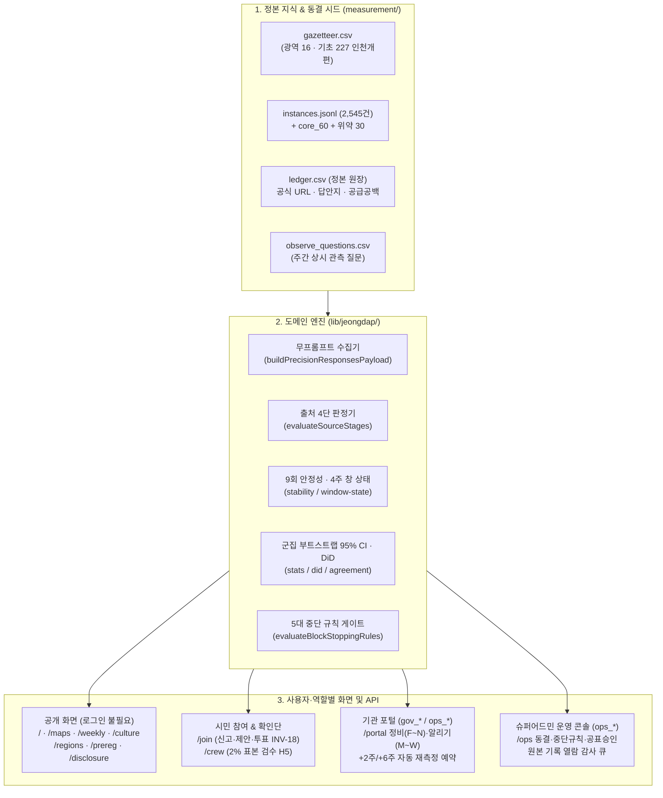

# Part 1. 정신 모델 (Mental Model) — 모두의 정답노트는 어떻게 작동하는가?

**모두의 정답노트 (Jeongdap Note)** 는 국가·광역(16곳)·기초(227곳)·읍면동 및 특별구역을 대상으로, **시민이 AI에게 묻는 질문에 대해 AI가 공식 문서를 근거로 정확히 답하는지(공식 근거율)** 와 **틀린 답으로 시민에게 시간·금전 피해를 줄 위험이 있는지(피해 위험 건수)** 를 측정해 공표하는 민간 공익 측정 플랫폼입니다.

슈퍼어드민(`ops_admin`)으로서 시스템을 점검·운영할 때는 아래 **5대 핵심 기둥**과 **18대 절대 불변식(`INV-1`~`INV-18`)** 을 정신 모델로 삼으면 모든 화면·API·DB 제약의 이유를 즉시 파악할 수 있습니다.

---

## 1. 제품을 지탱하는 5대 기둥

### 기둥 ① 정본 원장(`facts` / `ledger.csv`)과 무프롬프트 관측(`INV-13`)
- **질문은 콘텐츠가 아니라 측정 도구다 (`INV-10`)**: 확인된 공식 출처 URL(`official_url_1`, 고위험은 2출처 `official_url_2`)과 정답 요지(`answer_key`), 핵심 숫자(`numbers`)가 등록된 문항만 정밀 측정에 사용합니다.
- **무프롬프트·무위치 신호 원칙 (`INV-13`, `ADR-0019`)**: 시민이 실제로 겪는 AI 응답 환경을 그대로 재현하기 위해, OpenAI Responses API 호출 시 시스템 프롬프트(`instructions`)나 위치 신호(`user_location`)를 절대 넣지 않고 질문 원문만 보냅니다.
- **검색 도구 반환 목록 전수 기록**: `include: ["web_search_call.action.sources"]` 옵션을 고정하여, AI가 인용하지 않았더라도 검색 결과 후보에 공식 문서가 떴는지(1단)를 분리 판정합니다.

### 기둥 ② 출처 4단(`S1~S4`) + 공급 공백 분리 이중 분모(`INV-2`, `INV-9`, `INV-14`)
단순히 "맞았다/틀렸다"로 뭉뚱그리지 않고, 어디서 끊어졌는지를 **출처 4단**으로 분해합니다.

- **한 자리 숫자 문맥 규칙**: `'2'` 같은 한 자리 숫자가 연도(`'2026년'`)에 걸려 오매칭되는 것을 막기 위해, 반드시 `'2일'`, `'2건'`, `'2명'`, `'2회'` 등 단위 문맥이 함께 있을 때만 일치로 인정합니다.
- **공개 머리 지표는 오직 둘뿐 (`INV-14`)**:
  1. **공식 근거율** (95% 군집 부트스트랩 신뢰 구간 + 분모 문항 수 + 회차 스탬프 병기)
  2. **피해 위험 건수** (고위험 생활행정 문항 중 오답 건수 · 재난·안전 제외 `INV-16`)
  - *단일 종합 점수나 평균 정답률은 절대 산출·표시하지 않습니다 (`INV-9`).*

### 기둥 ③ 단발 관측 배제 — 9회 블록 안정성 & 4주 12회 창 상태(`INV-8`, `ADR-0024`)
AI 응답은 확률적이므로 단 1회 호출 결과를 공개 판정으로 쓰지 않습니다.
- **정밀 측정 (기준 단위 5곳 패널)**: 3블록 × 3회 = **총 9회 반복 실행** 중 최빈 판정과 다른 횟수가 **2회 이하(≤2/9)** 일 때만 `안정(isStable = true)` 문항으로 판정합니다.
- **주간 상시 관측 (월·수·금 주 3회 × 4주 = 12회 창)**:
  - `안정`: 최근 4주 12회 중 **9회 이상** 등장 (공개 기상도 표시 허용)
  - `신규`: 이전 3주(9회) 동안 **0회**였다가 이번 주(3회) 중 **2회 이상** 등장 (사람 확인 후 공개 표시 허용)
  - `가끔`: 4주 12회 중 **3~8회** 등장 (내부 기록, 기상도 미표시)
  - `소멸`: 이전 3주 동안 **6회 이상** 등장했다가 최근 2주 연속 **0회** (원인 점검 대상, 기상도 미표시)
  - `드묾`: 4주 12회 중 **1~2회** 단발 등장 (잡음으로 간주, 기상도 미표시)
- **미등장 지역 명단 금지 (`INV-15`)**: 상시 관측 화면과 API에서는 `안정`·`신규`만 보여주며, "등장하지 않은 지자체 목록", "음성 점유율(SoV)", "AI 추천 순서(`first_three`)"는 산출하거나 공개하지 않습니다.

### 기둥 ④ 모집단 분리(`INV-1`) · 무순위 3구간 지도(`INV-3`) · 공표 시점 게이트(`INV-17`)
- **단일 마스터 저장 + 모집단 집계 분리 (`INV-1`, `ADR-0022`)**:
  - 저장소(`units`)는 국가(`national`) · 광역(`metro` 16곳) · 기초(`basic` 227곳, 2026-07 인천 제물포구·영종구·검단구 신설 및 구 중구·동구 이력 보존 반영) · 읍면동(`emd`) · 특별구역(`special_zone`)을 단일 테이블에 담지만, **모든 조회·집계·내보내기 API는 `population` 인자를 필수로 고정**하며 서로 다른 모집단을 합산하지 않습니다.
- **3구간 가나다순 무순위 지도 (`INV-3`, `ADR-0018`)**:
  - 점수로 줄 세우지 않으며, 고정 경계값 기준 3구간(**`공식 근거 많음` / `보통` / `공식 근거 적음`**) 내부에서는 오직 **가나다순**으로만 나열합니다.
- **2027-03 이전 단위 실명 수치 비공개 게이트 (`INV-17`, `ADR-0016`)**:
  - 자체 사업 전환(`D103`)에 따라 14일 기관 사전 통지·엠바고는 폐지하되, 1차 사전 등록 약속에 따라 **2027년 3월 전국 243곳 전수 공개 전까지는 개별 지자체의 실명 수치를 공개하지 않고 `측정 전` 상태로 안내**합니다.

### 기둥 ⑤ A원칙(이해충돌 방지)과 역할·데이터 방화벽(`INV-17`, `ADR-0021`)
- **유·무상 컨설팅 및 진단 상품 판매 금지**: 측정 기관이 측정 대상 지자체에 유료 컨설팅이나 VIP 진단 리포트를 팔면 측정의 공정성이 무너집니다.
- **코드 수준 데이터 방화벽**: 상업 실험실 역할(`lab_org`, `lab_member` — K-Brand Lab 등 민간 브랜드 실험실)은 측정 운영 콘솔(`/ops`, `/api/measure/**`) 및 지자체 포털(`/portal`, `/api/portal/**`)에 접근할 수 없도록 미들웨어(`lib/auth/route-policy.ts`)와 DB RLS 정책 양쪽에서 차단됩니다.

---

## 2. 전체 시스템 데이터 및 권한 흐름도

---

## 3. 18대 절대 불변식(`INV-1` ~ `INV-18`) 요약 대조표

| 코드 | 불변식 핵심 내용 | 코드·테스트 강제 위치 |
|---|---|---|
| **INV-1** | 서로 다른 모집단(`metro`, `basic`, `special_zone`)을 합산하지 않으며 `population` 인자를 필수로 둔다 | `app/api/regions/route.ts`, `tests/invariants/inv-1-two-populations.test.ts` |
| **INV-2** | 출처 4단(`S1~S4`)과 공급 공백·해당 없음을 분리하며, 보존 기술 접근성에서도 `undetermined`를 합치지 않는다 | `lib/jeongdap/source-stages.ts`, `tests/invariants/inv-2-four-way-verdict.test.ts` |
| **INV-3** | 점수로 정렬하지 않으며(`code`, `name`만 허용), 3구간 내부는 가나다순 무순위로만 표시한다 | `lib/validators/sort-allowlist.ts`, `lib/jeongdap/band.ts` |
| **INV-4** | 자발적 참여(시민 신고·제안·투표, 포털 등록)는 참여·등록 분모로만 표기하고 공식 지표와 섞지 않는다 | `app/api/join/*`, `app/api/portal/events/route.ts` |
| **INV-5** | `SCANNER_UA`(`JeongdapNoteBot/1.0`) 단일 UA만 쓰며 `robots.txt` 차단을 절대 우회하지 않는다 | `lib/constants/scanner.ts`, `lib/jeongdap/cited-page-fetcher.ts` |
| **INV-6** | AI 응답 원문(`raw_response`)을 공개 테이블·API·내보내기에 절대 노출하지 않는다 | `app/api/export/jeongdap/route.ts`, `tests/invariants/inv-6-no-raw-ai.test.ts` |
| **INV-7** | 측정 조건(`method_version`, `model_version`, `web_search`, `language`, `measured_on`) 없는 관측은 불가하다 | `supabase/migrations/20261017000002_jeongdap_phase1_core.sql` |
| **INV-8** | 단발 관측을 공표하지 않으며 9회 블록 안정성(변동 ≤2) 및 4주 12회 창 상태 규칙을 거친다 | `lib/jeongdap/stability.ts`, `lib/jeongdap/window-state.ts` |
| **INV-9** | 반복 회차(`rep`)별로 저장하며 집계값을 덮어쓰지 않고, 단일 종합 점수를 내지 않는다 | `lib/jeongdap/types.ts`, `supabase/migrations/20261017000002_*.sql` |
| **INV-10** | 동결 해시(`frozen_hash`)와 강건성·타당도 검사를 통과하지 않은 문항은 공개 집계에서 제외한다 | `docs/jeongdap-freeze-manifest-v1.0.json`, `scripts/jeongdap/import-seed-data.ts` |
| **INV-11** | 사전 등록 없는 측정은 탐색적으로만 표기하며, 결과를 본 뒤 반증 조건을 바꾸지 않는다 | `app/(public)/prereg/page.tsx`, `components/jeongdap/ExploratoryBanner.tsx` |
| **INV-12** | `docs/EVIDENCE.md` 대장에 없는 사실 주장을 쓰지 않으며 검증 상태를 그대로 표기한다 | `docs/EVIDENCE.md`, `tests/invariants/inv-12-evidence-ledger.test.ts` |
| **INV-13** | 정밀 측정 요청에 시스템 프롬프트(`instructions`)나 위치 신호를 넣지 않는다 | `lib/jeongdap/index.ts` (`buildPrecisionResponsesPayload`) |
| **INV-14** | 공개 머리 지표는 `PublicMetricPair`(`공식 근거율` · `피해 위험 건수`) 두 개뿐이다 | `lib/jeongdap/types.ts`, `app/(public)/regions/[unitId]/page.tsx` |
| **INV-15** | 미등장 지역 명단, 점유율(SoV), 첫 셋(`first_three`) 순서를 공개하지 않는다 (`안정`·`신규`만 공개) | `lib/jeongdap/window-state.ts`, `app/api/maps/weather/route.ts` |
| **INV-16** | 재난·안전(`disaster = true`) 문항 결과는 공개 화면·API·내보내기에서 제외한다 | `lib/jeongdap/index.ts` (`filterOutDisasterItems`) |
| **INV-17** | 2027-03 이전에는 단위 실명 수치를 공개하지 않으며(`측정 전`), A원칙(유·무상 컨설팅 미제공)을 지킨다 | `lib/jeongdap/constants.ts` (`canPublishNamedUnitMetrics`), `lib/auth/route-policy.ts` |
| **INV-18** | 정부 입장 영역·재난·개별 영리 업소 신고는 접수 단계에서 분류·차단(`422`)한다 | `lib/jeongdap/index.ts` (`validateCitizenReportScope`), `app/api/join/report/route.ts` |
