# Part 3. 슈퍼어드민 직접 실행 E2E 튜토리얼 (실제 워크스루 캡처 포함)

이 튜토리얼은 슈퍼어드민(`ops_admin`)이 자신의 PC(Windows PowerShell + 브라우저)에서 **모두의 정답노트** 의 모든 핵심 시나리오를 처음부터 끝까지 직접 실행·검증할 수 있도록, **실제 로컬 서버에서 캡처한 13장의 워크스루 스크린샷**과 함께 단계별로 구성한 실습 매뉴얼입니다.

---

## Step 0. 사전 준비 — 보호 경로 로그인 가드 확인 및 슈퍼어드민(`ops_admin`) 권한 부여

### 0-1. 비로그인 상태에서 보호 경로(`/portal`, `/ops`) 접근 시 가드 동작 확인
로컬 서버(`npx pnpm dev`)를 띄운 뒤, 로그인하지 않은 상태에서 `http://localhost:3000/portal` 또는 `http://localhost:3000/ops` 에 접속하면 미들웨어([`middleware.ts`](../../middleware.ts))가 즉시 `/login?next=/portal` 화면으로 리다이렉트합니다 (`SEC-0` 검증).

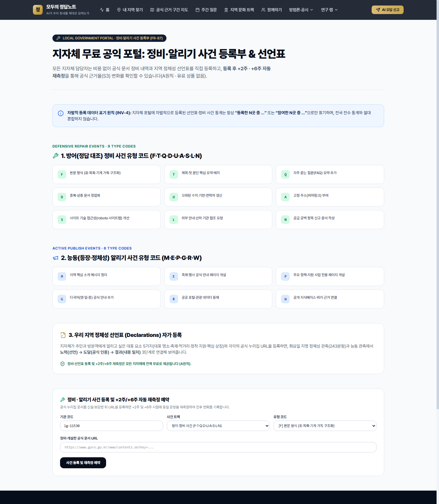

### 0-2. Supabase 계정에 슈퍼어드민(`ops_admin`) 역할 부여하기
우리 시스템의 미들웨어([`lib/auth/roles.ts`](../../lib/auth/roles.ts))는 보안상 사용자가 임의로 고칠 수 있는 `user_metadata`를 절대 읽지 않고, 오직 `service_role`만 수정할 수 있는 **`raw_app_meta_data` (`app_metadata.app_roles`)** 만 읽습니다.

Supabase Studio → **SQL Editor** 에서 본인 이메일 계정에 대해 아래 SQL 한 줄을 실행하면 즉시 슈퍼어드민(`ops_admin`) 권한이 부여됩니다.

```sql
-- 본인의 로그인 이메일로 바꿔서 실행하세요.
UPDATE auth.users
SET raw_app_meta_data = COALESCE(raw_app_meta_data, '{}'::jsonb) || '{"app_roles": ["ops_admin"]}'::jsonb
WHERE email = 'admin@jeongdap.kr';
```

---

## 튜토리얼 T-1. CLI 자동 골든 테스트 & 0단계 원장·그림자 대조 실행

PowerShell 터미널에서 아래 명령어를 순서대로 실행해 봅니다.

### 1-1. 20개 불변식 + E2E 골든 테스트 전체 실행
```powershell
npx pnpm test:invariants
```
- **기대 결과**: `INV-1`부터 `INV-18`, `SEC-0`(보호 경로·비밀키 누출 차단), 그리고 **`E2E-GOLDEN: 7대 주요 시나리오 End-to-End 골든 테스트 (G-1 ~ G-7)`** 까지 **총 20개 스위트 통과 (`통과 20개, 실패 0개`)** 메시지가 출력됩니다.

### 1-2. 0단계 정본 원장(`ledger.csv`) 검수 현황 및 Python-TS 그림자 대조 실행
```powershell
npx pnpm stage0:shadow
```
- **기대 결과**:
  - `totalLedgerRows: 3262` (기준 단위 5곳: `GURO` 668행, `SUWON` 668행, `HWASEONG` 668행, `JEUNGPYEONG` 590행, `GWANGJU_SEO` 668행)
  - `shadowGoldenComparison`: 골든 표본 50문항에 대해 Python `judge_auto.py` 와 TypeScript `evaluateSourceStages()` 의 1~3단 일치율이 `1.0 (100%)` 이며 `readyForDecemberTsSwitch: true` 로 출력되는지 확인합니다.

---

## 튜토리얼 T-2. 공개 화면 전수 워크스루 및 불변식 육안 점검 (스크린샷 대조)

브라우저에서 아래 순서대로 이동하며 각 화면이 캡처본과 동일하게 렌더링되는지 확인합니다.

### 2-1. 홈 (`http://localhost:3000/`)
- **육안 체크포인트**:
  - 상단 GNB에 `홈` · `내 지역 찾기` · `공식 근거 구간 지도` · `주간 질문` · `지역 문화 트랙` · `함께하기` · `방법론·공시` · `연구 랩` 메뉴와 우측 `AI 오답 신고` 버튼이 표시됩니다.
  - 히어로 영역 하단에 **2대 공표 지표(`INV-14`)**, **순위·종합점수 배제(`INV-3`)**, **사전 등록 공표(`INV-11`)**, **A원칙 독립성(`INV-17`)** 4대 불변식 배지가 명시되어 있습니다.


---

### 2-2. 공식 근거 구간 지도 & 12분야 AI 추천 지도 (`http://localhost:3000/maps`)
- **육안 체크포인트**:
  - **체크포인트 1 (`INV-3`)**: 3구간(`● 공식 근거 많음` / `▲ 보통` / `◆ 공식 근거 적음`)이 색각 이상 친화 도형(`●·▲·◆`)과 함께 표시되며, 각 카드 우측 상단에 `가나다순 표기` 배지가 붙어 있습니다.
  - **체크포인트 2 (`INV-17`)**: 중단 안내 박스에 *"전국 243개 지방자치단체 전수 코어 60문항 정밀 측정은 2027년 3월 공개 예정이며, 측정 완료 전까지 해당 지역은 「측정 전」 상태로 정직하게 표기합니다 (INV-17)"* 문구가 표시됩니다.
  - **체크포인트 3 (`INV-15`)**: 하단 **12분야 AI 추천 지도(`ACT-01` ~ `ACT-12`)** 에 공개 대상이 `● 안정(≥9/12)` · `◆ 신규 등장 지역`으로 한정되며 미등장 지역 목록은 공개하지 않는다는 원칙이 명시되어 있습니다.

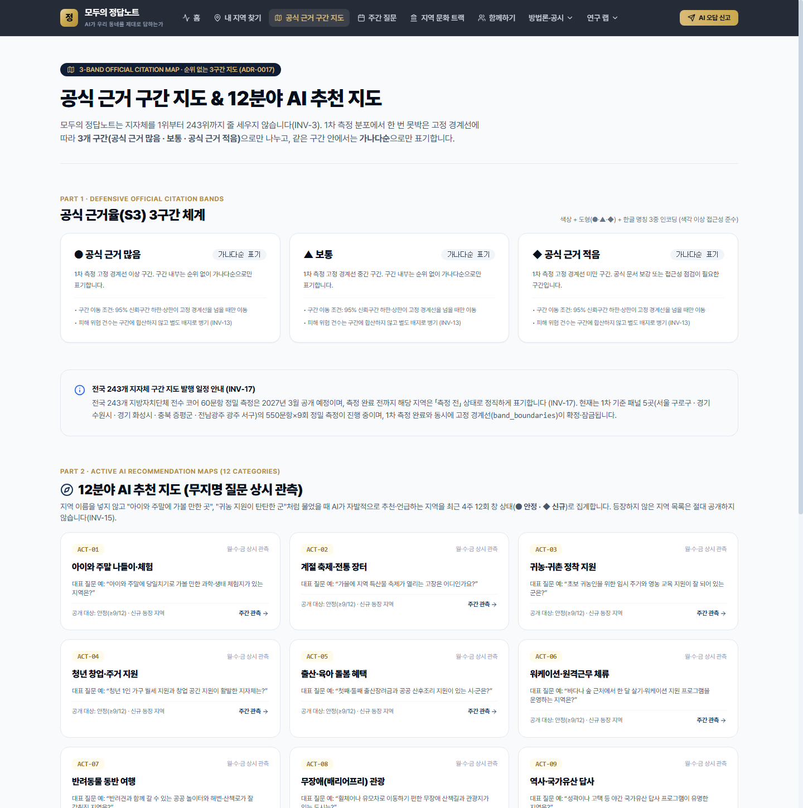

---

### 2-3. 주간 질문 & 전국 관측 기상도 (`http://localhost:3000/weekly`)
- **육안 체크포인트**:
  - 화요일 발행 **방어판(공식 근거 점검)** 과 **능동판(지역 등장·정체성 점검)** 격주 교대 체계가 설명되어 있습니다.
  - 월·수·금 무지명 상시 관측의 **최근 4주 12회 창 상태 5분류(`● 안정` · `◆ 신규` · `▲ 가끔` · `○ 소멸` · `· 드묾`)** 정의와 공개 허용 여부가 표로 제시되어 있습니다.

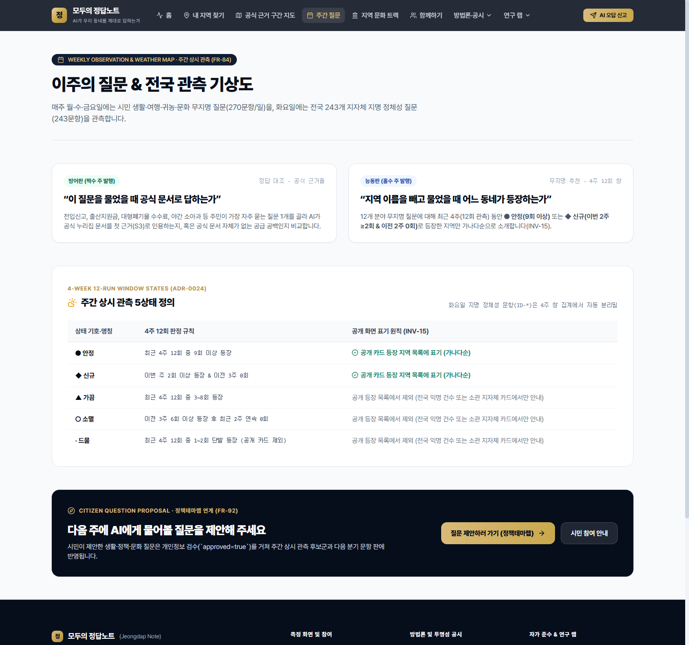

---

### 2-4. 지역 문화 트랙 (`http://localhost:3000/culture`)
- **육안 체크포인트 (`INV-11`)**:
  - 상단에 **탐색적 민간 공익 측정 배너(`ExploratoryBanner`)** 가 표시되며, 유산·음식·축제·자연·인물 5개 분야 200문항과 4개 측정 언어(`ko`·`en`·`ja`·`zh-Hans`) 구성이 안내됩니다.

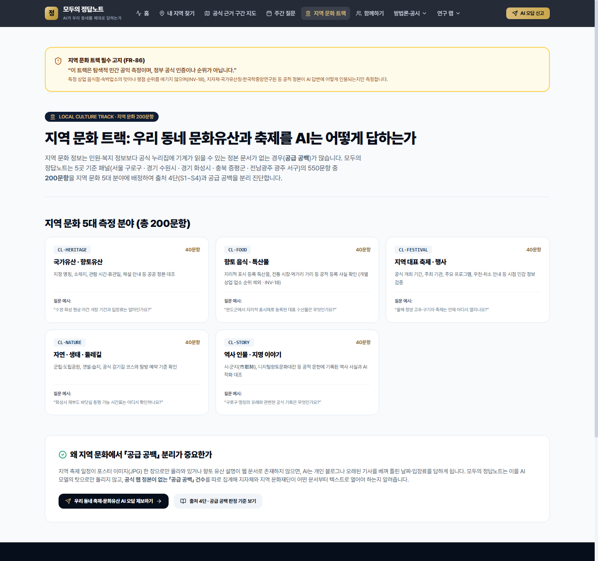

---

### 2-5. 내 지역 찾기 — 행정단위 마스터 사전 (`http://localhost:3000/regions`)
- **육안 체크포인트 (`INV-1`, `ADR-0022`)**:
  - **광역자치단체 16곳**과 **기초자치단체 227곳(2026-07 인천 제물포구·영종구·검단구 신설 반영)** 이 합산되지 않고 명확히 분리되어 표시됩니다.
  - 상단에 **1차 기준 단위 패널 5곳(`서울 구로구` · `경기 수원시` · `경기 화성시` · `충북 증평군` · `전남광주 광주 서구`)** 바로가기 카드가 배치되어 있습니다.

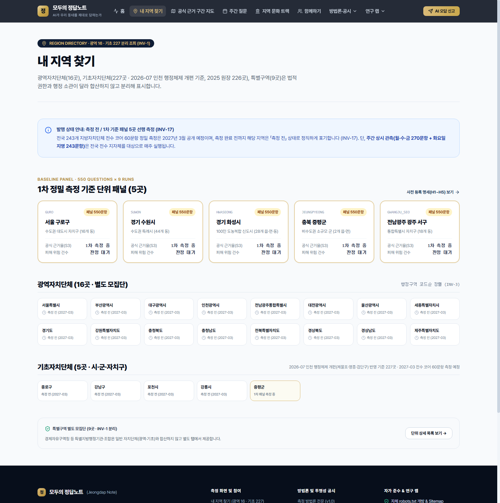

---

### 2-6. 단위 상세 화면 (`http://localhost:3000/regions/GURO`)
- **육안 체크포인트 (`INV-6`, `INV-13`, `INV-14`, `INV-16`, `INV-17`)**:
  - 상단 회차 스탬프(`RoundStamp`)에 **측정일·방법론 판본(`jeongdap-v1.0`)·모델(`gpt-5`)·검색 도구(`web_search:responses_v1`)** 및 **`API 기준 관측 · 시스템 프롬프트 없음 · 위치 신호 없음 (INV-13)`** 녹색 배지가 표시됩니다.
  - **1. 2대 공개 머리 지표 (`INV-14`)**: `지표 1 · 공식 근거율(S3 첫 근거 비율)` 과 `지표 2 · 피해 위험 건수(재난·안전 제외 · INV-16)` 두 개만 존재하며, 2027-03 이전 게이트(`INV-17`) 안내 배너가 함께 표시됩니다.
  - **2. 출처 4단 배지 (`JudgmentBadge`)**: `1단 검색에 뜸` → `2단 AI가 읽음` → `3단 첫 근거가 됨` → `4단 내용이 맞음` / `4단 내용이 다름` / `공급 공백(분모 분리)` / `해당 없음(분모 제외)` 배지가 색상+기호+텍스트 3중 인코딩으로 표시됩니다.
  - 하단에 **측정 범위 및 원인 해석 안내(`ScopeNote`)** 와 **이해관계 공시(`InterestDisclosure` · A원칙)** 가 함께 표시됩니다.

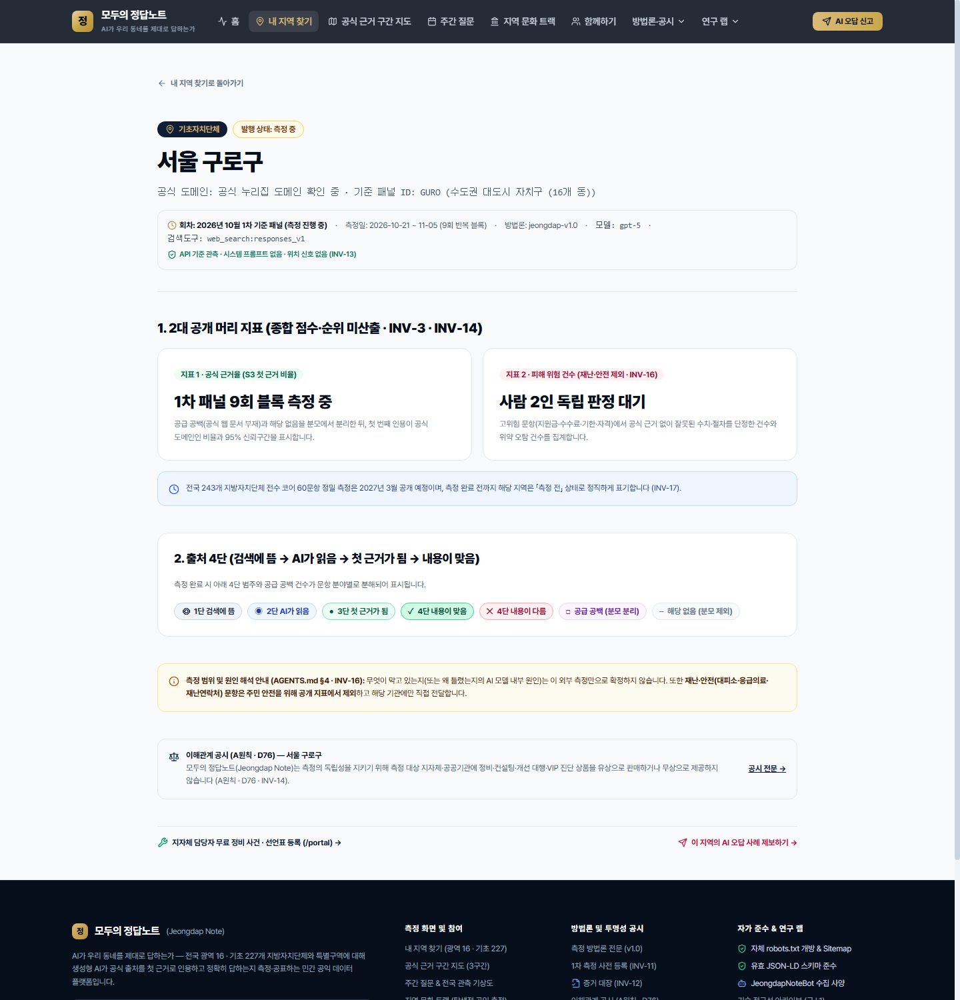

---

### 2-7.1차 사전 등록 (`http://localhost:3000/prereg`) 및 이해관계 공시 (`http://localhost:3000/disclosure`)
- `/prereg`: 가설 `H1~H5`, 반증 조건, 5대 중단 규칙, 그리고 `jeongdap-freeze-manifest-v1.0.json`의 실제 SHA-256 동결 해시가 화면에 출력됩니다.
- `/disclosure`: **A원칙(유·무상 컨설팅 미제공)** 과 원본 기록 검증 패킷 요청 안내가 표시됩니다.

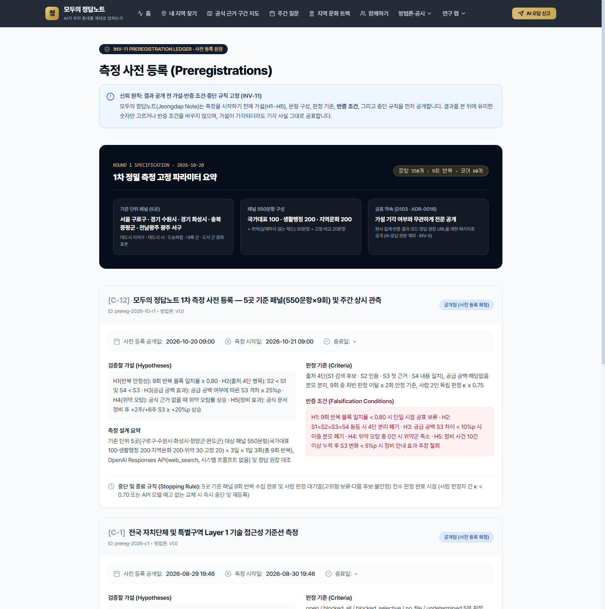

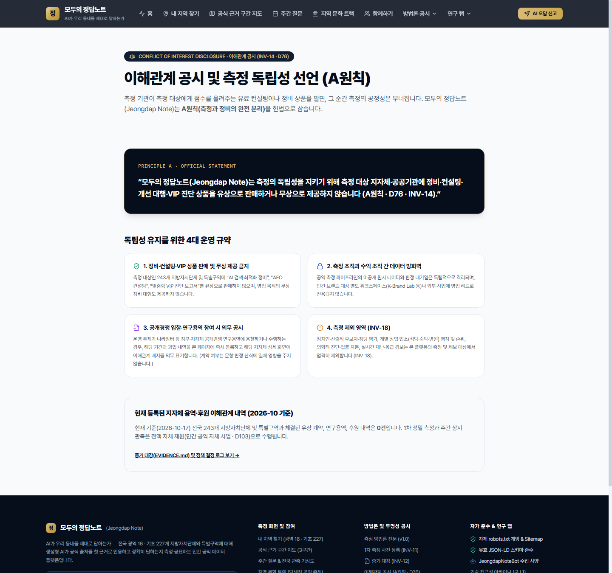

---

## 튜토리얼 T-3. 시민 참여 3종(`/join`) & 범위 제외 차단 테스트

### 3-1. 브라우저 UI에서 제안·신고 화면 점검 (`http://localhost:3000/join`)
1. `http://localhost:3000/join` 에 접속하면 상단에 **① AI 오답 신고판**, **② 다음 주 질문 제안**, **③ 시민 확인단(유급 검증)** 3대 참여 카드가 표시됩니다.
2. 중단의 **「다음 주 측정 질문 바로 제안하기」** 폼에서 질문 분야와 범위 자가 확인(`INV-18`)을 선택하고 질문 원문을 입력해 제출할 수 있습니다.
3. 하단 붉은색 경고 박스에 **측정 및 제보 범위 제외 안내(`INV-18`: 정치인·선출직 평가, 개별 상업 업소 평점·순위, 의학·법률 자문, 실시간 재난·응급 경보 제외)** 가 명시되어 있습니다.

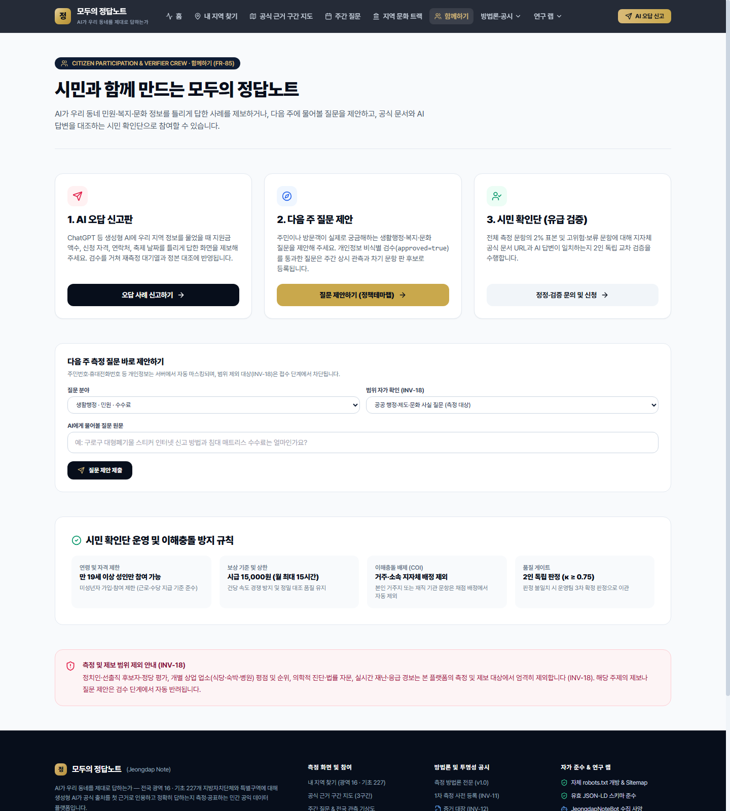

### 3-2. PowerShell에서 API 직접 호출로 불변식 게이트 검증 (`http://localhost:3000` 실행 중)

PowerShell에서 아래 명령어를 복사해 실행하면서 응답 상태 코드를 직접 확인합니다.

#### ① 범위 제외 신고(`disaster_emergency`) 차단 확인 (`INV-18` → `422` 에러 기대)
```powershell
try {
  Invoke-RestMethod -Uri "http://localhost:3000/api/join/report" -Method POST -ContentType "application/json" -Body '{"scopeCategory":"disaster_emergency","questionText":"지진 대피소 위치가 틀렸어요"}'
} catch {
  Write-Host "차단 상태 코드:" $_.Exception.Response.StatusCode.value__
}
```
- **기대 출력**: `차단 상태 코드: 422`

#### ② 정상 생활행정 신고 + 주민번호·전화번호 자동 마스킹 확인 (`201` 기대)
```powershell
Invoke-RestMethod -Uri "http://localhost:3000/api/join/report" -Method POST -ContentType "application/json" -Body '{"scopeCategory":"civil_admin","questionText":"여권 발급 수수료가 다릅니다. 제 번호는 010-1234-5678, 주민번호 900101-1234567 입니다."}'
```
- **기대 출력**: `sanitizedQuestion` 필드에 `[연락처 마스킹]` 및 `[주민번호 마스킹]`으로 치환된 문자열이 반환됩니다.

#### ③ 점수 정렬 시도 차단 확인 (`INV-3` → `400` 에러 기대)
```powershell
try {
  Invoke-RestMethod -Uri "http://localhost:3000/api/regions?population=basic&order=score" -Method GET
} catch {
  Write-Host "점수 정렬 거부 상태 코드:" $_.Exception.Response.StatusCode.value__
}
```
- **기대 출력**: `점수 정렬 거부 상태 코드: 400`

---

## 튜토리얼 T-4. 유급 시민 확인단 작업대 (`/crew`) 점검

`http://localhost:3000/crew` 로 이동하여 시민 확인단 운영 규칙과 3단계 검증 절차(① AI 답변에 인용된 공식 URL 열기 → ② 공식 문서 본문과 AI 답변 수치·절차 대조 → ③ 4단 판정 및 피해 위험 유무 선택)를 확인합니다.

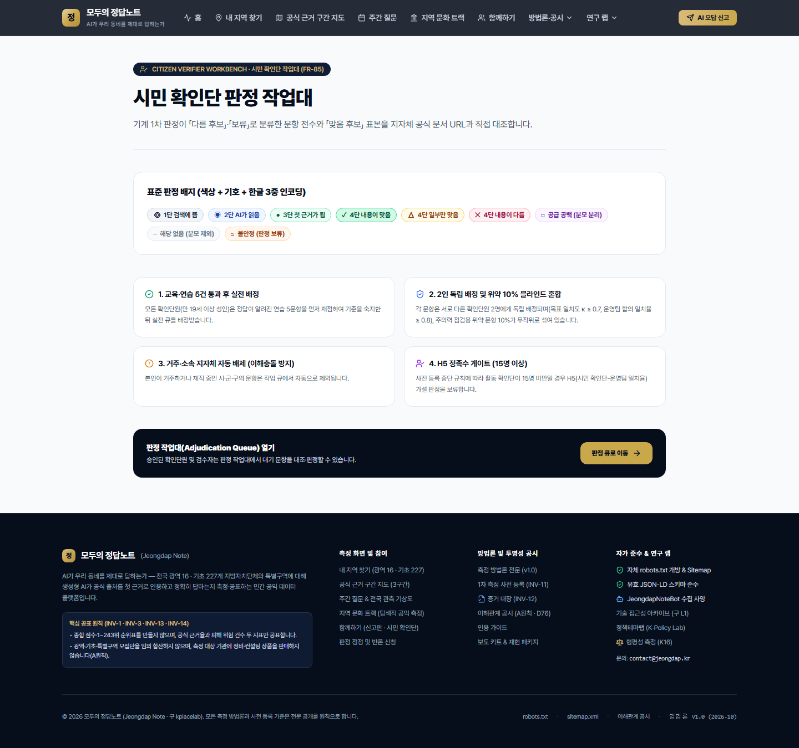

---

## 튜토리얼 T-5. 지자체 무료 공익 포털 (`/portal`) 사건 등록 & +2/+6주 재측정 예약

슈퍼어드민(`ops_admin`) 또는 지자체 담당자(`gov_editor`)로 로그인한 상태에서 `http://localhost:3000/portal` 로 이동합니다.

1. 상단 파란색 안내 박스에 **자발적 등록 데이터 표기 원칙(`INV-4`: 항상 `"등록한 N곳 중 ..."` 으로만 표기하며 전국 전수 통계와 혼합하지 않음)** 이 명시되어 있습니다.
2. **1. 방어(정답 대조) 정비 사건 유형 코드 9종(`F·T·Q·D·U·A·S·L·N`)** 과 **2. 능동(등장·정체성) 알리기 사건 유형 코드 6종(`M·E·P·G·R·W`)** 카드를 확인합니다.
3. 하단 **「정비·알리기 사건 등록 및 +2주/+6주 자동 재측정 예약」** 폼에서:
   - 기관 코드: `lg-11530` (또는 `GURO`)
   - 사건 트랙: `방어 정비 사건 (F·T·Q·D·U·A·S·L·N)`
   - 유형 코드: `[F] 본문 형식 (표·목록·기계 가독 구조화)` 또는 `[Q] 자주 묻는 질문(FAQ) 요약 추가`
   - 정비·개설한 공식 문서 URL 입력 후 **사건 등록 및 재측정 예약** 버튼을 클릭하면 `+2주` 및 `+6주` 자동 재측정 예정일이 즉시 반환됩니다.


---

## 튜토리얼 T-6. 슈퍼어드민 운영·승인 콘솔 (`/ops`) 점검

슈퍼어드민(`ops_admin`)으로 로그인한 상태에서 `http://localhost:3000/ops` 로 이동합니다.

1. **1. 블록 중단 규칙 (Stopping Rules) 실시간 감시**:
   - 도구 반환 목록 누락 상한(`≤ 5%`), 위약 거짓 양성 중단선(`< 10%`), 블록 간 일치율 / 자동-사람 $\kappa$ (`H1 ≥ 0.8 / κ ≥ 0.7`), 시민 확인단 최소 인원(`≥ 15명`) 4개 지표와 우측 상단 `정상 진행 가능` 상태 배지를 확인합니다.
2. **2. 관찰 측정 (`ObservationServiceStat` 분리 입력 · `INV-4`)**:
   - OpenAI 외 타 서비스 소표본(수원 10문항 × 한·영 × 2개 서비스)이 정밀 측정 지표와 절대 합산되지 않고 별도 타입으로 격리되어 관리되는 것을 확인합니다.
3. **3. 자체 사업 3대 공표 승인 게이트 (`ADR-0016`)**:
   - **게이트 1**: 사전 등록 해시(`jeongdap-freeze-manifest-v1.0.json`) 일치 확인 (`INV-11`)
   - **게이트 2**: 사람 판정 대기열(고위험 2인 독립 판정) 100% 완료 및 운영자 승인
   - **게이트 3**: 재난·안전(`disaster=true`) 문항 공개 응답 제외 필터 통과 (`INV-16`)

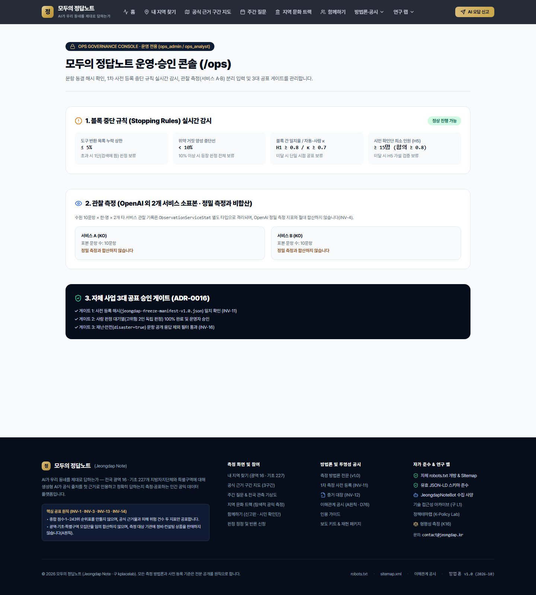

---

## 튜토리얼 T-7. 로컬레이다 (`LocalRadar` · 소상공인 3대 상권 코호트 탐색 스캔) 점검 (`ADR-0025`, `FR-93`~`FR-96`)

슈퍼어드민(`ops_admin`) 또는 브랜드랩 구성원(`lab_org`, `lab_member`)은 민간 소상공인 상권 탐색 스캔 트랙인 **「로컬레이다 (LocalRadar)」**를 CLI와 웹 대시보드에서 즉시 검증할 수 있습니다.

### 1. CLI 3대 상권 코호트 배치 진단 실행 (`pnpm localradar:scan`)
```powershell
pnpm localradar:scan
```
- **기대 결과**: **서귀포(`SEOGWIPO_STAY`) · 강남(`GANGNAM_SMB`) · 은평구(`EUNPYEONG_LOCAL`)** 3개 코호트 소속 총 15곳 실명 매장의 4개 국어(`KO`·`EN`·`JA`·`ZH`) 4주 창 상태, 출처 4단 도달 현황, 감지된 손님 헛걸음 위험 건수, Schema.org JSON-LD 생성 검증(`15/15 PASS`)이 출력됩니다.

### 2. 로컬레이다 코호트 대시보드 (`/kbrandlab/local`) 및 10분 자가 정본 온보딩 (`/kbrandlab/local/onboarding`)
1. `http://localhost:3000/kbrandlab/local` 로 이동하여 상단 탭에서 **서귀포 스테이·로컬체험**, **강남 뷰티·클리닉·웰니스**, **은평구 골목상권 소상공인** 코호트를 전환합니다.
2. 코호트 비교표에서 **가게 실명**이 가나다순(또는 매장 코드순)으로 표시되며, 행을 클릭하면 하단 Layer B 매장별 5대 고위험 영업 사실(`영업시간·정기휴무`, `대표 가격·구성`, `예약·워크인 조건`, `주차·대중교통 접근`, `반려동물·아동·다국어 규정`) 상세 대조표가 전환되는 것을 확인합니다.
3. 우측 상단 **「10분 자가 정본 등록 & JSON-LD 생성 →」** 버튼(`http://localhost:3000/kbrandlab/local/onboarding`)을 클릭하여 영업 정본을 수정하면 실시간으로 의료법 제56조·금지어 검증과 `LocalBusiness` / `MedicalClinic` + `FAQPage` Schema.org JSON-LD 스니펫이 갱신되는지 확인합니다.

