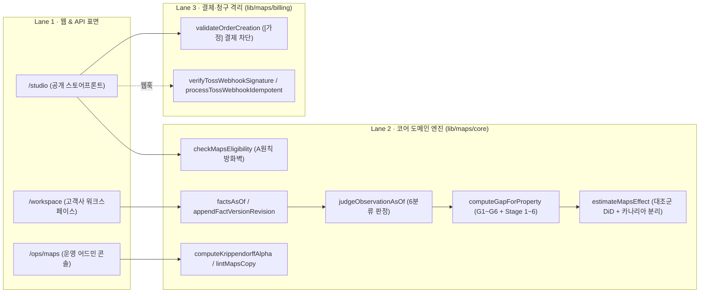
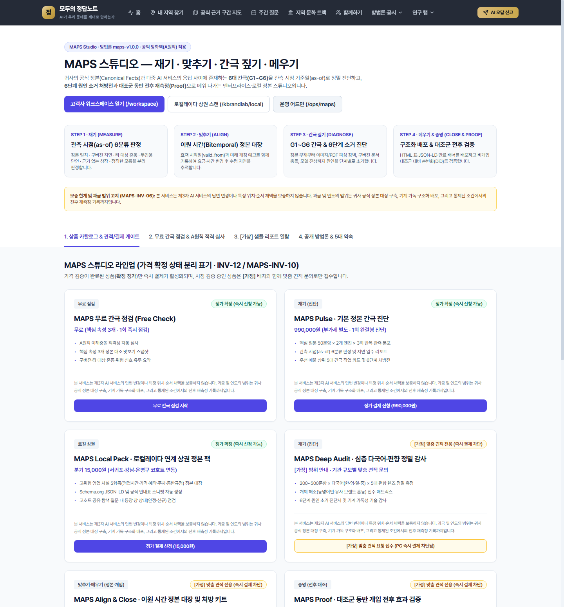
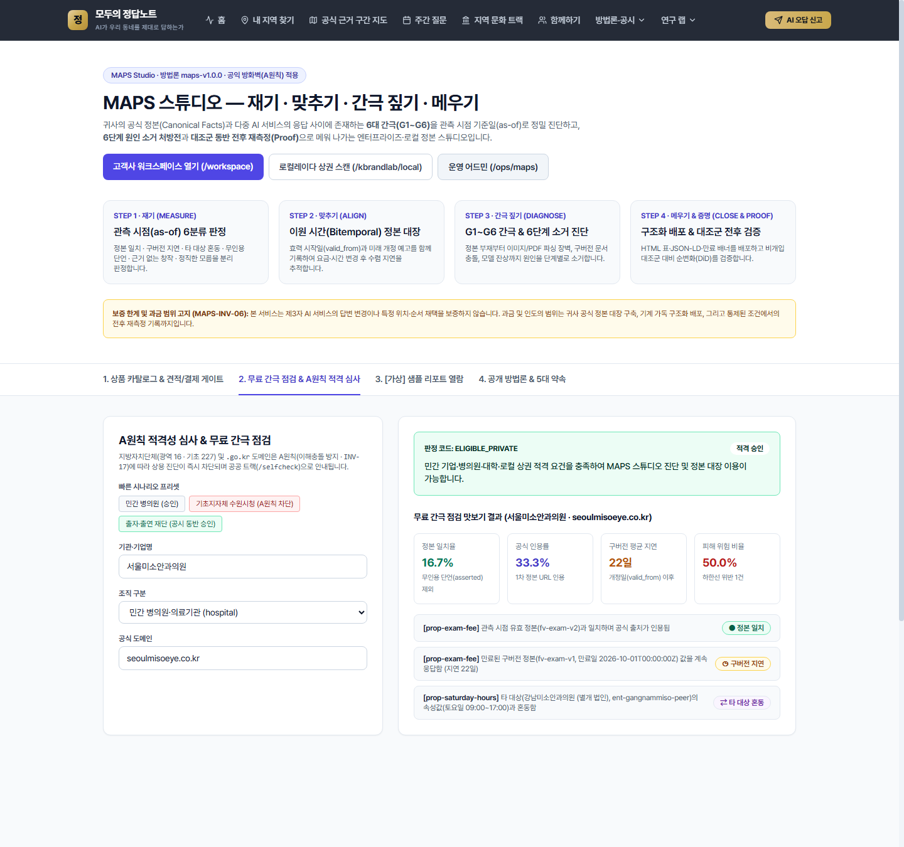
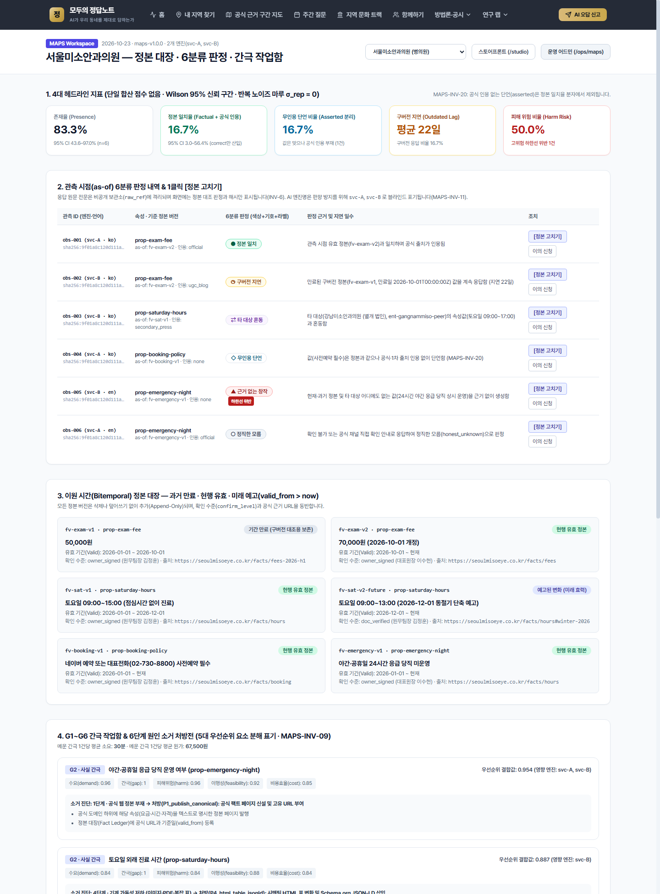
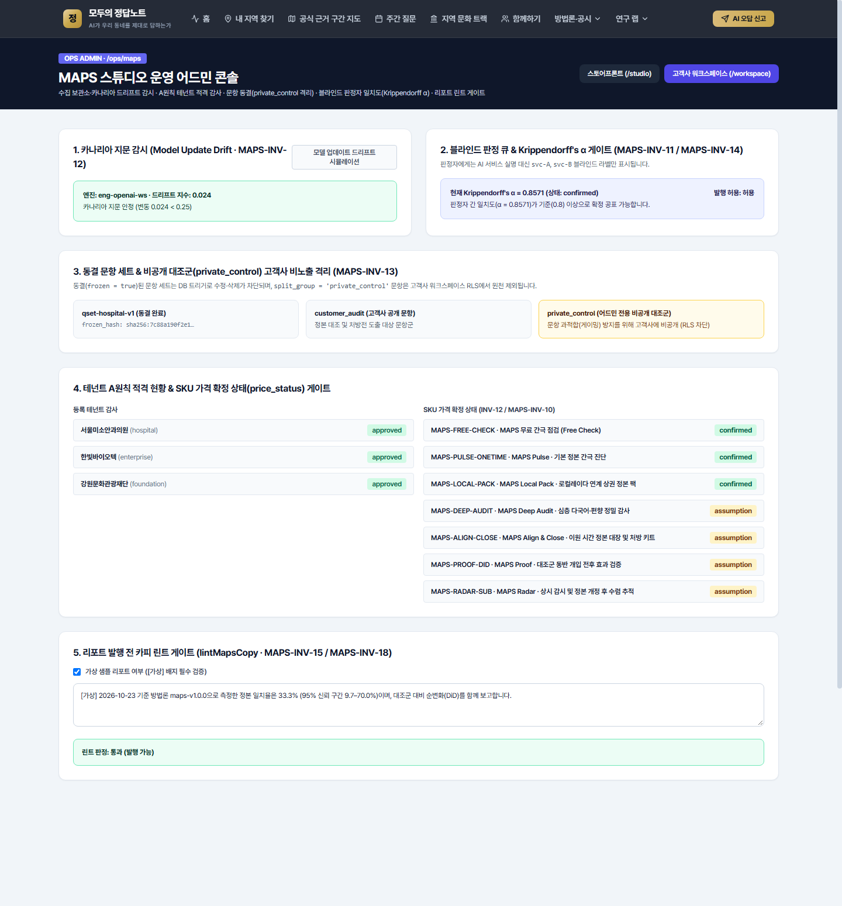

# Part 5 · MAPS 스튜디오 (MAPS Studio) 통합 매뉴얼 — 기능 명세 · 사용자 가이드 · 운영자 가이드

이 문서는 **MAPS 스튜디오 (Multi-AI Presence & Alignment Studio)** 서브시스템의 **기능 명세(Functional Spec)**, **사용자 가이드(고객사·잠재 구매자용)**, **운영자 가이드(슈퍼어드민 `ops_admin`용)** 를 하나로 통합한 정본 매뉴얼입니다.

- **관련 요구사항**: `FR-97` ~ `FR-106` ([docs/PRD.md](../PRD.md))
- **관련 ADR**: [ADR-0026](../adr/0026-maps-subsystem-architecture.md) (3-Lane 분리 및 6분류 기준일 판정), [ADR-0027](../adr/0027-maps-billing-isolation.md) (결제·청구 격리 및 가격 가정 게이트)
- **관련 증거 대장**: `C-13 (MAPS-H1 ~ H3)` ([docs/EVIDENCE.md](../EVIDENCE.md))

---

## 1. 기능 명세 (Functional Specification)

### 1.1 아키텍처 개요 및 3-Lane 격리 구조

MAPS 스튜디오는 민간 기업·병의원·대학·준공공 출자출연기관이 자사 공식 정본(Canonical Facts)과 다중 AI 서비스 답변 사이의 간극(Gap)을 **재고(Measure) · 맞추고(Align) · 간극을 짚고(Diagnose) · 메우고 증명(Close & Proof)** 하는 상용 B2B 서브시스템입니다.



- **결제·판정 무결합 원칙 (`MAPS-INV-05`)**: `lib/maps/core/**` 의 어떤 파일도 `lib/maps/billing/**` 또는 `maps_billing_*` 테이블을 참조하지 않습니다. 고객사의 결제 금액이나 구독 상태는 판정·간극·우선순위 수치에 0% 관여합니다.
- **공익–상용 방화벽 (`INV-17`, `MAPS-INV-17`)**: 지방자치단체(광역 16 · 기초 227) 및 `.go.kr` / `.korea.kr` 도메인은 상용 MAPS 스튜디오에서 진단·구매가 원천 차단되며 공공 무료 트랙(`/selfcheck`)으로 리다이렉트됩니다.

---

### 1.2 웹 라우트 및 권한 정책 명세

| 경로 | 파일 위치 | 접근 권한 (`lib/auth/route-policy.ts`) | 핵심 역할 |
|---|---|---|---|
| `/studio` | [app/(public)/studio/page.tsx](../../app/%28public%29/studio/page.tsx) | 공개 (로그인 불필요, JSON-LD 내장) | 4단계 파이프라인 소개, SKU 카탈로그(`confirmed` vs `assumption`), A원칙 적격성 & 무료 간극 점검, `[가상]` 샘플 리포트, 공개 방법론 요약 |
| `/workspace` | [app/(org)/workspace/page.tsx](../../app/%28org%29/workspace/page.tsx) | `CLIENT_ROLES` (`client_owner`, `client_editor`, `client_viewer`), `LAB_ROLES`, `OPS_ROLES` | 4대 헤드라인 지표(`asserted` 분리), 관측 시점(`as-of`) 6분류 판정 & 1클릭 `[정본 고치기]`, 이원 시간 정본 대장(미래 예고 포함), `G1~G6` 간극 작업함 & 6단계 소거 처방전, 5대 편향 렌즈, Proof 대조군 DiD, 이의 신청 |
| `/ops/maps` | [app/(admin)/ops/maps/page.tsx](../../app/%28admin%29/ops/maps/page.tsx) | `OPS_ROLES` (`ops_admin`, `ops_editor`, `ops_measure`, `ops_approver`, `ops_analyst`) | 카나리아 지문 드리프트 감시, 블라인드 판정 큐 & Krippendorff's $\alpha$ 게이트, 문항 동결(`private_control` 격리), 테넌트 A원칙 적격 감사 & SKU `price_status` 관리, 리포트 발행 전 `lintMapsCopy` 검증기 |

---

### 1.3 API 엔드포인트 명세

#### (1) `POST /api/studio/free-check`
- **구현 파일**: [app/api/studio/free-check/route.ts](../../app/api/studio/free-check/route.ts)
- **요청 본문 (JSON)**:
  ```json
  {
    "orgName": "서울미소안과의원",
    "orgType": "hospital",
    "domain": "seoulmisoeye.co.kr",
    "sponsorDisclosure": ""
  }
  ```
- **응답 규칙**:
  - `orgName` 또는 `domain` 누락 시 `400 Bad Request`
  - 지자체(`local_gov_blocked`, 시청·군청·구청 명칭) 또는 `.go.kr` 도메인, 공시 없는 준공공기관(`public_corp`, `foundation`)인 경우 `403 Forbidden` + `{ eligible: false, eligibility: { reasonCode, messageKo, redirectPath: '/selfcheck' } }`
  - 적격 기관인 경우 `200 OK` + `{ eligible: true, eligibility, preview: { metrics, sampleJudgments, topGapTasks }, nonGuaranteeNotice }`

#### (2) `POST /api/studio/webhooks/toss`
- **구현 파일**: [app/api/studio/webhooks/toss/route.ts](../../app/api/studio/webhooks/toss/route.ts)
- **헤더**: `x-toss-signature` (HMAC-SHA256 서명)
- **동작**:
  - 서명 불일치 시 `401 Unauthorized` 반환
  - `idempotencyKey = "${orderId}::${paymentKey}::${status}"` 기준으로 중복 수신 여부를 판별하여 `duplicated: true | false` 와 결제 레코드(`rawWebhookHash` 포함)를 반환

#### (3) `GET / POST /api/workspace/overview`
- **구현 파일**: [app/api/workspace/overview/route.ts](../../app/api/workspace/overview/route.ts)
- **권한**: `CLIENT_ROLES` · `LAB_ROLES` · `OPS_ROLES`
- **동작**:
  - `GET ?tenantId=ten-seoulmiso`: 실시간 계산된 워크스페이스 전체 스냅샷(`metrics`, `factVersions`, `observations`, `judgments`, `gapTasks`, `biasLenses`, `costEfficiency`, `proofEffect`) 반환
  - `POST`: 기존 정본 버전을 덮어쓰지 않고 새 효력일(`effectiveFromIso`)을 가진 정본 버전을 Append-Only로 추가(`appendFactVersionRevision`)

#### (4) `GET / POST /api/ops-maps/overview`
- **구현 파일**: [app/api/ops-maps/overview/route.ts](../../app/api/ops-maps/overview/route.ts)
- **권한**: `OPS_ROLES`
- **동작**:
  - `GET`: 카나리아 지문 상태, 판정자 간 일치도(Krippendorff's $\alpha$), SKU 카탈로그 상태 반환
  - `POST`: 리포트 초안 문자열에 대해 `lintMapsCopy` 를 실행하여 `publishAllowed` 및 위반 목록(`violations`) 반환

---

### 1.4 코어 도메인 알고리즘 및 수식 명세 (`lib/maps/core/**`)

1. **이원 시간(`as-of`) 정본 대장 ([as-of.ts](../../lib/maps/core/as-of.ts))**
   - 모든 정본 버전은 `validFrom` ~ `validTo` (현실 효력 시간)와 `recordedAt` (대장 기록 시간)을 가집니다.
   - 관측 시각 $t_{\text{obs}}$ 에 대한 정본 조회 시:
     - $\text{validFrom} \le t_{\text{obs}} < \text{effectiveValidTo}$ 인 버전을 `activeFact` 로 선택합니다.
     - $\text{effectiveValidTo} \le t_{\text{obs}}$ 인 이전 버전들은 `expiredFactsBeforeObservedAt` 배열로 분리하여 구버전 지연(`outdated`) 대조에 사용합니다.
     - $\text{validFrom} > t_{\text{obs}}$ 인 버전은 `scheduledFutureFacts` (미래 예고된 변화)로 분류합니다.
   - 후속 정본 버전이 추가되어도 기존 행의 `factVersionId` 와 과거 관측 시점의 판정 결과는 절대 소급 변경되지 않습니다(`MAPS-INV-03`, `MAPS-INV-04`).

2. **관측 시점 6분류 판정 ([verdict.ts](../../lib/maps/core/verdict.ts))**
   - `honest_unknown`: 확인 불가를 정직하게 밝히거나 답변을 유보함
   - `correct`: `activeFact` 값과 일치하고 **공식 도메인 또는 1차 정본 URL(`official` | `primary_doc`)이 인용됨**
   - `asserted`: `activeFact` 값과 일치하나 **공식·1차 인용이 전혀 없는 단언** (`MAPS-INV-20`에 따라 `factualRate` 분자에서 제외하고 `assertedRate`로 별도 집계)
   - `outdated`: `activeFact` 와는 다르나 만료된 과거 정본(`expiredFactsBeforeObservedAt`) 값과 일치함. 이때 지연 일수는 다음과 같이 계산합니다:
     $$\text{lagDays} = \left\lfloor \frac{t_{\text{obs}} - t_{\text{change}}}{86400\text{ sec}} \right\rfloor$$
   - `confused`: 동명이인·유사 기관(`peerFacts`)의 속성값과 일치함 (`confusedWithEntityId` 기록)
   - `fabricated`: 현재·과거 정본 및 타 대상 어디에도 없는 수치·사실을 창작함 (`harmScore >= 4.0` 이면 `limitViolation = true`)

3. **개체 해소 이중 임계값 ([entity-resolution.ts](../../lib/maps/core/entity-resolution.ts))**
   - 후보 개체별 점수 $S_i \in [0, 1]$ 를 정식 명칭/별칭 일치($+0.65$ / $+0.55$), 구분자(`disambiguators`, 최대 $+0.35$), 배제 별칭(`negativeAliases`, 건당 $-0.45$)으로 산출합니다.
   - 1순위 점수 $S_{(1)}$ 과 2순위 점수 $S_{(2)}$ 가 다음 두 조건을 동시에 만족할 때만 개체를 확정(`resolved`)합니다:
     $$S_{(1)} \ge \tau \quad (\tau = 0.72), \qquad S_{(1)} - S_{(2)} \ge \delta \quad (\delta = 0.15)$$
   - 동명이인 기관 사이에 구분 문맥이 없어 격차($\delta$)가 부족하면 억지 매칭하지 않고 `ambiguous` 로 분류합니다.

4. **6단계 원인 소거 진단 및 `G1~G6` 간극 우선순위 ([cause-diagnosis.ts](../../lib/maps/core/cause-diagnosis.ts), [gap-engine.ts](../../lib/maps/core/gap-engine.ts))**
   - 간극 유형(`G1_presence`, `G2_fact`, `G3_time`, `G4_source`, `G5_context`, `G6_engine`)은 저장된 정적 값이 아니라 원시 관측과 판정으로부터 조회 시점에 계산합니다(`MAPS-INV-08`).
   - 원인 진단은 1단계부터 6단계까지 순서대로 소거합니다:
     - `S1_existence` (공식 웹 정본 유무) → `P1_publish_canonical`
     - `S2_crawl_access` (`robots.txt`·SSR 접근성) → `P2_open_robots_sitemap`
     - `S3_indexing_discoverability` (검색 후보 1단 포착 여부) → `P3_ia_deeplink_anchor`
     - `S4_parseability` (통이미지·PDF가 아닌 HTML 표·JSON-LD 여부) → `P4_html_table_jsonld`
     - `S5_conflict_recency` (구버전 공지·외부 요약본 충돌 여부) → `P5_retire_old_date_pin`
     - `S6_model_internal` (모델 사전학습 잔상) → `P6_official_objection_pack`
   - 모든 간극 작업은 `priority` 값과 함께 반드시 5대 구성요소(`demand`, `gap`, `harm`, `feasibility`, `cost`)를 함께 반환합니다(`MAPS-INV-09`). 공개 페이지(`/studio`)에는 내부 가중치 계수를 노출하지 않습니다(`MAPS-INV-19`).

5. **대조군 동반 효과 추정(DiD) 및 카나리아 구간 분리 ([effect.ts](../../lib/maps/core/effect.ts), [fingerprint.ts](../../lib/maps/core/fingerprint.ts))**
   - 비개입 대조군(`control`)이 없으면 `status = 'exploratory_no_control'`, `effectClaimAllowed = false` 로 강제하여 인과적 개입 효과 주장을 차단합니다(`MAPS-INV-07`).
   - 전후 측정 창 내부에 카나리아 지문 드리프트($\text{driftScore} \ge 0.25$)가 감지되면 `status = 'segmented_by_model_update'`, `effectClaimAllowed = false` 로 전환하고 시계열을 업데이트 전·후 2개 구간으로 분리합니다(`MAPS-INV-12`).

---

## 2. 사용자 가이드 (User Guide — 잠재 고객사 및 워크스페이스 담당자용)

### 2.1 스토어프론트 (`/studio`) 이용 방법





1. **무료 간극 점검 & A원칙 적격성 확인**
   - 브라우저에서 `/studio` 에 접속한 뒤 상단 탭에서 **`2. 무료 간극 점검 & A원칙 적격 심사`** 를 클릭합니다.
   - **민간 기업·병의원·대학·로컬 상권**: 기관명과 공식 도메인(예: `seoulmisoeye.co.kr`)을 입력하면 즉시 `ELIGIBLE_PRIVATE` 승인과 함께 핵심 속성 3개에 대한 6분류 판정 맛보기 스냅샷을 확인할 수 있습니다.
   - **지방공기업·출자출연 재단**: 조직 구분에서 `출자·출연 재단 (foundation)` 또는 `지방공기업 (public_corp)`을 선택하고 **후원·용역 이해관계 공시 문구**를 5자 이상 입력해야 `ELIGIBLE_QUASI_PUBLIC_WITH_DISCLOSURE` 로 승인됩니다.
   - **지방자치단체(광역 16 · 기초 227)**: 시청·군청·구청 명칭이나 `.go.kr` 도메인 입력 시 `BLOCKED_MUNICIPAL_A_PRINCIPLE` 배지와 함께 상용 접수가 차단되며, **`공공 무료 자가점검 트랙(/selfcheck)으로 이동`** 버튼으로 안내됩니다.

2. **상품 카탈로그 확인 및 신청 (`1. 상품 카탈로그 & 견적/결제 게이트` 탭)**
   - **정가 확정(`confirmed`) 상품** (`MAPS-FREE-CHECK`, `MAPS-PULSE-ONETIME` 990,000원, `MAPS-LOCAL-PACK` 분기 15,000원): 카드 하단의 결제 신청 버튼을 눌러 즉시 신청할 수 있습니다.
   - **가격 가정(`[가정]`, `assumption`) 상품** (`MAPS-DEEP-AUDIT`, `MAPS-ALIGN-CLOSE`, `MAPS-PROOF-DID`, `MAPS-RADAR-SUB`): 시장 검증 전 단계이므로 즉시 결제(PG Checkout)가 자동 차단되며 **`[가정] 맞춤 견적 요청 접수`** 버튼으로만 상담·견적을 신청할 수 있습니다.
   - 모든 상품 카드 하단의 **보증 한계 고지문**("제3자 AI 서비스의 답변 변경이나 특정 위치·순서 채택을 보증하지 않습니다...")을 반드시 확인하십시오.

3. **`[가상]` 샘플 리포트 열람 (`3. [가상] 샘플 리포트 열람` 탭)**
   - 실제 계약 전 리포트 형태를 미리 볼 수 있는 예시 화면입니다. 상단의 `[가상]` 배지 고지문과 함께 6분류 판정의 기호·색상·해석을 확인할 수 있습니다.

---

### 2.2 고객사 워크스페이스 (`/workspace`) 실무 가이드



1. **4대 헤드라인 지표 읽는 법**
   - `/workspace` 상단 첫 섹션에서 **존재율(Presence)**, **정본 일치율(Factual + 공식 인용)**, **무인용 단언 비율(Asserted 분리)**, **구버전 지연(Outdated Lag)**, **피해 위험 비율(Harm Risk)** 5개 카드를 확인합니다.
   - **주의**: AI가 숫자를 맞혔더라도 공식 출처를 인용하지 않은 응답(`◇ 무인용 단언`)은 정본 일치율에 포함되지 않고 별도 카드로 분리 집계됩니다(`MAPS-INV-20`).

2. **관측 시점(`as-of`) 6분류 판정 확인 및 1클릭 `[정본 고치기]`**
   - 섹션 2의 판정 표에서 각 문항별 판정 배지(`● 정본 일치`, `◷ 구버전 지연`, `⇄ 타 대상 혼동`, `◇ 무인용 단언`, `▲ 근거 없는 창작`, `○ 정직한 모름`)와 지연 일수를 확인합니다.
   - 요금이나 진료시간이 바뀌어 정본을 갱신해야 할 때는 해당 행 우측의 **`[정본 고치기]`** 버튼을 클릭합니다.
   - 열리는 입력창에 **신규 정본 값(`value_raw`)** 과 **효력 시작일(`valid_from`)** 을 입력하고 **`Append-Only 새 정본 버전 등록`** 을 클릭합니다.
   - 다음 달부터 시행될 동절기 단축 시간이나 요금 인상은 `valid_from` 에 **미래 날짜(예: `2026-12-01T00:00:00Z`)** 를 입력하여 **`예고된 변화 (미래 효력)`** 로 미리 등록할 수 있습니다.

3. **`G1~G6` 간극 작업함 및 6단계 처방전 이행**
   - 섹션 4에서 우선순위 결합값 순으로 정렬된 간극 작업 카드를 확인합니다.
   - 각 카드에는 왜 이 항목이 시급한지 보여주는 **5대 우선순위 구성요소(`수요`, `간극`, `피해위험`, `이행성`, `비용효율`)** 와 함께 **소거 진단 단계(`1단계 ~ 6단계`)** 및 **실행 처방(`P1 ~ P6`) 체크리스트**가 제시됩니다.
   - 예: `[G3 시간 간극] 정밀 안종합검진 기본 비용` → `5단계 · 구버전 문서 경합` → `처방(P5): 상반기 구버전 안내 페이지 상단에 [개정 만료] 배너와 최신 정본 canonical 링크 삽입`.

4. **Proof 대조군 전후 검증 및 이의 신청**
   - 웹사이트에 처방 조치를 배포한 뒤 섹션 6(`Proof · 대조군 동반 개입 전후 효과 검증`)에서 **개입군 전→후 변화**와 **비개입 대조군 전→후 변화**를 차감한 **순변화(DiD)** 및 95% 신뢰 구간을 확인합니다.
   - 만약 판정에 오류가 있다고 판단되면 섹션 2 판정 표 우측의 **`이의 신청`** 버튼을 클릭해 공식 근거 URL과 함께 재판정을 요청할 수 있습니다.

---

## 3. 운영자 가이드 (Operator Guide — 슈퍼어드민 `ops_admin`용)

### 3.1 운영 어드민 콘솔 (`/ops/maps`) 일상 점검 절차



1. **카나리아 지문 드리프트 감시 (`섹션 1`)**
   - 매일/매주 측정 런 전후로 카나리아 문항의 지문 드리프트 지수(`driftScore`)가 임계값(`0.25`) 미만인지 확인합니다.
   - 콘솔 우측 상단의 **`모델 업데이트 드리프트 시뮬레이션`** 버튼을 눌러 드리프트 발생 시 경고 배너와 시계열 구간 분리 안내가 정상 작동하는지 점검할 수 있습니다.
   - 실제 드리프트(`modelUpdateSuspected = true`) 발생 시 해당 기간의 Proof 리포트는 자동으로 `segmented_by_model_update` 상태가 되며 단일 연속선 인과 주장이 차단됩니다.

2. **블라인드 판정 큐 및 Krippendorff's $\alpha$ 게이트 관리 (`섹션 2`)**
   - 사람 판정자에게는 AI 서비스 실명(OpenAI, Gemini 등)이 노출되지 않고 `svc-A`, `svc-B` 블라인드 코드만 노출되는지 확인합니다(`MAPS-INV-11`).
   - 2인 이상 교차 판정 표본의 **Krippendorff's $\alpha$** 값을 확인합니다(`MAPS-INV-14`):
     - $\alpha \ge 0.800$: `confirmed` (확정 발행 허용)
     - $0.667 \le \alpha < 0.800$: `tentative` (`[잠정 판정]` 배지 부착 조건부 허용)
     - $\alpha < 0.667$: `retrain_required` (**발행 자동 차단** — 판정 루브릭 재작성 및 판정자 재교육 실시)

3. **동결 문항 세트 및 비공개 대조군(`private_control`) 격리 점검 (`섹션 3`)**
   - 측정 시작 전 문항 세트(`maps_question_sets`)의 `frozen = true` 및 `frozen_hash` 생성 여부를 확인합니다. 동결 후에는 DB 트리거(`trg_maps_qset_freeze_guard`)가 문항 수정을 원천 차단합니다.
   - 고객사 과적합(게이밍) 방지를 위한 `private_control` 문항군이 고객사 워크스페이스에 노출되지 않고 RLS(`maps_questions_client_safe_read`)로 차단되어 있는지 확인합니다(`MAPS-INV-13`).

4. **테넌트 적격성 감사 및 SKU `price_status` 승격 (`섹션 4`)**
   - 신규 테넌트 중 `public_corp` / `foundation` 유형의 `sponsor_disclosure` 문구가 적정하게 기재되었는지 감사하고, 지자체(`local_gov_blocked`)가 승인된 사례가 0건인지 확인합니다.
   - 가격 검증이 완료된 SKU만 `price_status` 를 `'assumption'` 에서 `'confirmed'` 로 승격합니다. 승격 전에는 PG 즉시 결제가 코드 수준에서 차단됩니다(`INV-12`, `MAPS-INV-10`).

5. **리포트 발행 전 카피 린트 게이트 (`섹션 5`)**
   - 고객사 리포트나 샘플 리포트를 발행하기 전, 초안 텍스트를 섹션 5의 텍스트 상자에 붙여넣어 실시간 `lintMapsCopy` 판정을 확인합니다.
   - 금칙어(`순위`, `랭킹`, `등급`, `1위`, `노출 보장`, `종합 점수` 등), 제3자 AI 답변 보증 문구(`답변 변경 보장` 등), 가상 샘플의 `[가상]` 배지 누락 시 즉시 **`차단 (금칙어·표기 위반)`** 사유가 출력됩니다.

---

### 3.2 슈퍼어드민 CLI 감사 및 불변식 테스트 명령어

```powershell
# 1. MAPS 스튜디오 CLI 감사 리포트 실행 (A원칙 방화벽 · 4대 지표 · 6분류 판정 · G1~G6 처방 · Proof DiD)
pnpm maps:audit

# 2. MAPS 불변식(MAPS-INV-01~20) 및 골든 시나리오(MG-1~MG-8) 포함 전체 22개 스위트 실행
pnpm test:invariants

# 3. TypeScript 전체 타입 무결성 검사
npx tsc --noEmit
```

---

### 3.3 장애 대응 및 트러블슈팅 치트시트

| 증상 / 오류 메시지 | 원인 (관련 불변식) | 해결 방법 |
|---|---|---|
| `MAPS append-only violation on table maps_fact_versions: UPDATE is prohibited` | `MAPS-INV-03` 위반: 정본 대장 행을 직접 `UPDATE` 또는 `DELETE` 시도함 | 기존 행을 수정하지 말고 `appendFactVersionRevision()` 또는 `INSERT` 로 새 `fact_version_id` 행을 추가하십시오. |
| `SKU(MAPS-DEEP-AUDIT)는 현재 가격 가정([가정]) 단계이므로 즉시 결제가 차단됩니다` | `INV-12` / `MAPS-INV-10`: `price_status = 'assumption'` 상품을 `pg_checkout` 모드로 주문 시도함 | `orderMode: 'b2b_quote'`(맞춤 견적 요청)를 사용하거나, 가격 확정 후 어드민에서 `price_status = 'confirmed'` 로 변경하십시오. |
| `Invalid Toss webhook signature (401)` | `x-toss-signature` 헤더가 `TOSS_WEBHOOK_SECRET` 의 HMAC-SHA256 값과 불일치함 | 환경변수 `TOSS_WEBHOOK_SECRET` 설정을 확인하고 원문 바디(`rawBody`)가 변형 없이 전달되었는지 확인하십시오. |
| `lintMapsCopy` 에서 `FORBIDDEN_WORD: 등급` 위반 발생 | `INV-3` 금칙어 위반 (`등급` 포함) | `확인 등급` 대신 **`확인 수준`(`confirm_level`)** 또는 **`구간`** 이라는 용어를 사용하십시오. |
