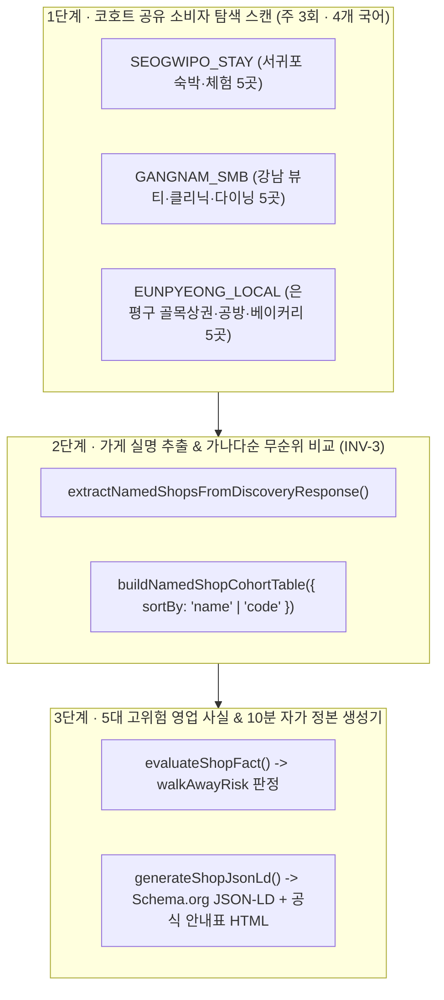
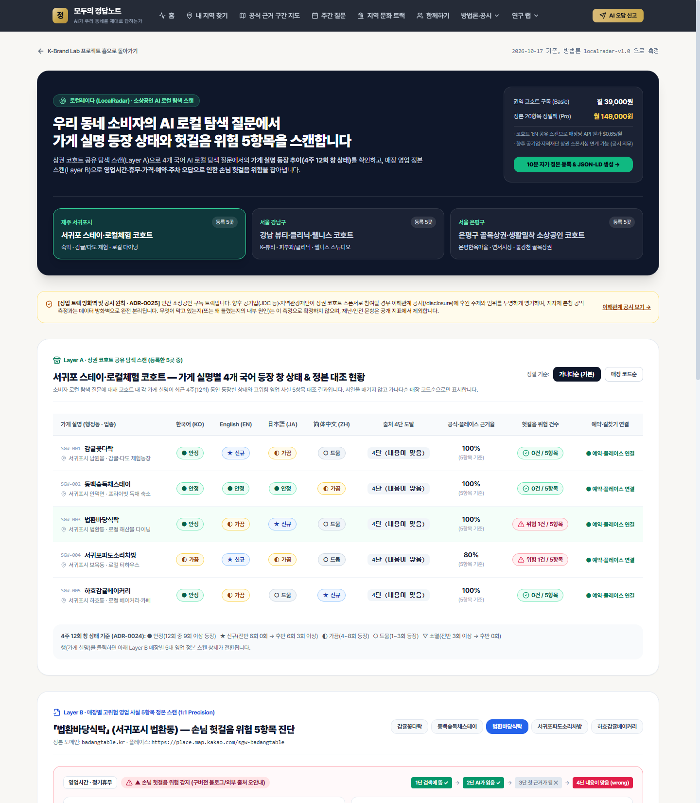
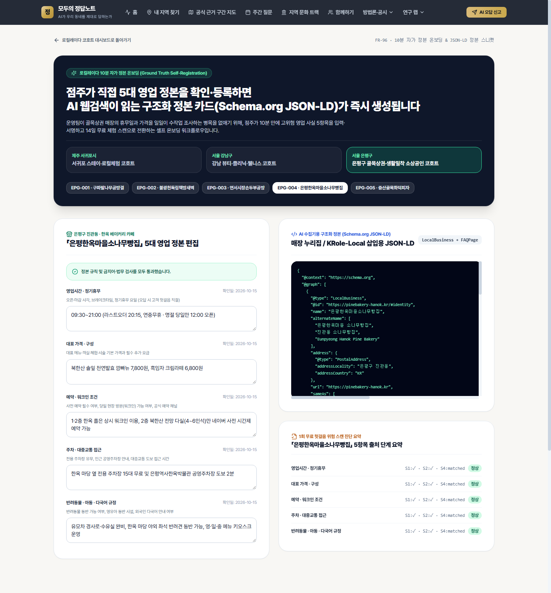

# Part 6 · 로컬레이다 (LocalRadar · 소상공인 AI 로컬 탐색 스캔) 통합 매뉴얼 — 기능 명세 · 사용자 가이드 · 운영자 가이드

이 문서는 지역 소상공인·골목상권을 위한 **로컬레이다 (LocalRadar · 소상공인 AI 로컬 탐색 스캔)** 서브시스템의 **기능 명세(Functional Spec)**, **사용자 가이드(소상공인 사장님·상권 매니저용)**, **운영자 가이드(슈퍼어드민 `ops_admin`용)** 를 통합한 정본 매뉴얼입니다.

- **관련 요구사항**: `FR-93` ~ `FR-96` ([docs/PRD.md](../PRD.md))
- **관련 ADR**: [ADR-0025](../adr/0025-local-radar-smb-discovery-track.md) (로컬레이다 3대 상권 코호트 탐색 스캔 및 공익 방화벽 분리)
- **관련 골디락스 전략 아티팩트**: `smb-goldilocks-strategy.md`

---

## 1. 기능 명세 (Functional Specification)

### 1.1 시스템 개요 및 골디락스(Goldilocks) 설계 원리

개별 소상공인 매장을 단독 문항으로 매일 측정하면 API 호출 원가가 과도해지고, 실제 소비자의 AI 검색 행동("은평구 한옥마을 근처 아이랑 갈 만한 빵집 추천해줘")과도 괴리됩니다. 로컬레이다는 다음 **2단 하이브리드 구조**로 원가 효율과 실용 가치를 동시에 달성합니다:

1. **코호트 공유 소비자 탐색 스캔 (Cohort-Shared Discovery Scan)**
   - 권역·업종별 코호트 단위로 다국어(한국어·영어·일본어·중국어 간체) 소비자 탐색 질문을 주 3회(월·수·금) 실행하고, 응답에 등장한 코호트 소속 모든 매장의 **등장 빈도(4주 12회 창 상태)** 와 **출처 1~3단(`s1` 검색 후보 · `s2` 인용 · `s3` 첫 인용)** 을 한 번에 추출합니다.
2. **매장별 5대 고위험 영업 사실 & 헛걸음 위험(`walkAwayRisk`) 점검**
   - 소비자가 잘못 알고 방문했을 때 가장 큰 불만과 피해(헛걸음·결제 분쟁)를 유발하는 **5대 핵심 영업 사실**만 정본 대장과 대조합니다.



---

### 1.2 웹 라우트 · API · 코어 모듈 · DB 명세

| 구분 | 경로 / 파일 | 설명 및 적용 불변식 |
|---|---|---|
| **상권 스캔 대시보드** | `/kbrandlab/local` ([page.tsx](../../app/%28org%29/kbrandlab/local/page.tsx)) | 3대 상권 코호트 탭, 공유 탐색 질문별 가게 실명 가나다순 비교 표(`INV-3`), 4주 12회 창 상태(`신규`·`안정`·`가끔`·`드묾`·`소멸`), 매장별 5대 영업 사실 헛걸음 위험 점검 |
| **10분 자가 정본 온보딩** | `/kbrandlab/local/onboarding` ([page.tsx](../../app/%28org%29/kbrandlab/local/onboarding/page.tsx)) | 매장 기본 정보 및 5대 영업 사실 입력, 의료법 준수 필터, Schema.org JSON-LD (`Restaurant`/`LodgingBusiness`/`MedicalClinic` + `FAQPage`) 및 복사용 HTML 스니펫 즉시 생성(`FR-96`) |
| **로컬레이다 API** | `GET / POST /api/kbrandlab/local/scan` ([route.ts](../../app/api/kbrandlab/local/scan/route.ts)) | 코호트별 가게 실명 비교 표 조회(`sortBy`에 점수 계열 파라미터 전달 시 400 거부 `INV-3`) 및 매장 자가 정본 검증·JSON-LD 생성 |
| **도메인 모듈** | [types.ts](../../lib/kbrandlab/local/types.ts), [constants.ts](../../lib/kbrandlab/local/constants.ts), [shop-matcher.ts](../../lib/kbrandlab/local/shop-matcher.ts), [fact-scanner.ts](../../lib/kbrandlab/local/fact-scanner.ts), [jsonld-generator.ts](../../lib/kbrandlab/local/jsonld-generator.ts) | 코호트·매장 시드(서귀포 5·강남 5·은평구 5 총 15곳), 동명이인 구분 토큰 매칭, 5대 사실 대조, JSON-LD 생성기 |
| **DB 마이그레이션** | [20261017000003_local_radar_smb_core.sql](../../supabase/migrations/20261017000003_local_radar_smb_core.sql) | `kbl_local_cohorts`, `kbl_local_shops`, `kbl_local_canonical_facts`, `kbl_local_discovery_probes`, `kbl_local_scan_runs`, `kbl_local_shop_mentions`, `kbl_local_fact_checks` (공익 `probe_*`/`units` 테이블과 FK 0개 `INV-17`) |

---

### 1.3 5대 고위험 영업 사실 (`HIGH_RISK_FACT_DEFINITIONS`) 명세

| 코드 (`factKey`) | 항목명 | 주요 헛걸음·피해 위험 사례 |
|---|---|---|
| `hours_holiday` | **영업시간 · 정기휴무 · 브레이크타임** | 화요일 정기휴무인데 AI가 "연중무휴"로 답해 소비자가 헛걸음함 |
| `price_menu` | **대표 메뉴 · 객실 · 시술 기본 가격** | 구버전 블로그의 3년 전 가격이나 타 매장 가격을 안내해 현장 결제 분쟁 발생 |
| `booking_method` | **예약 방법 · 워크인 가능 여부 · 취소 규정** | 100% 사전예약제 공방인데 "당일 현장 방문 가능"으로 오안내함 |
| `parking_access` | **주차 가능 여부 · 발렛 · 대중교통 접근성** | 주차 불가 골목 매장인데 "전용 주차장 무료 이용"으로 창작 응답함 |
| `pet_kids_policy` | **반려동물 · 영유아 동반 · 외국어 응대 규정** | 반려견 동반 불가 식당인데 "애견 동반 가능"으로 잘못 추천함 |

---

## 2. 사용자 가이드 (User Guide — 소상공인 사장님 및 상권 담당자용)

### 2.1 내 상권 코호트에서 우리 가게 AI 탐색 현황 확인하기 (`/kbrandlab/local`)



1. **상권 코호트 선택**
   - `/kbrandlab/local` 에 접속하여 상단 3대 상권 탭 중 내 매장이 속한 코호트를 선택합니다:
     - **서귀포 숙박·로컬체험 코호트 (`SEOGWIPO_STAY`)**
     - **강남 뷰티·클리닉·다이닝 코호트 (`GANGNAM_SMB`)**
     - **은평구 골목상권·공방·베이커리 코호트 (`EUNPYEONG_LOCAL`)**
2. **코호트 내 가게 실명 비교 표 읽는 법**
   - 표의 모든 가게는 점수가 아닌 **가나다순(또는 매장 코드순)** 으로만 정렬됩니다(`INV-3`).
   - 각 가게의 **최근 4주 12회 창 상태 배지(`안정` · `신규` · `가끔` · `드묾`)** 와 **공식 정본 인용 단계(`S1 검색포착` · `S2 인용` · `S3 첫인용`)** 를 확인합니다.
   - 다국어 탭(`한국어 ko`, `영어 en`, `일본어 ja`, `중국어 간체 zh-Hans`)을 전환하여 외국인 관광객 질문에서 내 가게가 어떻게 소개되는지 비교할 수 있습니다.
3. **우리 가게 5대 영업 사실 헛걸음 위험 점검**
   - 가게를 클릭하면 우측 상세 패널에 **5대 영업 사실(영업시간·가격·예약·주차·동반규정)** 별 정본 값과 AI 응답 대조 결과가 표시됩니다.
   - `헛걸음 위험 감지 (walkAwayRisk)` 경고가 뜬 항목은 홈페이지·스마트플레이스·인스타그램 고정 게시물에 텍스트 정본이 빠져 있거나 예전 블로그 글이 AI에 먼저 읽히고 있다는 신호입니다.

---

### 2.2 10분 자가 정본 등록 및 JSON-LD 코드 복사하기 (`/kbrandlab/local/onboarding`)



1. `/kbrandlab/local` 우측 상단의 **`10분 자가 정본 & JSON-LD 생성기`** 버튼(또는 `/kbrandlab/local/onboarding`)을 클릭합니다.
2. 매장 이름, 업종 구분, 동네/역세권 구분 토큰(예: `은평한옥마을`, `연신내역`), 공식 URL을 입력합니다.
3. 5대 영업 사실 입력란에 **현재 정확한 영업시간·정기휴무, 대표 메뉴/가격, 예약 방법, 주차 안내, 반려동물·유아 동반 규정**을 한 줄씩 입력합니다.
4. **강남 뷰티·클리닉(의료기관) 주의사항**:
   - `의료법 준수 대상(병의원·클리닉)` 체크박스를 켜면, 입력 문구에 `"100% 완치 보장"`, `"무통증 보장"`, `"최고 명의"` 같은 의료법상 금지된 치료 효과 단정·비교 표현이 포함될 경우 자동으로 경고를 띄우고 생성을 차단합니다.
5. 검사를 통과하면 우측에 자동 생성된 **Schema.org JSON-LD 스크립트(`<script type="application/ld+json">...`)** 와 **공식 영업 정본 HTML 표**를 복사하여 내 가게 홈페이지·워드프레스·아임웹 헤더나 공지사항 본문에 붙여넣습니다.

---

## 3. 운영자 가이드 (Operator Guide — 슈퍼어드민 `ops_admin`용)

### 3.1 주간 코호트 탐색 스캔 CLI 실행 및 감시

터미널에서 아래 명령으로 3대 코호트 15개 매장에 대한 탐색 스캔과 5대 사실 평가를 일괄 실행하고 검증할 수 있습니다:

```powershell
# 로컬레이다 3대 코호트(서귀포·강남·은평구) 15개 매장 전체 탐색 스캔 및 JSON-LD 무결성 검증
pnpm localradar:scan
```

- 실행 시 각 코호트별 가나다순 가게 실명 비교 결과, 5대 영업 사실 헛걸음 위험 건수, JSON-LD `@graph` 생성 결과가 콘솔에 출력됩니다.

### 3.2 준공공·지역재단·상권활성화재단 스폰서십 공시 관리

- 로컬레이다는 소상공인 자부담(이코노미 분기 15,000원 / 정밀팩 분기 29,000원)뿐 아니라 **향후 지방공기업·지역재단·상권활성화재단의 코호트 스폰서십**을 지원합니다(`ADR-0025` 결정 1).
- 단, 스폰서십 적용 시 반드시 `kbl_local_cohorts` 테이블의 `sponsor_status` (`'foundation_sponsored'` 또는 `'public_corp_sponsored'`), `sponsor_org_name`, `disclosure_note` 를 설정하여 화면 상단에 후원 기관과 공익 측정(`모두의 정답노트` 지자체 평가)과의 무관함을 투명하게 공시해야 합니다(`INV-17`).

### 3.3 방화벽 및 불변식 자동 검증

```powershell
# 로컬레이다 방화벽 및 무순위·의료법 준수 불변식 테스트 단독 확인을 포함한 전체 스위트 실행
pnpm test:invariants
```

- [tests/invariants/firewall-commercial.test.ts](../../tests/invariants/firewall-commercial.test.ts)가 `lib/kbrandlab/local/**` 및 `app/(org)/kbrandlab/local/**` 의 모든 파일을 정적 스캔하여 공익 테이블(`probe_runs`, `probe_judgments`, `observe_*`) 참조가 0건인지 자동 검증합니다.
