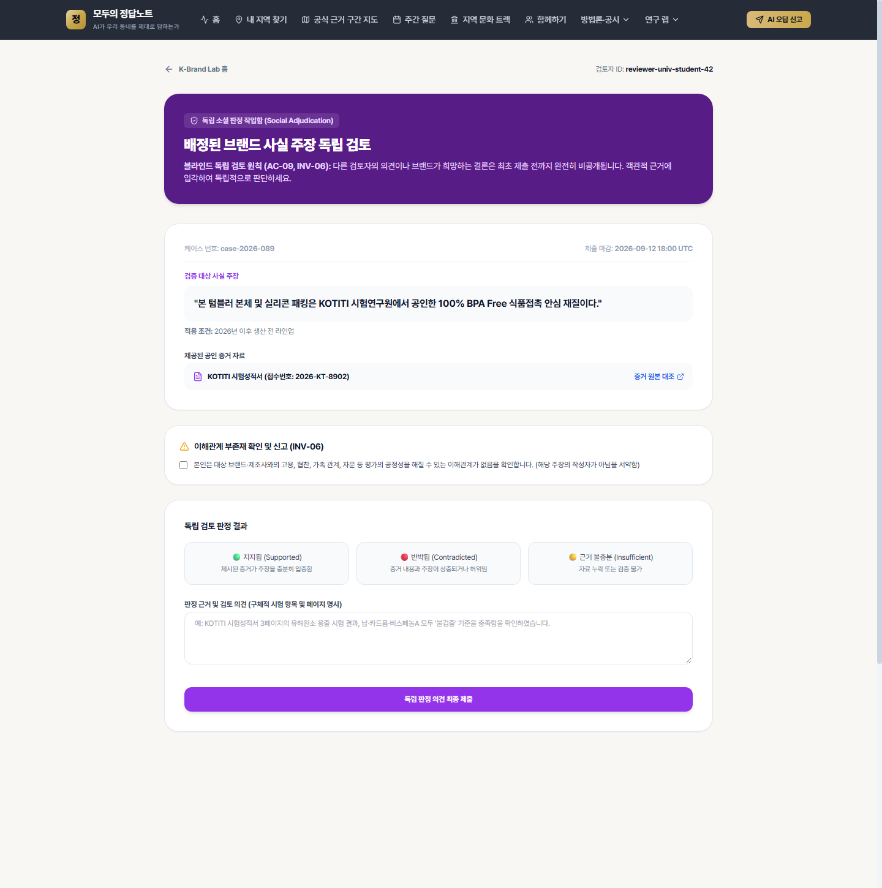
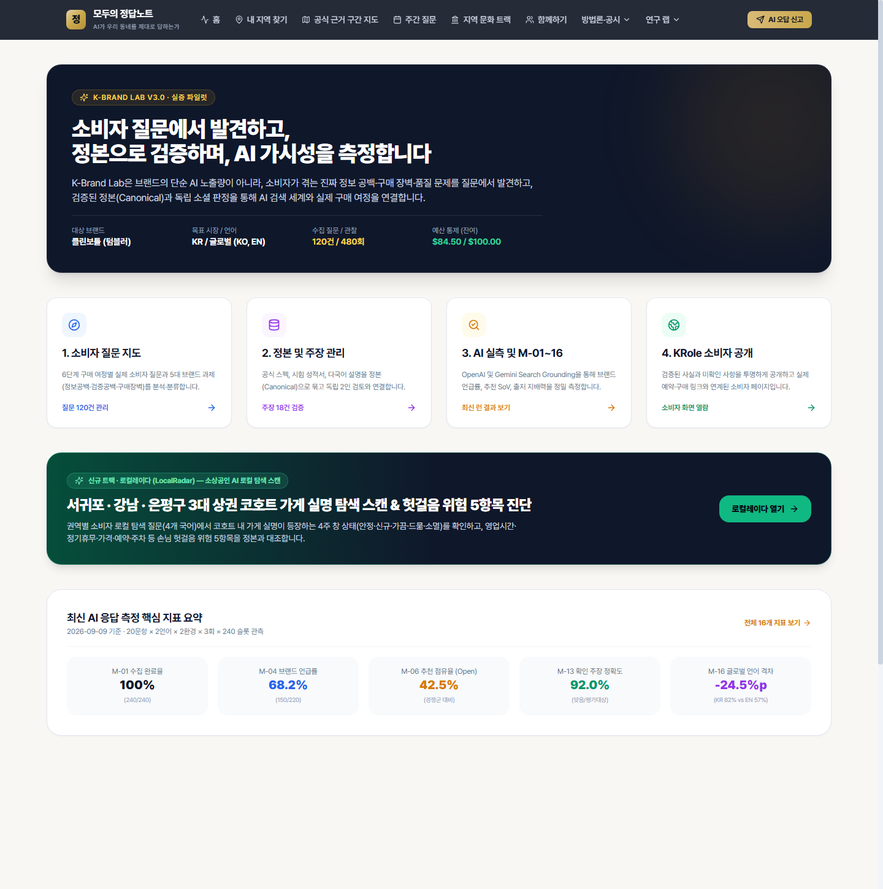
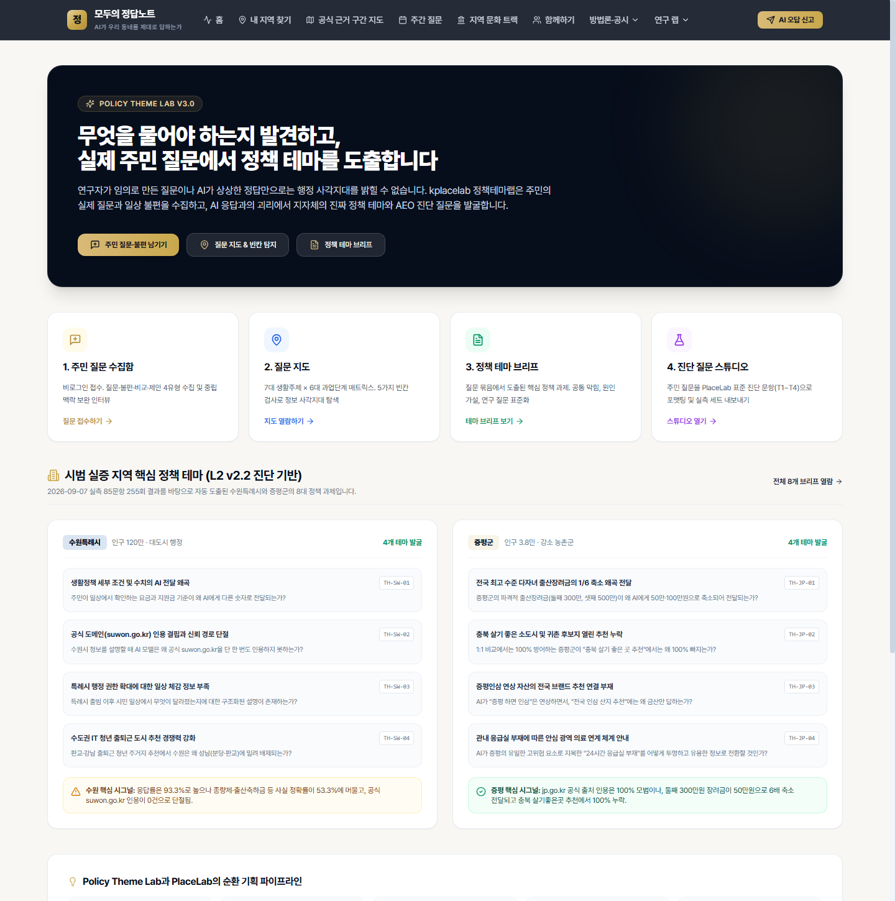
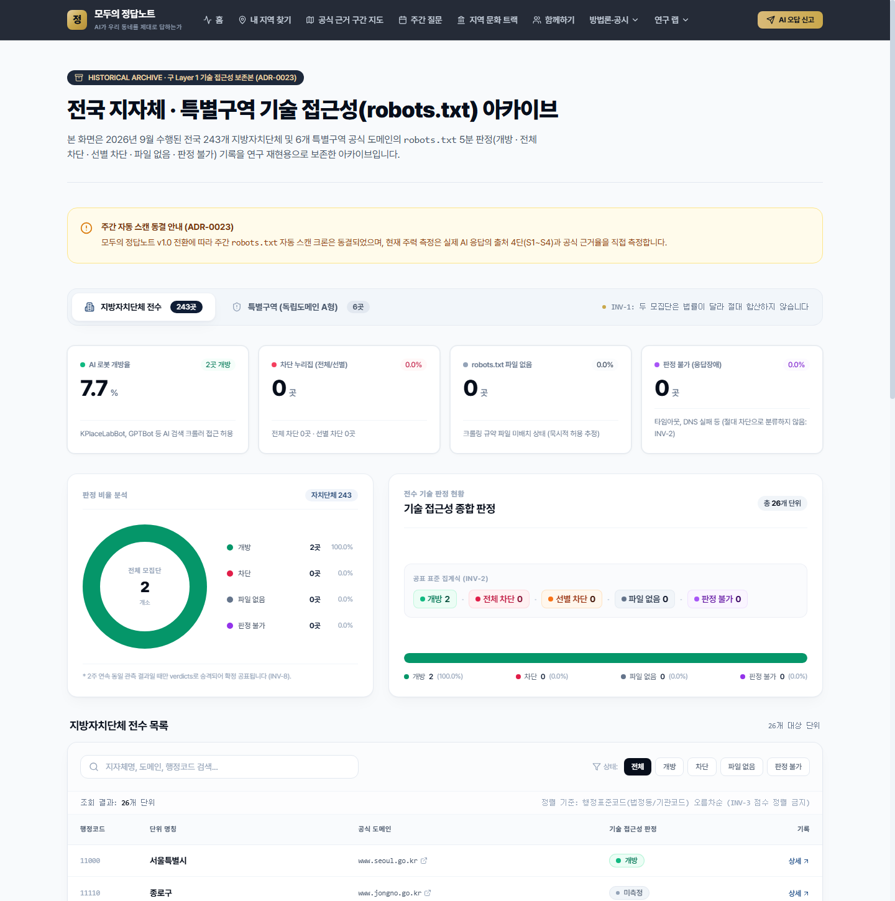

# Part 7 · 통제 측정 파이프라인 및 위성 모듈 통합 매뉴얼 — 기능 명세 · 사용자 가이드 · 운영자 가이드

이 문서는 모노레포 내에 구현된 **통제 측정 파이프라인(Measurement-Spec & OpenAI Web Search 수집기)**, **K-Brand Lab**, **Policy Theme Lab**, **시민 크라우드소싱 신고판(Floor Hunter)**, **기술 접근성 보존 연구소(Layer 1 아카이브)**, 그리고 **단일 인증·자체 준수 인프라**에 대한 **기능 명세 · 사용자 가이드 · 운영자 가이드**를 정리한 정본 매뉴얼입니다.

---

## 1. 통제 측정 파이프라인 (Measurement-Spec & OpenAI Web Search 수집기)

### 1.1 기능 명세 (Functional Spec)
- **관련 문서·ADR**: [docs/measurement-spec/README.md](../measurement-spec/README.md), [ADR-0011](../adr/0011-grounding-first-source-analysis.md), [ADR-0012](../adr/0012-openai-web-search-condition.md)
- **핵심 모듈**:
  - [collector-websearch.ts](../../lib/measurement/collector-websearch.ts): OpenAI Responses API (`tools: [{ type: 'web_search' }]`, `include: ['web_search_call.action.sources']`)를 사용하여 시스템 프롬프트(`instructions`) 없이 원문 질문을 전송하고(`INV-13`), 1단 검색 후보 전체와 2단 본문 인용을 분리 수집합니다. 검색 도구 호출 여부에 따라 `on_verified`, `off`, `unverified` 라벨을 부여합니다.
  - [extractor.ts](../../lib/measurement/extractor.ts), [verifier.ts](../../lib/measurement/verifier.ts), [grid-analyzer.ts](../../lib/measurement/grid-analyzer.ts), [output-generator.ts](../../lib/measurement/output-generator.ts): 수집(`ResponseRecord`) → 추출(`Observation`) → 정본 검증(`Verdict`, 부정합 코드 `C1~C4` / 무응답 코드 `N1~N4`) → 질문-주체 격자(`Grid`, 최소 셀 크기 `min_cell_size` 보호) → 5절 표준 산출물 생성까지 4단계 파이프라인을 수행합니다.
- **웹 화면 및 API**:
  - `/measure` ([page.tsx](../../app/%28public%29/measure/page.tsx)), `/reviewer/adjudication` ([page.tsx](../../app/%28public%29/reviewer/adjudication/page.tsx)) — 모두 `OPS_ROLES` 보호 경로로 설정되어 운영자만 접근 가능합니다.
  - `/api/measure/{start,run,spec,status/[id],stream/[jobId],report/[id]}` — 측정 잡 실행 및 SSE 실시간 진행률 스트리밍.

### 1.2 사용자(내부 연구자·판정관) 가이드



1. **측정 실행 (`/measure`)**: `ops_measure` 또는 `ops_admin` 계정으로 로그인 후 `/measure` 에서 대상 프로젝트(예: 구로구 232문항 `run_profile`)를 선택하고 실행 상태를 SSE 스트림으로 모니터링합니다.
2. **판정 심판소 (`/reviewer/adjudication`)**: 규칙 판정기(`judged_by = 'rule'`)에서 유보되었거나 경합이 발생한 관측 건을 열람하여 부정합 사유 코드(`C1` 수치 불일치, `C2` 조건 누락, `C3` 구버전, `C4` 타 기관 혼동)와 귀책(`canon_absent` 정본 부재 vs 모델 오류)을 최종 판정합니다.

### 1.3 운영자 가이드 (`ops_admin`)
```powershell
# 1. measurement-spec JSON 스키마 및 코드표/등록부 무결성 검증 (Python 검증기)
pnpm lint:spec

# 2. 문항 JSON과 DB/타입 동기화 검증
pnpm sync:questions
pnpm verify:types
```
- **RunGuard 중단 규칙**: 수집 도중 API 오류율이 임계치를 넘거나 `web_search` 라벨이 `unverified` 로 떨어지면 즉시 런을 중단하고 `data/registries/condition_label_errata.json` 정오표 규칙을 확인하십시오(`ADR-0012`).

---

## 2. K-Brand Lab (민간 기업 브랜드 여정·이슈 매트릭스 진단)

### 2.1 기능 명세 (Functional Spec)
- **관련 요구사항**: `FR-76` ~ `FR-80` ([docs/PRD.md](../PRD.md))
- **웹 화면**: `/kbrandlab` ([page.tsx](../../app/%28org%29/kbrandlab/page.tsx)), `/kbrandlab/brands/[id]` ([page.tsx](../../app/%28org%29/kbrandlab/brands/%5Bid%5D/page.tsx))
- **코어 모듈 (`lib/kbrandlab/**`)**:
  - [journey-classifier.ts](../../lib/kbrandlab/questions/journey-classifier.ts), [issue-classifier.ts](../../lib/kbrandlab/questions/issue-classifier.ts), [probe-builder.ts](../../lib/kbrandlab/questions/probe-builder.ts): 소비자 구매 여정(탐색·비교·검증·구매후) × 브랜드 리스크 이슈 매트릭스 기반 프로브 생성
  - [adapter-registry.ts](../../lib/kbrandlab/adapters/adapter-registry.ts): OpenAI 및 Gemini Search Grounding 어댑터 레지스트리
  - [metrics.ts](../../lib/kbrandlab/analysis/metrics.ts): 브랜드 언급·출처 귀속·오정보 위험 분포 산출
- **DB 스키마**: [20260910000021_kbrandlab_core.sql](../../supabase/migrations/20260910000021_kbrandlab_core.sql)

### 2.2 사용자 가이드 (`LAB_ROLES` 브랜드 담당자용)



1. `/kbrandlab` 에 접속하여 등록된 브랜드 프로젝트를 선택합니다.
2. 구매 여정 단계별 AI 응답의 공식 출처 인용 비율과 허위·과장 리스크 항목을 확인하고, 소상공인·로컬 매장 트랙이 필요한 경우 상단 배너를 통해 **로컬레이다(`/kbrandlab/local`)** 또는 **MAPS 스튜디오(`/studio`)** 로 이동합니다.

### 2.3 운영자 가이드 (`ops_admin`)
```powershell
# K-Brand Lab 단위 테스트 스위트 실행
pnpm test:kbrandlab
```

---

## 3. Policy Theme Lab (시민 질문 수집 및 정책 이슈 테마 발굴)

### 3.1 기능 명세 (Functional Spec)
- **관련 요구사항**: `FR-60` ~ `FR-68` ([docs/PRD.md](../PRD.md))
- **웹 화면**:
  - `/theme-lab` ([page.tsx](../../app/%28public%29/theme-lab/page.tsx)): 정책 테마 랩 메인 대시보드
  - `/theme-lab/submit` ([page.tsx](../../app/%28public%29/theme-lab/submit/page.tsx)): 시민 생활정책 질문 제안 및 AI 후속 질문 생성
  - `/theme-lab/map` ([page.tsx](../../app/%28public%29/theme-lab/map/page.tsx)): 생활영역별 질문 분포 지형도
  - `/theme-lab/themes` ([page.tsx](../../app/%28public%29/theme-lab/themes/page.tsx)): 발굴된 정책 테마 카탈로그
  - `/theme-lab/studio` ([page.tsx](../../app/%28public%29/theme-lab/studio/page.tsx)): 시민 질문을 측정용 표준 프로브 문항으로 정제·승격하는 스튜디오
- **코어 모듈 (`lib/theme-lab/**`)**: [context-enricher.ts](../../lib/theme-lab/context-enricher.ts), [followup-generator.ts](../../lib/theme-lab/followup-generator.ts), [seed-data.ts](../../lib/theme-lab/seed-data.ts)
- **API & 스크립트**: `POST /api/theme-lab/submissions` ([route.ts](../../app/api/theme-lab/submissions/route.ts)), [export-probes.ts](../../scripts/theme-lab/export-probes.ts)
- **DB 스키마**: [20260907000020_policy_theme_lab.sql](../../supabase/migrations/20260907000020_policy_theme_lab.sql)

### 3.2 사용자 가이드 (시민 제안자용)



1. `/theme-lab/submit` 에서 평소 AI에게 물어봤다가 부정확한 답을 들었거나 꼭 측정해 주길 바라는 생활행정 질문을 입력합니다.
2. 자동 생성된 후속 맥락 질문(대상 연령, 거주 지역 성격 등)을 선택해 제출하면 `/theme-lab/themes` 의 후보 테마에 집계됩니다.

### 3.3 운영자 가이드 (`ops_admin`)
1. `/theme-lab/studio` 에서 시민이 제출한 질문 중 개인정보가 없고 정본(법령·조례·공고문) 확인이 가능한 문항을 선별합니다.
2. 선별된 문항은 **바로 공표 집계에 넣지 않고(`INV-4`, `INV-10`)**, 정본(`facts`) 및 답안지 연결과 파일럿 강건성 검사를 거친 뒤 차기 사전 등록 문항 세트로 내보냅니다(`scripts/theme-lab/export-probes.ts`).

---

## 4. 시민 크라우드소싱 신고판 & 승격 엔진 (Floor Hunter)

### 4.1 기능 명세 (Functional Spec)
- **관련 요구사항**: `FR-69` ~ `FR-75` ([docs/PRD.md](../PRD.md))
- **불변식**: `INV-4` (자발적 시민 제보를 전국 공식 지표와 절대 합산하지 않으며 `"참여·제보된 N건 중..."` 분모로만 표기), `INV-6` (검수 전 원문 비공개), `INV-18` (범위 제외 대상 접수 차단)
- **웹 화면 및 API**:
  - 시민 제보 입력: `/report` ([page.tsx](../../app/%28public%29/report/page.tsx)), `POST /api/report` ([route.ts](../../app/api/report/route.ts))
  - 시민 제보 공개 현황판: `/dashboard/reports` ([page.tsx](../../app/%28public%29/dashboard/reports/page.tsx)), `GET /api/report/aggregate` ([route.ts](../../app/api/report/aggregate/route.ts))
  - 운영자 검수 및 문항 승격 콘솔: `/admin/reports` ([page.tsx](../../app/%28admin%29/admin/reports/page.tsx)), `/admin/promotions` ([page.tsx](../../app/%28admin%29/admin/promotions/page.tsx)), `/api/admin/reports`, `/api/admin/promotions`
- **코어 모듈**: [report-aggregator.ts](../../lib/crowdsource/report-aggregator.ts), [promotion-engine.ts](../../lib/crowdsource/promotion-engine.ts)
- **DB 스키마**: [20260915000002_create_citizen_reports.sql](../../supabase/migrations/20260915000002_create_citizen_reports.sql)

### 4.2 사용자 가이드 (시민 제보자용)
- `/join` 또는 `/report` 에서 AI 오답 사례를 제보할 때 주민등록번호·전화번호 등 개인정보를 넣지 마십시오.
- 정부 정책 찬반 입장, 재난·응급 실시간 상황, 개별 영리 업소 분쟁은 접수 단계에서 자동 안내와 함께 제외됩니다(`INV-18`).

### 4.3 운영자 가이드 (`ops_admin`)
- `/admin/reports` 에서 접수된 제보의 개인정보 마스킹 여부를 검수하고, 동일 주제 제보가 임계치 이상 누적되면 `/admin/promotions` 에서 공식 측정 후보 문항으로 승격 심사합니다.

---

## 5. 기술 접근성 보존 연구소 (Layer 1 `robots.txt` 아카이브)

### 5.1 기능 명세 (Functional Spec)
- **관련 ADR**: [ADR-0001](../adr/0001-scanner-runtime.md), [ADR-0003](../adr/0003-four-way-verdict.md), [ADR-0023](../adr/0023-retire-l1-robots-scan.md) (Layer 1 주간 스캔 동결 및 아카이브 보존)
- **웹 화면**: `/labs/tech-access` ([page.tsx](../../app/%28public%29/labs/tech-access/page.tsx)), `/units` ([page.tsx](../../app/%28public%29/units/page.tsx)), `/scans` ([page.tsx](../../app/%28admin%29/scans/page.tsx))
- **핵심 규칙 (`INV-2`, `INV-5`)**:
  - `robots.txt` 판정은 4분류(`open`, `blocked_all`, `blocked_selective`, `no_file`)와 `undetermined`(`undetermined_reason` 필수 동반)로 분리 보존합니다.
  - `20261017000001_freeze_l1_scan_cron.sql` 마이그레이션으로 주간 정기 스캔 크론은 동결되었으며, 과거 시계열 데이터는 연구·열람용 아카이브로 영구 보존됩니다.

### 5.2 사용자 및 운영자 가이드



- 일반 사용자는 `/labs/tech-access` 에서 보존된 기술 접근성 분포를 모집단별(`광역` · `기초` · `특별구역`)로 분리해 열람할 수 있습니다(`INV-1`).
- 운영자는 Layer 1 보존 데이터를 AI 응답 품질의 직접적 원인으로 단정하는 문구를 작성하지 않도록 주의하십시오(`docs/EVIDENCE.md` `C-8` 준수).

---

## 6. 단일 보호 경로 인가(`route-policy.ts`) 및 자체 준수(`Self-Compliance`) 인프라

### 6.1 기능 명세
- **인증·인가 정책**: [roles.ts](../../lib/auth/roles.ts), [route-policy.ts](../../lib/auth/route-policy.ts), [middleware.ts](../../middleware.ts)
  - 모든 `app/(admin)/**/page.tsx`, `app/(org)/**/page.tsx` 및 관리/조직 API는 `ROUTE_POLICIES` 에 등록되어야 하며, 누락 시 [route-guard.test.ts](../../tests/invariants/route-guard.test.ts)가 즉시 실패합니다.
- **자체 준수 (`AGENTS.md` §7)**:
  - [app/robots.ts](../../app/robots.ts): 모든 수집기(`User-agent: *`)에 대해 공개 경로를 개방(`Allow: /`)하고 `Sitemap` 을 선언합니다.
  - [app/sitemap.ts](../../app/sitemap.ts): `/`, `/regions`, `/maps`, `/weekly`, `/culture`, `/studio` 등 모든 공개 경로를 포함합니다.
  - 모든 `app/(public)/**/page.tsx` 는 유효한 `application/ld+json` 구조화 데이터를 포함하며 [self-compliance.test.ts](../../tests/invariants/self-compliance.test.ts)가 이를 전수 검사합니다.

### 6.2 운영자 가이드 (`ops_admin`)
새 페이지나 API를 추가할 때는 반드시 아래 두 가지를 체크하십시오:
1. `app/(public)` 하위에 새 공개 페이지를 만들었다면 `<script type="application/ld+json">` 을 포함하고 `app/sitemap.ts` 에 경로를 추가하십시오.
2. `app/(org)` 또는 `app/(admin)` 하위에 새 보호 페이지를 만들었다면 `lib/auth/route-policy.ts` 의 `ROUTE_POLICIES` 에 경로와 허용 역할(`OPS_ROLES`, `GOV_ROLES`, `LAB_ROLES`, `CLIENT_ROLES`)을 추가한 뒤 `pnpm test:invariants` 를 실행하십시오.
