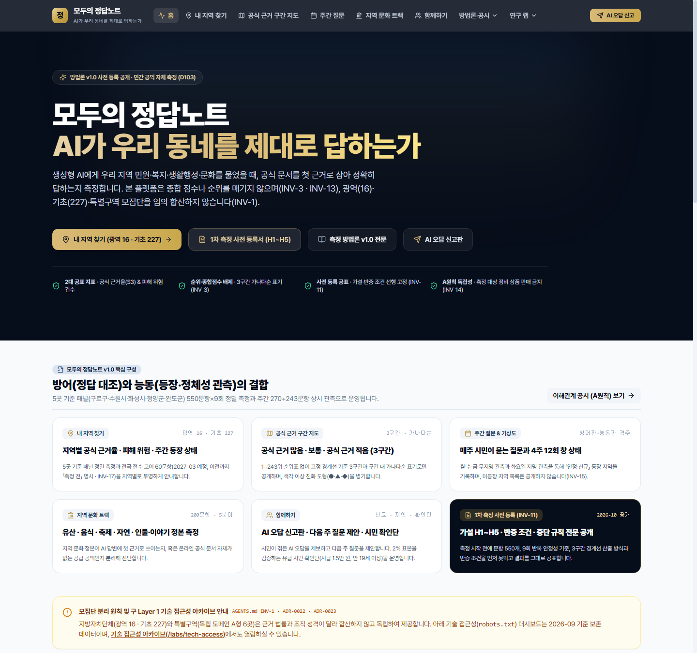

# 모두의 정답노트 (Jeongdap Note) — 슈퍼어드민(`ops_admin`) 통합 E2E 매뉴얼

이 디렉터리(`docs/guide/`)는 **모두의 정답노트(구 kplacelab)** 의 슈퍼어드민(`ops_admin`)이 제품의 전체 작동 원리를 이해하고, 로컬·스테이징·운영 환경에서 직접 **End-to-End(E2E) 검증과 운영 통제**를 수행할 수 있도록 구성된 정본 매뉴얼입니다.



---

## 문서 구성 (8대 파트 + 실제 워크스루 스크린샷 갤러리)

| 순서 | 문서 파일 | 목적 및 핵심 내용 |
|---|---|---|
| **Part 1** | [`01-mental-model.md`](./01-mental-model.md) | **정신 모델 (Mental Model)**<br/>모두의 정답노트를 관통하는 5대 기둥(정본 대조, 출처 4단 + 공급 공백 이중 분모, 9회 블록 안정성 & 4주 12회 창 상태, 3구간 무순위 지도 & 공표 시점 게이트, A원칙 이해충돌 방지)과 18대 절대 불변식(`INV-1`~`INV-18`), 전체 데이터·권한 흐름도 |
| **Part 2** | [`02-functional-spec.md`](./02-functional-spec.md) | **모두의 정답노트 기능 명세 (Functional Specification)**<br/>전체 라우트(공개 13종 · 포털 `/portal` · 운영 콘솔 `/ops` · 보존 아카이브 `/labs/tech-access`), 신규 API 11종 입출력 스키마·상태 코드, 도메인 모듈(`lib/jeongdap/*`) 14종, DB 마이그레이션 및 RLS/방화벽 명세 |
| **Part 3** | [`03-e2e-tutorial.md`](./03-e2e-tutorial.md) | **슈퍼어드민 직접 실행 E2E 튜토리얼 (실제 화면 캡처 포함)**<br/>슈퍼어드민 권한(`ops_admin`) 부여부터 CLI 골든 테스트, 브라우저 화면 12종 전수 워크스루 캡처 대조, 시민 참여 3종(신고·제안·투표), 기관 포털 사건 등록(+2/+6주 재측정 예약), 운영 콘솔 중단 규칙·감사 큐, 2027-03 실명 공개 전환 시뮬레이션까지 단계별 실습 |
| **Part 4** | [`04-feature-guide.md`](./04-feature-guide.md) | **모두의 정답노트 기능별 운영 가이드 & 레퍼런스 (Feature Guide)**<br/>0단계·정기 측정 실행, 출처 4단 판정 & 인용 페이지 수집기(`robots.txt` 준수), 주간 상시 관측 & 지명 사전(인천 개편·광주 서구 동명 처리), 페이지 단위 이중차분(DiD 30건·10곳 게이트), 시민 확인단 2% 검수, 트러블슈팅 치트시트 |
| **Part 5** | [`05-maps-studio-manual.md`](./05-maps-studio-manual.md) | **MAPS 스튜디오 (MAPS Studio) 통합 매뉴얼 — 기능 명세 · 사용자 가이드 · 운영자 가이드**<br/>3-Lane 아키텍처(`/studio` · `/workspace` · `/ops/maps`), 이원 시간(`as-of`) 정본 대장, 관측 시점 6분류 판정(`asserted` 분리 `MAPS-INV-20`), `G1~G6` 간극 & 6단계 소거 처방전(`P1~P6`), 대조군 동반 Proof(DiD) & 카나리아 드리프트 분리, 결제 격리(`maps_billing_*`) 및 20대 MAPS 불변식 |
| **Part 6** | [`06-local-radar-manual.md`](./06-local-radar-manual.md) | **로컬레이다 (LocalRadar · 소상공인 AI 로컬 탐색 스캔) 통합 매뉴얼 — 기능 명세 · 사용자 가이드 · 운영자 가이드**<br/>3대 상권 코호트(서귀포·강남·은평구) 다국어 공유 탐색 스캔, 가게 실명 가나다순 무순위 비교(`INV-3`), 5대 고위험 영업 사실 헛걸음 위험(`walkAwayRisk`) 진단, 10분 자가 정본 & Schema.org JSON-LD 생성기 |
| **Part 7** | [`07-satellite-and-infra-manual.md`](./07-satellite-and-infra-manual.md) | **통제 측정 파이프라인 & 위성 모듈 통합 매뉴얼 — 기능 명세 · 사용자 가이드 · 운영자 가이드**<br/>Measurement-Spec 4단계 파이프라인 & OpenAI Web Search 수집기(`ADR-0012`), K-Brand Lab, Policy Theme Lab, 시민 신고판(Floor Hunter), 기술 접근성 보존 연구소(`ADR-0023`), 단일 보호 경로 인가(`route-policy.ts`) 및 자체 준수 인프라 |
| **Part 8** | [`08-all-artifacts-master-reference.md`](./08-all-artifacts-master-reference.md) | **전체 서비스 아티팩트 전수 마스터 레퍼런스 (총괄 매트릭스)**<br/>모노레포 내 모든 화면·API·도메인 모듈·DB 스키마·CLI·테스트 아티팩트별 ① 기능 명세, ② 사용자 가이드 핵심 행동, ③ 운영자(`ops_admin`) 통제 포인트를 한눈에 대조하는 총괄표 |

---

## 캡처된 E2E 워크스루 스크린샷 목록 (`docs/guide/screenshots/`)

| 파일명 | 대상 경로 | 검증 포인트 요약 |
|---|---|---|
| [`00-login-guard.png`](./screenshots/00-login-guard.png) | `/portal` · `/ops` (비로그인 접근 시) | `SEC-0`: 미인증 상태에서 보호 경로 접근 시 `/login` 리다이렉트 가드 작동 |
| [`01-home.png`](./screenshots/01-home.png) | `/` | 브랜드 홈, `INV-1`·`INV-3`·`INV-11`·`INV-14` 핵심 원칙 배지 및 6대 트랙 진입점 |
| [`02-maps.png`](./screenshots/02-maps.png) | `/maps` | 3구간(`● 공식 근거 많음` / `▲ 보통` / `◆ 공식 근거 적음` 가나다순 `INV-3`) & 12분야 AI 추천 지도(`INV-15`) & 2027-03 공표 게이트(`INV-17`) |
| [`03-weekly.png`](./screenshots/03-weekly.png) | `/weekly` | 주간 질문 지도(방어·능동 격주 교대) 및 최근 4주 12회 창 상태(`안정`·`신규`) 기상도 |
| [`04-culture.png`](./screenshots/04-culture.png) | `/culture` | 지역 문화 트랙(유산·음식·축제·자연·인물 200문항 다국어 탐색적 측정 `INV-11`) |
| [`05-regions.png`](./screenshots/05-regions.png) | `/regions` | 내 지역 찾기: 광역 16곳 · 기초 227곳(2026-07 인천 제물포구·영종구·검단구 신설 반영) 모집단 분리(`INV-1`) |
| [`06-region-guro.png`](./screenshots/06-region-guro.png) | `/regions/GURO` | 기준 단위 상세(서울 구로구): 2대 머리 지표(`INV-14`), 출처 4단 배지, 2027-03 이전 `측정 전` 게이트(`INV-17`), A원칙 공시 |
| [`07-join.png`](./screenshots/07-join.png) | `/join` | 시민 함께하기: AI 오답 신고판, 다음 주 측정 질문 제안 폼, 범위 제외(`INV-18`) 안내 |
| [`08-crew.png`](./screenshots/08-crew.png) | `/crew` | 유급 시민 확인단 작업대(만 19세 이상, 시급 15,000원, 2인 독립 판정 `H5`) |
| [`09-portal.png`](./screenshots/09-portal.png) | `/portal` (`gov_*` / `ops_*` 인가 후) | 지자체 무료 공익 포털: 방어 정비 9종(`F~N`)·능동 알리기 6종(`M~W`)·정체성 선언표 등록 및 +2주/+6주 자동 재측정 예약 |
| [`10-ops.png`](./screenshots/10-ops.png) | `/ops` (`ops_*` 슈퍼어드민 인가 후) | 운영·승인 콘솔: 블록 중단 규칙 실시간 감시, 관찰 측정 분리 입력(`INV-4`), 3대 공표 승인 게이트(`ADR-0016`) |
| [`11-prereg.png`](./screenshots/11-prereg.png) | `/prereg` | 1차 측정 사전 등록(가설 `H1~H5`, 반증 조건, 중단 규칙, 정본 동결 해시 `INV-11`) |
| [`12-disclosure.png`](./screenshots/12-disclosure.png) | `/disclosure` | 이해관계 공시(A원칙 · `D76`) 및 원본 기록 열람·검증 요청(`INV-6`) |
| [`13-maps-studio-catalog.png`](./screenshots/13-maps-studio-catalog.png) | `/studio` (카탈로그 탭) | MAPS 스튜디오 4단계 파이프라인, 비보증 고지(`MAPS-INV-06`), 확정 정가(`confirmed`) vs `[가정]`(`assumption`) 견적 게이트(`INV-12`) |
| [`14-maps-studio-freecheck.png`](./screenshots/14-maps-studio-freecheck.png) | `/studio` (무료 점검 탭) | MAPS 스튜디오 A원칙 이해충돌 적격성 심사(`INV-17`, `MAPS-INV-17`) 및 핵심 속성 3개 무료 간극 점검 시뮬레이터 |
| [`15-maps-workspace.png`](./screenshots/15-maps-workspace.png) | `/workspace` | MAPS 고객사 워크스페이스: 4대 헤드라인 지표(`asserted` 분리 `MAPS-INV-20`), `as-of` 6분류 판정 & `[정본 고치기]`, 이원 시간 정본 대장, `G1~G6` 간극 작업함(5요소 우선순위 `MAPS-INV-09` + 6단계 처방전), Proof 대조군 DiD |
| [`16-maps-ops-admin.png`](./screenshots/16-maps-ops-admin.png) | `/ops/maps` | MAPS 운영 어드민 콘솔: 카나리아 드리프트 감시(`MAPS-INV-12`), 블라인드 판정 큐 & Krippendorff's $\alpha$ 게이트(`MAPS-INV-14`), 문항 동결(`private_control` 격리 `MAPS-INV-13`), 리포트 발행 전 `lintMapsCopy` 게이트 |
| [`17-local-radar-dashboard.png`](./screenshots/17-local-radar-dashboard.png) | `/kbrandlab/local` | 로컬레이다(LocalRadar) 3대 상권 코호트(서귀포·강남·은평구) 다국어 탐색 스캔, 가게 실명 가나다순 무순위 비교(`INV-3`), 5대 영업 사실 헛걸음 위험(`walkAwayRisk`) 점검 |
| [`18-local-radar-onboarding.png`](./screenshots/18-local-radar-onboarding.png) | `/kbrandlab/local/onboarding` | 로컬레이다 10분 자가 정본 입력, 의료법 준수 필터, Schema.org JSON-LD (`@graph`) 및 공식 HTML 안내표 생성기(`FR-96`) |
| [`19-satellite-theme-lab.png`](./screenshots/19-satellite-theme-lab.png) | `/theme-lab` | Policy Theme Lab 시민 생활정책 질문 수집 및 정책 이슈 테마 발굴(`FR-60`~`FR-68`) |
| [`20-satellite-tech-access.png`](./screenshots/20-satellite-tech-access.png) | `/labs/tech-access` | 기술 접근성 보존 연구소: 동결된 Layer 1 `robots.txt` 4분류 시계열 아카이브(`ADR-0023`) |
| [`21-satellite-kbrandlab.png`](./screenshots/21-satellite-kbrandlab.png) | `/kbrandlab` | K-Brand Lab 민간 브랜드 구매 여정 × 리스크 이슈 매트릭스 진단(`FR-76`~`FR-80`) |
| [`22-satellite-adjudication.png`](./screenshots/22-satellite-adjudication.png) | `/reviewer/adjudication` | 통제 측정 파이프라인(Measurement-Spec) 경합 관측 건 판정 심판소(`C1~C4` / `N1~N4`) |

---

## 슈퍼어드민 3분 Quickstart (CLI 원클릭 검증)

터미널(PowerShell)에서 아래 명령어 4줄로 전체 시스템의 무결성을 즉시 확인할 수 있습니다.

```powershell
# 1. TypeScript 전체 컴파일 및 타입 무결성 검사 (에러 0건 확인)
npx tsc --noEmit

# 2. 전체 시스템 22대 불변식 + 골든 시나리오 통합 테스트 (22/22 PASS 확인)
pnpm test:invariants

# 3. 모두의 정답노트 0단계 기준 단위 5곳(구로·수원·화성·증평·광주 서구) 원장 집계 및 그림자 대조
pnpm stage0:shadow

# 4. 로컬레이다 3대 상권 코호트(서귀포·강남·은평구 15개 매장) 탐색 스캔 및 헛걸음 위험 점검
pnpm localradar:scan

# 5. MAPS 스튜디오 코어 파이프라인(A원칙 방화벽 · as-of 6분류 판정 · G1~G6 처방 · Proof DiD) CLI 감사
pnpm maps:audit
```
