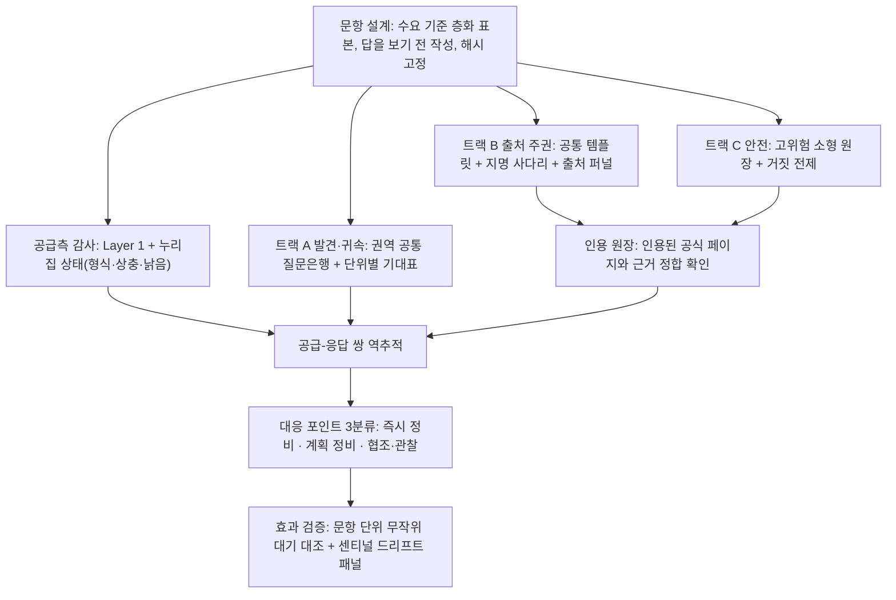
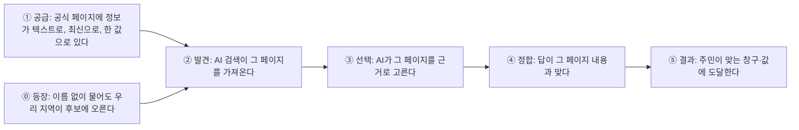

# 지자체 AI 검색 대응 측정 방법론 — 고도화안 v0.2

> [!IMPORTANT]
> **상태: 내부 초안 · 미채택 · 사전 등록 아님.**
> 이 문서는 방법론 **제안**이다. 측정 계획이 아니다. 채택하려면 PRD FR 추가, ADR, K03·K04 개정, `method_version` 상향을 거쳐야 한다(§9). 실제 측정은 단계마다 별도 사전 등록이 필요하다(INV-11).
> 본문의 구로구 수치는 모두 **내부 탐색 관측**이다(사전 등록 가설 밖, 강건성 미검사). 공표·외부 인용·구로구 전달에 쓰지 않는다.
> 교정 효과(EVIDENCE C-4), 문항의 단위 간 변별(C-3), Layer 1과 응답 품질의 관계(C-8), 방법론 제3자 검증(C-7)은 모두 `미검증`이다. 이 문서의 대응 포인트와 효용 추정은 **가설**로 읽는다.

- 작성일: 2026-10-08
- 선행: v0.1 「구로구 측정 회고와 더블 다이아몬드 도출」(세션 산출물, 저장소 밖)
- 관련: [ADR-0006](./adr/0006-distribution-over-score.md) · [ADR-0007](./adr/0007-questions-are-instruments.md) · [ADR-0009](./adr/0009-preregistration.md) · [ADR-0011](./adr/0011-grounding-first-source-analysis.md) · [ADR-0012](./adr/0012-openai-web-search-condition.md) · [K03](./knowledge/K03-measurement-spec.md) · [K04 v2.1](./knowledge/K04-question-sets-v2.1.md) · [K06](./knowledge/K06-validity-statistics.md) · [K13](./knowledge/K13-diffusion-track.md)
- 근거 자료: [구로 본측정 보고서](./aeo-reports/guro/INTERNAL-guro-ko-oai-ws.md) · [출처 재분석](./aeo-reports/guro/INTERNAL-guro-sources.md) · [보완 1차](./aeo-reports/guro/EXPLORE-guro-supp1.md) · [경쟁 측정 사전 등록 초안](./aeo-measurements/guro/PREREG-DRAFT-guro-comp1.md)

---

## 0. 한 장 요약

### 0.1 무엇을 재는가 (재정의)

> **지자체의 AI 검색 대응 상태**: 주민·외부인이 AI에 물을 때 다음 세 가지가 성립하는가.
> ① 그 지역의 자산과 창구가 **발견되고, 맞는 지역으로 귀속**된다.
> ② 답의 근거가 **지자체가 관리하는 공식 출처**다.
> ③ 답을 그대로 따라 해도 **피해가 없다**.
>
> 측정의 목적은 이 상태가 **어느 고리에서 끊기는지** 찾는 것이다. 찾은 지점은 **지자체가 직접 고칠 수 있는 대상**으로 바꿔 돌려준다. 대상은 자기 누리집, 연결기관 페이지, 소관 광역과의 정합이다.

### 0.2 v0.1 → v0.2 무엇이 달라졌나

v0.1 구조는 "트랙 3개 + 역추적 감사 + 조치·대조 실험"이었다. v0.2는 이 구조를 유지하면서 **설계 요소 7개**를 더하거나 바꾼다.

| # | v0.2 설계 요소 | v0.1의 약점 | 구로에서 나온 근거 |
|---|---|---|---|
| 1 | **수요 기준 문항 표본 + 답을 보기 전에 문항 작성** | 문항이 공급(누리집에 답이 있는 것) 기준이었다 | 정답이 있는 사실만 문항화해 구청에 유리하게 기울었다 |
| 2 | **지명 사다리**: 광역 → 생활권 지명 → 기초 지명 → 기관 지명 | 지명 효과를 사후 보정(자가 겨냥률)으로만 다뤘다 | `site:guro.go.kr` 자가 겨냥이 지명 있는 질문 53%, 지명 없는 질문 4% |
| 3 | **출처 퍼널 4단**: 검색 포함 → 인용 → 첫 인용 → 근거 정합 | 출처를 숫자 하나(인용률)로 봤다 | 구청 페이지가 검색 결과에 든 회차 91%, 실제 인용 72% (빠지는 구간이 있다) |
| 4 | **인용 원장**: 인용된 공식 페이지 자체를 정답 근거로 대조 | 트랙 B는 원장이 없어 "공식 인용 + 오답"을 놓친다 | 구청·연결기관을 인용하고도 불일치가 나온 회차 28건 |
| 5 | **권역 공통 질문은행 + 단위별 기대표 사전 선언** | 경쟁 문항이 한 단위 중심으로 짜인다 | comp1 초안 38문항은 구로구 자산에서 출발했다 |
| 6 | **대응 포인트 3분류**: 피해 × 통제권 × 수요 | 결함 목록만 있고 처리 순서를 정할 기준이 없다 | 미도달 17문항, 상충 4건, 낡은 문구 1건, 오귀속 1건이 같은 무게로 나열됐다 |
| 7 | **문항 단위 무작위 대기 대조 + 센티널 패널** | 효과 검증이 유사 단위 대조에만 기댔다(협조·매칭 어려움) | 같은 날 3회 반복이라 날짜 변동(drift)을 몰랐다 |

여기에 원칙 3개를 더 고정한다.

- **공급-응답 쌍:** 누리집 상태(선행)와 AI 응답(결과)을 짝지어 잰다.
- **평판 질문은 사실 오류만 판정:** 감정·태도는 판정하지 않는다(K06 §4).
- **비공개 보류 문항:** "시험 문제에 맞춘 정비"를 막는다.

### 0.3 구조

### 0.4 효용 결론 (§6 요약)

- **편향:** 문항이 지자체에 유리하게 기우는 두 경로(공급 기준 문항, 지명 효과)를 **설계 단계에서** 막는다. v0.1은 사후 보정에 그쳤다.
- **조치 가능성:** 같은 "미인용"이라도 퍼널의 어느 단에서 끊겼는지에 따라 정비 방향이 다르다. 결함마다 정비 후보와 담당 범위(통제권)가 붙어 나온다.
- **확장성:** 단위당 정답 원장 문항이 231개(구로 본측정)에서 **15개 안팎**(트랙 C)으로 준다. 트랙 A는 권역 공유라 단위 수에 비례하지 않는다. 회당 API 비용 추정은 서울 25개 자치구 기준 약 \$100이다(§6.3, 가정 포함).
- **효과 검증:** 단위 하나 안에서도 대조군을 만들 수 있다. 다만 **단일 단위로는 큰 효과만 검출된다**(§6.4). 중간 크기 효과는 참여 단위를 묶어야 잴 수 있다.
- **교정 효과의 크기:** 구로 데이터로 상한만 낼 수 있다. 지명 질문의 값 불일치 기준으로는 **전체 약 3%p가 상한**이다(강한 가정 아래, §6.5). 큰 효용이 있을 수 있는 곳은 아직 재지 않은 발견·귀속(트랙 A)과 고위험 문항이다. 이것도 가설이다.

---

## 1. 출발점 — v0.1을 다시 따져 본 결과

### 1.1 v0.1 요약

| 요소 | 내용 |
|---|---|
| 트랙 A | 비지명 경쟁. 광역 권역 단위로 문항 공유. 등장·오귀속·대체 출현 분포 |
| 트랙 B | 지명 출처 귀속. 공통 템플릿 문항. 원장 불필요. 자가 겨냥률 동반 |
| 트랙 C | 고위험 안전 표본. 단위당 10~15문항 원장. Floor Risk |
| 역추적 감사 | 응답 → 출처 → 누리집 대조로 상충·낡음·미도달·오귀속 목록 |
| 조치·대조 실험 | 정비 단위 대 대조 단위 전후 비교 (C-4) |

### 1.2 다시 따져 보니 남아 있던 약점 10개

| # | 약점 | 왜 문제인가 | v0.2 해법 |
|---|---|---|---|
| W1 | 트랙 A의 "권역 공유"가 실제로는 **한 단위의 자산에서 출발한 문항** | 그 단위에 유리하고, 다른 단위에는 쓸 수 없다 | 권역 내 **모든 단위의 공개 자산 합집합**으로 질문은행을 만들고, 단위별 기대표를 사전 선언한다 (§3.5) |
| W2 | 자가 겨냥률은 **사후 해석 보정**이다 | 지명 효과의 크기는 알려 주지만 "어느 정도로 구체적으로 물어야 공식 출처에 닿는가"는 모른다 | **지명 사다리**로 같은 의도를 지명 수준만 바꿔 묻는다 (§3.2) |
| W3 | 출처를 인용률 하나로 봤다 | 검색 결과에 들었는데 인용되지 않은 것과 검색 결과에 아예 없는 것은 원인과 조치가 다르다 | **출처 퍼널 4단** (§3.3) |
| W4 | 트랙 B "원장 불필요"의 사각 | 공식 페이지를 인용하고도 틀린 답이 나올 수 있다. 원인은 페이지가 낡았거나, 내부에 상충이 있거나, AI가 잘못 읽은 것이다 | **인용 원장**: 인용된 공식 페이지를 그 자리에서 근거로 대조한다 (§3.4) |
| W5 | 문항 공간 원천이 여전히 공급 측 | "질문 공간에서 출발"을 선언만 하고 절차가 없었다 | 생활 영역 × 질문 기능으로 층화하고, 층별 배분과 **답을 보기 전 작성** 절차를 둔다 (§3.1) |
| W6 | 누리집에 답이 없는 질문의 처리 규칙이 없다 | 그런 질문을 버리면 "공급 공백"이 보이지 않는다 | 답이 없는 질문은 **공급 공백 문항**으로 남기고 별도 집계한다 (§3.1) |
| W7 | 대응 포인트를 처리할 순서가 없다 | 담당 부서가 무엇부터 할지 정할 수 없다 | 점수 없이 **3분류**한다: 피해 × 통제권 × 수요 (§3.8) |
| W8 | 효과 검증이 단위 간 대조뿐 | 비슷한 대조 단위를 구하기 어렵고, 기간 중 모델 갱신이 섞인다 | 단위 안에서 **문항 단위 무작위 대기 대조** + 센티널 드리프트 패널 (§3.9) |
| W9 | 누리집 상태(선행)와 AI 응답(결과)이 섞여 있다 | C-8을 검증할 구조가 없다 | **공급-응답 쌍**으로 잰다 (§3.7) |
| W10 | 기존 프레임워크(K04 v2.1 T3-F, 7축의 역발상 평판축)의 부정 질문 판정이 감정·균형 중심 | K06 §4는 AI 응답에서 감정·태도를 추론해 지자체 특성으로 돌리는 것을 금지한다 | 부정·평판 질문은 **근거 없는 사실 주장(역작화)만** 판정한다 (§3.6) |

---

## 2. 구성 개념 — 대응 상태를 고리로 본다

### 2.1 인과 사슬과 고리별 프록시

| 고리 | 무엇이 끊기나 | 프록시 | 트랙 |
|---|---|---|---|
| ⓪ 등장·귀속 | 이름 없는 질문에서 안 나오거나, 다른 지역 것으로 소개된다 | 비지명 등장 분포, 오귀속(양방향) | A |
| ① 공급 | 공식 정보가 없거나, PDF·이미지에만 있거나, 페이지끼리 값이 다르거나, 낡았다 | 공급 공백 문항, 형식·상충·낡음 목록 | 공급측 감사 |
| ② 발견 | 검색 결과에 공식 페이지가 없다 | 퍼널 R단 | B |
| ③ 선택 | 검색 결과에는 있는데 인용되지 않는다. 또는 외부 출처가 먼저 인용된다 | 퍼널 C단·P단 | B |
| ④ 정합 | 공식 페이지를 인용했는데 답이 다르다 | 퍼널 F단 (인용 원장) | B·C |
| ⑤ 결과 | 따라 하면 피해가 난다 | Floor Risk 분포, 거짓 전제 수용 | C |

> 고리 ⑤(실제 주민 피해)는 이 측정으로 직접 관측하지 않는다. K06 §6은 "구성 타당도는 아직 확보되지 않았다"고 적고 있다. 이 문서도 그 한계를 그대로 이어받는다.

### 2.2 핵심 지표 (단위 하나 안에서 읽는다 · 합성하지 않는다)

| 축 | 지표 | 정의(요약) | 표시 형식 | 대응으로 이어지는 방식 |
|---|---|---|---|---|
| 등장·귀속 | **기대 단계별 등장 분포** | 단위별로 사전 선언한 anchor/plausible/weak 문항 각각에서 3회 중 등장 횟수(0~3) 분포 | 분포표 | anchor인데 등장하지 않으면 대표 자산 소개 정비 후보 |
| 등장·귀속 | **오귀속 목록** | 우리 소재 개체를 다른 지역 것으로 소개, 또는 다른 지역 개체를 우리 것으로 소개 | 목록 + 건수 | 소재지 표기, 운영기관·소관 광역 페이지와 정합 |
| 등장·귀속 | **대체 출현 개수 분포** | 우리 단위가 나오지 않은 회차에 대신 나온 지역 수 | 개수 분포. **지역명은 공개하지 않는다** | 경쟁 맥락 해석용 |
| 출처 주권 | **출처 퍼널 R·C·P·F** | 지명 문항 회차에서 공식 출처가 검색 포함 → 인용 → 첫 인용 → 근거 정합까지 남는 비율 | 퍼널 + 문항별 0~3 분포 | 끊긴 단에 따라 정비 방향이 다르다 (§3.3) |
| 출처 주권 | **발견 문턱** | 지명 사다리에서 공식 출처가 첫 인용이 되는 가장 덜 구체적인 지명 수준 | 의도별 L1~L4 분포 | "이름까지 알아야 찾는다"면 일반 검색어 대응을 정비할 후보 |
| 출처 주권 | **공식 미도달 문항** | 반복 전부에서 공식 출처가 인용되지 않은 문항 | 목록 | 가장 구체적인 정비 대상 |
| 출처 주권 | **출처 의존 분포** | 첫 인용이 소관 광역·중앙·타 지자체·그 밖인 비율 | 분포 | 광역·중앙과의 정합 점검 |
| 안전 | **고위험 Floor Risk 분포** | 고위험 문항별 최악 회차의 위험 수준 분포 | 분포. 평균 금지 | 즉시 정비 분류의 근거 |
| 안전 | **거짓 전제 수용** | 없는 제도·시설에 구체 안내를 지어낸 회차 | 원값 | 전제 부정 정보 정비 후보 |
| 공급 | **공급 상태 목록** | 대상 정보의 형식(텍스트/PDF·HWP/이미지), 페이지 간 상충, 낡은 문구, 갱신일 표기 | 목록 | 페이지 정비 |
| 보정 | **자가 겨냥률** | 검색 질의에 `site:우리도메인`이 붙은 회차 비율. 사다리 단계별로 | 단계별 비율 | 대응 지표가 아니다. 해석 보정용 |

**쓰지 않는 것:** 종합 점수·등급·지수. 단위 간 서열. 트랙 간 합산. 일치율 단독 표기(일치율은 트랙 C 안에서 Floor Risk와 함께만 쓴다).

---

## 3. 설계 요소 — 무엇을 어떻게 하는가

### 3.1 수요 기준 문항 표본

**층화 틀**

| 생활 영역 \ 질문 기능 | 사실 (값·시간·장소) | 연결 (어디에·누구에게) | 추천·후보 (이름 없이) | 위험 (거짓 전제·고위험) |
|---|---|---|---|---|
| 민원·증명 | ○ | ○ | – | ○ |
| 복지·돌봄 | ○ | ○ | – | ○ |
| 안전·재난 | ○ | ○ | – | ◎ |
| 교육·도서관 | ○ | ○ | ○ | – |
| 교통·주차·환경 | ○ | ○ | – | ○ |
| 문화·관광 | ○ | – | ◎ | – |
| 산업·창업·투자 | ○ | ○ | ◎ | – |
| 정주·이사 | – | ○ | ◎ | – |

(◎ 중점, ○ 포함, – 해당 적음)

**배분 규칙**

1. 층별 배분은 **수요 근거**로 정하고, 측정 전에 공개한다. 공개 수요 자료 후보는 민원 분류 통계, 지자체 콜센터 FAQ 분류, 검색어 추이다. 이용 가능성과 품질은 **아직 확인하지 않았다**. 확인 전에는 균등 배분하고, 균등 배분했다고 적는다.
2. 참여 지자체가 실제 질의 분류를 주면 그 단위의 배분에만 쓴다. 표시는 "참여한 N곳 중"이다(INV-4).

**작성 절차 (편향 차단)**

1. 문항 작성자는 **누리집에서 답을 확인하기 전에** 사용자 말투로 문항을 쓴다. 지명 수준은 §3.2에 따른다.
2. 문항 파일을 확정하고 **해시를 기록**한다. 이 시점 이후에는 문항을 바꾸지 않는다.
3. 원장 작성자(트랙 C만 해당)가 그다음에 누리집을 조사한다. 가능하면 문항 작성자와 다른 사람이 맡는다.
4. 누리집에서 답을 찾지 못한 문항은 버리지 않는다. **공급 공백 문항**으로 표시하고, 퍼널 F단 대신 "공식 정보 없음"으로 집계한다.

> 구로 본측정은 이 순서를 거꾸로 했다. 원장을 먼저 읽고 문항을 만들었고, 그 과정에서 약 70문항을 폐기했다. 그 결과 "구청이 공개한 것을 AI가 옮기는가"만 측정됐다.

### 3.2 지명 사다리

같은 의도를 지명 수준만 바꿔 묻는다.

| 단계 | 형태 | 예 (구로형, 설명용) | 공유 범위 |
|---|---|---|---|
| L1 광역 | 광역 지명만 | "서울에서 공사장 소음 민원은 어디에 내?" | **권역 공유** (한 번 묻고 권역 내 모든 단위에 귀속) |
| L2 생활권 | 역·동·랜드마크. 기초 지명 없음 | "신도림역 근처 공사장 소음 민원은 어디에 내?" | 단위별 |
| L3 기초 | 기초 지명 | "구로구 공사장 소음 민원은 어디에 내?" | 단위별 |
| L4 기관 | 기관명 명시 | "구로구청 공사장 소음 민원 접수처" | 단위별 (선택) |

- **발견 문턱** = 공식 출처가 3회 중 2회 이상 첫 인용이 되는 가장 낮은 단계. 문턱이 L3·L4이면 "이름을 알아야 찾는다"로 읽는다.
- L2를 두는 이유: 주민은 구 이름보다 역·동 이름으로 묻는 경우가 많다는 **가설**이 있다(미검증). L2는 이 가설을 직접 시험한다.
- 비용 통제: 사다리는 트랙 B 전체가 아니라 **대표 의도 8~10개**에만 적용한다.
- 자가 겨냥률을 단계마다 기록한다. 구로 기준으로 L3에서 높고(53%), 지명이 없으면 낮다(4%). 사다리가 이 차이를 단계별로 쪼개 보여 준다.

### 3.3 출처 퍼널

지명 문항의 회차마다 공식 출처(지자체 + 연결기관)가 어느 단까지 남는지 기록한다.

| 단 | 정의 | 끊겼을 때의 해석(가설) | 정비 후보 |
|---|---|---|---|
| **R 검색 포함** | AI 검색 도구가 가져온 결과에 공식 도메인이 있다 | 발견 문제: 색인, 제목·본문 표현, 사이트맵, robots | 고정 안내 페이지의 제목·첫 문단에 핵심 사실, 사이트맵 포함, Layer 1 점검 |
| **C 인용** | 응답이 공식 출처를 인용한다 | 선택 문제: 페이지에 답이 텍스트로 없음(PDF·표·이미지), 정보가 흩어짐 | 핵심 사실을 HTML 본문으로, 한 페이지에 한 주제 |
| **P 첫 인용** | 첫 인용이 공식 출처다 | 경쟁 출처 우위: 외부 정리 글이 더 읽기 쉽다 | 요약 문단, 질문형 소제목 |
| **F 근거 정합** | 응답의 핵심 값이 인용된 공식 페이지에 있다 (§3.4) | 페이지가 낡았거나, 누리집 안에서 값이 상충하거나, AI가 잘못 읽었다 | 페이지 갱신, 중복 페이지 정합 |

구로 관측(본측정 693회차): R 91% → C 72% → P 71%(구청 단독). 구청·연결기관을 합치면 C 75%, P 73%다. F단은 미측정이다. **R과 C 사이 약 19%p**가 "가져왔지만 쓰지 않은" 구간이다. v0.1은 이 구간을 보지 못했다.

> 퍼널의 "해석"은 원인 진단이 아니다. 원인 규명은 Layer 4의 일이다. 무료 화면에서는 끊긴 단까지만 보여 주고 원인·조치를 단정하지 않는다(AGENTS §4).

### 3.4 인용 원장

**목적:** 정답 원장을 만들지 않고도 "공식 인용 + 오답"을 잡는다.

**절차**

1. 응답에서 핵심 주장(값·장소·창구)을 구조화해 추출한다.
2. 인용된 공식 URL을 **측정 후 24시간 이내에** 가져와 해시와 함께 비공개 저장소에 둔다. 수집은 INV-5를 따른다: `SCANNER_UA`만 쓰고, robots.txt를 준수하고, 요청 간격은 1.5초 이상으로 한다.
3. 핵심 주장이 그 페이지에 있는지 자동으로 대조한다. 결과는 세 가지다: 있음 / 다름 / 페이지에 해당 정보 없음.
4. **"다름"과 "정보 없음"은 사람이 전수 확인한다.** 같은 누리집의 다른 페이지와도 대조해 상충 여부를 함께 본다.
5. robots.txt로 거부됐거나 가져오기에 실패하면 "확인 불가"로 기록한다. 우회하지 않는다.

**판정 분류**

| 결과 | 의미 | 대응 분류 |
|---|---|---|
| 정합 | 공식 페이지 내용대로 답했다 | – |
| 불일치 – 페이지 낡음 | 페이지 값이 다른 최신 공식 자료와 다르다 | 정비 (지자체 통제) |
| 불일치 – 내부 상충 | 누리집 안에서 값이 둘 이상이다 | 정비 (지자체 통제) |
| 불일치 – AI 오독 | 페이지는 맞는데 답이 다르다 | 관찰 (지자체 통제 밖). 형식 개선 후보로 기록 |
| 근거 없음 | 인용 페이지에 해당 정보가 없다 | 관찰. 외부 출처 경유 가능성 |

**한계:** AI가 페이지를 인용하면서 실제로는 다른 출처의 정보를 썼을 수 있다. 동적 페이지는 측정 시점과 수집 시점의 내용이 다를 수 있다. 인용 원장은 "공식 페이지가 맞다"를 전제하므로, 고위험 문항은 트랙 C의 독립 원장으로 따로 확인한다.

> 구로에서 공식 출처를 인용하고도 불일치가 나온 회차는 28건이었다. 지금 구조에서는 이 28건을 "낡음·상충"과 "오독"으로 가르는 데 사람 검토가 전부 필요하다. 인용 원장은 그 일을 자동 1차 분류 + 사람 확인으로 바꾼다.

### 3.5 트랙 A — 권역 공통 질문은행 + 단위별 기대표

1. **은행 구성:** 권역(예: 서울) 내 모든 단위의 공개 대표 자산을 모은다. 출처는 각 누리집의 관광·산업·문화 소개 페이지와 광역 관광 포털이다. 여기에 생활 시나리오(이사·창업·육아·통근)를 더한다. 한 단위 중심으로 짜지 않는다.
2. **균형 점검:** 단위마다 anchor 문항이 최소 k개(예: 2개) 있는지 확인한다. 미달 단위는 "은행이 이 단위를 충분히 덮지 못함"으로 기록하고, 해당 단위의 미등장을 해석하지 않는다.
3. **기대표 사전 선언:** 문항 × 단위마다 anchor / plausible / weak / none을 측정 전에 선언하고 해시로 고정한다.
4. **측정:** 권역당 한 번 묻는다. 3회, 서로 다른 날. 결과는 응답 속 모든 단위에 동시에 귀속된다.
5. **판정:** (개체, 귀속 지역, 언급 위치, 인용 URL) 구조로 추출한다. 등장·귀속은 **사람이 전수 확인**한다. 부분 문자열 판정은 금지한다(구로 "구로공단" 오판 사례).
6. **도구 감도 점검:** 단위별 anchor 등장 > weak 등장, 음성 대조 거짓 양성 < 5%. 이 두 조건을 통과하지 못하면 트랙 A 결과를 해석하지 않는다.
7. **표시:** 단위는 자기 값만 받는다. 다른 단위 이름과 값은 내보내지 않는다(K13 §3). AI가 응답에서 스스로 매긴 서열은 원문 그대로 인용하지 않는다. 기존 K04 v2.1 §5.3과 달리, 이 방법론은 **그런 서열을 산출물에 담지 않는다.**

### 3.6 트랙 C — 고위험 안전 표본

- 단위당 10~15문항이다. 선정 기준은 **틀리면 행동 피해가 나는가**다. 대피·재난, 수수료·기한, 자격·급여, 긴급 연락처, 운영 중단·휴관이 해당한다.
- 거짓 전제 3~5문항을 더한다. 판정은 원문 대조로만 한다. 추출기 라벨은 후보일 뿐이다(구로에서 전제를 바로잡은 응답 12건이 "구체 진술"로 오분류됐다).
- 원장은 공식 페이지 근거 구절과 해시로 만들고 구절 검증을 거친다. 누리집 안에서 상충이 발견되면 `ledger_error`로 제외하고, 그 상충 자체를 공급측 결함으로 넘긴다.
- 결과는 Floor Risk 분포로만 낸다. `부재`와 `작화`를 같은 무게로 평균하지 않는다(INV-9).
- **부정·평판 질문**("○○ 살면 불편한 점")은 트랙 C의 보조 문항으로만 둔다. 판정 대상은 **근거 없는 사실 주장(역작화)** 하나다. 감정·균형·태도는 판정하지 않는다(K06 §4).

### 3.7 공급측 감사와 공급-응답 쌍

AI를 쓰지 않는 누리집 점검이다. 대상은 트랙 B·C 문항과 연결된 정보다.

| 항목 | 측정 | 자동화 |
|---|---|---|
| 형식 | 해당 사실이 HTML 본문에 있는가, PDF·HWP·이미지에만 있는가 | 가능 |
| 상충 | 같은 사실(전화번호·운영시간·면적 등)이 페이지마다 다른가 | 부분 (정규식 + 사람 확인) |
| 낡음 | 확정된 최신 공식 자료와 다른 문구가 남아 있는가 | 부분 |
| 갱신 표기 | 페이지에 최종 수정일이 있는가 | 가능 |
| Layer 1 | robots 4분 판정, 사이트맵, JSON-LD | 기존 스캐너 |

- **쌍으로 기록:** 문항마다 (공급 상태, 퍼널 결과)를 한 행으로 남긴다. 여러 단위에 쌓이면 "공급 상태와 퍼널 단의 관계"를 탐색할 수 있다(C-8, 탐색).
- 관계가 보여도 인과로 쓰지 않는다. 인과는 §3.9의 실험으로만 말한다.

### 3.8 대응 포인트 3분류

점수를 매기지 않는다. 세 기준을 범주로 조합한다. 분류는 **단위 하나 안에서만** 쓰고, 단위 간 비교에 쓰지 않는다.

| 기준 | 범주 |
|---|---|
| 피해 | critical (행동 피해 가능) · high · low |
| 통제권 | 자기 누리집 · 연결기관 · 소관 광역·중앙·외부 |
| 수요 | 층 배분 상 · 중 · 하 (§3.1) |

| 분류 | 조건 | 예 (구로 관측 유형) |
|---|---|---|
| **즉시 정비** | 피해 critical, 그리고 통제권이 자기 누리집 또는 연결기관 | 대피장소 주소 문항이 공식 미도달 + 불일치 |
| **계획 정비** | 그 밖에 자기 통제 안에 있는 결함 | 낡은 슬로건 잔존, 내부 번호 상충, 도서관 운영시간 미도달 |
| **협조·관찰** | 통제권이 외부, 또는 AI 오독 | 박물관 오귀속(운영 주체·광역 페이지 정합 요청), 오독 사례 |

> 즉시 정비로 분류된 문항은 §3.9의 무작위 대기 대조에 넣지 않는다. 피해 가능성이 있는 정비를 실험 때문에 늦추지 않는다.

### 3.9 효과 검증 — 문항 단위 무작위 대기 대조 + 센티널 패널

**(a) 문항 단위 무작위 대기 대조**

1. 대상은 계획 정비로 분류된 결함 가운데 **페이지 하나만 고치면 되는 것**이다. 사이트 전체에 영향을 주는 변경(robots·사이트맵·전면 개편)은 제외한다.
2. 대상 문항을 무작위로 둘로 나눈다. 정비군은 지금 고치고, 대기군은 T주 뒤에 고친다. 배정은 **측정 전에** 기록한다(K06 §4.5 조건 1).
3. 두 군을 같은 날, 같은 방법으로 측정한다. 정비 전 3회와 정비 후 3회를 각각 서로 다른 날에 한다.
4. 보고값은 (정비군 변화) − (대기군 변화)다. 음수면 "개선되지 않았다"고 쓴다.
5. **K06 §4.5와의 관계:** K06은 대조군을 "아무 조치도 하지 않은 단위"로 정의한다. 문항 단위 대조를 성과 주장 게이트의 조건 2로 인정할지는 **ADR로 정해야 한다.** 정하기 전에는 보조 근거로만 쓴다. 단위 간 대조(기준 표본)와 병행하는 것이 원칙이다.
6. 위협: 같은 누리집 안에서 정비 효과가 대기군 문항으로 번질 수 있다(내부 링크·사이트 평판). 그러면 효과는 **과소 추정**되는 방향이다. 이 방향을 문서에 미리 적어 둔다.

**(b) 센티널 드리프트 패널**

- 단위·트랙을 가로지르는 고정 문항 10~20개를 정기적으로 측정한다(예: 격주). 판본 고정, 앞말 없음 조건이다.
- 모델 판본이 바뀌거나 패널 분포가 크게 움직인 시점을 시계열에 표시한다. 효과 검증 기간에 이런 표시가 있으면 그 구간 해석을 보류한다.

---

## 4. 운영 규약

| 규약 | 내용 | 출처 |
|---|---|---|
| 측정 조건 | 앞말 없는 소비자 조건이 기본이다. 앞말 있음은 비교 조건이다. Responses API + `web_search`, 검색 조건 라벨 `on_verified` | ADR-0012, 구로 교훈 #8 |
| 필수 기록 | `method_version`, `ai_service`, 모델 판본, `web_search`, `language`, `measured_on`, 사다리 단계, 문항 파일 해시 | INV-7 |
| 반복 | 3회 이상, **서로 다른 날**. 구간은 문항 군집 부트스트랩. 3회 미만이면 원값 분포만 쓴다 | K06 §3, 구로 교훈 #7 |
| 강건성 | 문항마다 표현 변형 2~3개. 판정이 흔들리는 문항은 공개 집계에서 제외. 트랙 A는 권역 표현 변형("서울에서"/"서울 안에서")을 포함 | INV-10 |
| 판정 | 구조 추출 → 규칙 → 인용 원장 대조 → 2차 의견은 "검토"로만 → 귀속·위험·불일치는 사람 전수, 그 밖은 20% 표본을 2인이 교차 확인. 일치도를 기록 | C-7, 구로 교훈 #5·#6 |
| 저장 | 회차별 저장. 응답 원문과 수집 페이지는 비공개 저장소에 해시와 함께. 공개 경로에는 판정과 최소 인용구만 | INV-6, INV-9 |
| 분리 | 모집단 `local_gov` 안에서 광역·기초 템플릿과 보고를 분리한다. `special_zone`과 합산하지 않는다. 트랙 간 합성 지수를 만들지 않는다 | INV-1, ADR-0006 |
| 보류 문항 | 문항의 20%는 단위에 공개하지 않는다. 공개 문항과 보류 문항의 결과 차이를 모니터링한다. 차이가 크면 "문항에 맞춘 정비"를 의심한다 | 신규 |
| 사전 등록 | 가설·기대표·배정·반증 조건·중단 규칙·공표 약속을 측정 전에 공개. 결과를 본 뒤에는 바꾸지 않는다 | INV-11 |
| 서비스 | 1단계 OpenAI 단독. 2단계에서 다른 서비스 추가 | ADR-0011 D-4 |
| 언어 | 1단계 한국어. 영문은 별도 조건으로 분리 | ADR-0012 D-6 |

### 4.1 광역과 기초

| | 광역 | 기초 |
|---|---|---|
| 트랙 A 범위 | 나라 전체 범위 질문("한국에서 ~"). 관광·투자·산업 비중이 크다 | 권역 범위 질문("서울에서 ~"). 권역 질문은행을 공유한다 |
| 지명 사다리 | L1을 "한국"으로, L2를 권역·대표 도시로 | §3.2 그대로 |
| 트랙 B 템플릿 | 정책·지원사업·광역 시설·광역 콜센터 | 민원·생활·동 단위 창구 |
| 출처 의존 해석 | 중앙부처 출처 비중 | **소관 광역 출처 비중**(구로 첫 인용 10%가 서울시·시 산하) |
| 귀속 위험 | 광역·기초 혼동(광역 시설을 기초 것으로, 또는 반대) | 인접 기초 간 혼동(구로 박물관 사례) |
| 연결기관 | 공사·공단·재단이 많다. 목록을 자동 수집한 뒤 사람이 확인 | 누리집 바닥글의 유관기관 링크 |

- **B형 단위**(소관 시·도 도메인을 쓰는 단위)는 퍼널 값마다 "이 값은 소관 시·도 도메인의 값입니다"를 함께 적는다.

---

## 5. 근거 — 왜 이 설계인가

근거 강도 표기: **[관측]** 구로 내부 탐색 관측 · **[규칙]** 저장소 불변식·ADR·K 문서 · **[원리]** 측정 방법론 일반 원리 · **[가설]** 검증 전

| 설계 요소 | 근거 | 강도 |
|---|---|---|
| 수요 기준 표본·답을 보기 전 작성 | 원장을 먼저 읽고 만든 문항은 구청 공개 정보만 덮었고, 약 70문항이 폐기됐다 | [관측] |
| | 표본 틀이 결과를 정한다. 측정 대상이 표본 선정에 관여하면 선택 편향이 생긴다 | [원리] |
| 지명 사다리 | 자가 겨냥이 지명 있는 질문 345/645(53%), 지명 없는 질문 2/48(4%) | [관측] |
| | 지명 없는 B6 탐침에서 구청·연결기관 인용 회차는 13/45(29%), 지명 있는 주민 문항은 312/381(82%) | [관측] |
| | 주민은 역·동 이름으로 묻는다 | [가설] |
| 출처 퍼널 | 구청 도메인 검색 포함 632/693(91%), 인용 502/693(72%) | [관측] |
| | 출처를 1급 측정 대상으로 둔다 | [규칙] ADR-0011 D-2 |
| 인용 원장 | 구청·연결기관 인용이 있는데도 불일치인 회차 28건. 원인 구분에 사람 검토 필요 | [관측] |
| | 원장 작성이 전체 노력의 대부분이었다(약 950쪽 열람) | [관측] |
| 권역 공통 은행·기대표 | 한 응답에 여러 단위가 함께 등장하므로 같은 관측을 공유할 수 있다 | [원리] |
| | 기대표 사전 선언 없이 미등장을 해석하면 "원래 덜 알려진 것"과 구분되지 않는다 | [원리] K06 §2.0 |
| | 보완 1차 비지명 탐침 9문항: 귀속 6, 미등장 2, 오귀속 1 | [관측] |
| 부분 문자열 판정 금지 | "구로공단" 낱말로 다른 지역 귀속을 맞다고 오판 | [관측] |
| 거짓 전제는 원문 대조 | 전제를 바로잡은 응답 12건이 추출기에서 "구체 진술"로 오분류 | [관측] |
| 날짜 분산 반복·센티널 | 같은 날 3회 반복은 드리프트를 반영하지 않는다. 모델 드리프트가 가장 위험한 위협이다 | [규칙] K06 §2.5 |
| 문항 단위 대조 | 단위 간 대조는 유사 단위 확보와 협조가 어렵다. 같은 누리집 안에서 무작위 배정하면 단위 특성과 시점을 통제한다 | [원리] |
| | 성과 주장 4조건 | [규칙] K06 §4.5 |
| 공급-응답 쌍 | 누리집 내부 상충 4건, 낡은 슬로건 1건이 측정 부산물로 나왔다 | [관측] |
| | Layer 1과 응답 품질의 관계 | [가설] C-8 미검증 |
| 3분류 | 순위표 금지, 분포 우선 | [규칙] INV-3, ADR-0006 |
| 평판은 사실 오류만 | AI 응답에서 감정·태도를 추론해 지자체 특성으로 돌리지 않는다 | [규칙] K06 §4 |
| 보류 문항 | 측정 문항이 알려지면 문항에 맞춘 정비로 지표가 실제 상태와 멀어진다 | [원리] |

---

## 6. 효용 분석

### 6.1 누가 무엇을 결정할 수 있게 되나

| 이해관계자 | 받는 산출물 | 내릴 수 있는 결정 | v0.1에서 가능했나 |
|---|---|---|---|
| 단체장·기획 | 등장 분포, 발견 문턱, 오귀속 | 대표 자산 소개를 정비할지, 광역과 협의할지 | 부분 (문턱 없음) |
| 홍보·관광·투자 | anchor 미등장 목록, 오귀속 | 소개 페이지·관광 포털 정비 대상 선정 | 부분 |
| 민원·복지 | 퍼널 단별 미도달 문항, 고위험 Floor Risk | 어떤 안내 페이지를 먼저 고칠지 | 부분 (끊긴 단 구분 없음) |
| 정보화·누리집 | 공급 상태 목록, 인용 원장 불일치 분류 | 형식 전환(PDF → 본문), 중복 페이지 정합, 갱신 | 부산물로만 |
| 감사·의회 | 즉시 정비 목록, 거짓 전제 수용 | 위험 관리 점검 | 가능 |
| kplacelab | 무작위 대기 대조 결과, 센티널 | C-4 주장 가능 여부 | 설계 미흡 |

### 6.2 방법 간 비교

| 기준 | 정답 원장형 (구로 본측정) | K04 v2.1 3-Tier | v0.1 3트랙 | **v0.2** |
|---|---|---|---|---|
| 공급 편향 통제 | × | △ (Tier 2가 사전 조사 기반) | △ (선언만) | ○ (답을 보기 전 작성, 공급 공백 문항) |
| 지명 효과 통제 | × | × | △ (사후 보정) | ○ (사다리) |
| 출처 진단의 해상도 | △ (사후 재분석) | △ | △ (인용률) | ○ (퍼널 4단 + 인용 원장) |
| 조치 연결 | △ | △ (처방전이 일반론) | ○ | ○ (3분류 + 통제권) |
| 확장성 | × (단위당 원장 수백 개) | △ (Tier 2 사전 조사) | ○ | ○ (원장 15개 안팎, 권역 공유) |
| 효과 검증 설계 | × | △ (월별 추적, 대조군 없음) | △ (단위 간 대조) | ○ (문항 단위 + 단위 간 + 센티널) |
| 불변식 위험 | 낮음 | 경쟁 SoV 비교·서열 인용이 INV-3에 가깝다 | 낮음 | 낮음 |
| 사람 노력 | 매우 큼 | 큼 | 중간 | 중간 (판정 사람 확인은 유지) |

(○ 충족, △ 부분, × 미흡 — 방법 비교용 표기이며 지자체 평가가 아니다)

### 6.3 비용 추정 (가정 포함)

**전제:** 호출당 약 \$0.0245. 구로 본측정 \$16.96 ÷ 693호출에서 나온 값이고, 비용의 약 95%가 검색 호출이다. 단가(입력 \$0.1/MTok, 출력 \$0.5/MTok, 검색 \$0.01/회)가 바뀌면 다시 계산한다.

| 항목 | 규모 | 호출 | API 비용 |
|---|---|---|---|
| 트랙 B 템플릿 | 단위당 25의도 × 3회 | 75 | 약 \$1.8 |
| 지명 사다리 L2·L3 | 단위당 8의도 × 2단계 × 3회 (L3는 트랙 B와 겹치면 재사용) | 24~48 | 약 \$0.6~1.2 |
| 지명 사다리 L1 | 권역당 8의도 × 3회 | 24 | 권역당 약 \$0.6 |
| 트랙 C | 단위당 15문항 × 3회 | 45 | 약 \$1.1 |
| 트랙 A | 권역당 60문항 × 3회 | 180 | 권역당 약 \$4.4 |
| 인용 원장 수집 | 인용 공식 URL 수집 | API 없음 | 0 (수집 시간: 페이지 수 × 1.5초 이상) |
| 공급측 감사 | 누리집 점검 | API 없음 | 0 |

- **서울 25개 자치구 1회차:** 단위당 약 \$3.5~4.1 × 25 + 권역 \$5.0 ≈ **\$93~108**
- 강건성 변형(문항 채택 시 1회): 해당 문항 호출의 2~3배
- 센티널(패널 단위만): 20문항 × 격주 ≈ 단위당 연 520호출, 약 \$13

**사람 노력** (구로 경험에서 나온 추정, 실측 아님)

| 항목 | 구로 본측정 | v0.2 단위당 |
|---|---|---|
| 정답 원장 문항 | 231 (+ 폐기 약 70) | **약 15** (트랙 C만) |
| 원장용 누리집 열람 | 약 950쪽 | 약 60쪽 내외 (문항당 약 4쪽 가정) |
| 귀속·위험 사람 확인 | 검토 결정 196건 | 트랙 A 등장 전수 + 불일치·근거 없음 전수 |
| 연결기관 목록 | 수작업 | 자동 수집 + 확인 |

> 병목은 여전히 사람 확인이다. v0.2는 원장 작성 노력을 크게 줄이는 대신, 판정 확인(귀속·인용 원장 불일치)에 노력을 옮긴다. 이 이동은 의도한 것이다. 확인 노력은 **대응 포인트를 직접 만드는 일**이기 때문이다.

### 6.4 효과 검증의 검출력 (근사)

문항 단위 이진 결과("공식 출처가 3회 중 2회 이상 첫 인용")를 가정한다. 양측 α=0.05, 검정력 80%, 두 비율 비교의 근사식을 쓴다. 회차 내 상관과 문항 이질성은 무시했으므로 **실제 필요 수는 이보다 크다.**

| 대기군 → 정비군 | 군당 필요 문항 수 (근사) |
|---|---|
| 10% → 50% | 약 20 |
| 10% → 40% | 약 32 |
| 20% → 40% | 약 81 |

- 구로의 공식 미도달 문항은 17개다. 이걸 둘로 나누면 군당 8~9개라 **매우 큰 효과만** 검출된다.
- 중간 크기 효과를 재려면 **참여 단위 5~10곳의 대상 문항을 묶는** 다단위 설계가 필요하다. 이 경우에도 단위 안에서 무작위 배정하고, 분석은 단위를 층으로 둔다.

### 6.5 교정 효과는 얼마나 클 수 있나 — 상한 추정

**구로 지명 질문의 값 판정 회차 604건**을 기준으로 한다(출처 재분석 §6).

| | 회차 | 불일치 | 부재 |
|---|---|---|---|
| 공식 인용 있음 | 489 | 28 (6%) | 13 |
| 공식 인용 없음 | 115 | 27 (23%) | 3 |
| 계 | 604 | 55 (9.1%) | 16 |

**강한 가정 세 개를 동시에 둔다.** (a) 인용과 일치의 연관이 전부 인과다. (b) 정비하면 인용 없음 회차가 모두 공식 인용으로 바뀐다. (c) 바뀐 회차의 불일치율이 인용 있음 회차와 같아진다. 이 가정 아래에서 인용 없음 회차의 불일치는 27건에서 약 7건으로 준다. 전체 불일치는 **9.1% → 약 5.8%(약 3%p 감소)**가 된다. 부재는 거의 변하지 않는다(3% 대 3%).

**읽는 법**

1. 이것은 **상한**이다. 실제로는 (a)부터 성립하지 않을 가능성이 높다. 원래 쉬운 문항이 공식 출처에 잘 닿았을 수 있다.
2. 지명 질문의 값 정확성만 보면, 전체 수준에서 교정 효과는 **작은 쪽에 머문다**. 대신 효과는 특정 문항(도서관·대피장소·소규모 시설)에 몰린다. 그 문항을 묻는 주민에게는 작지 않을 수 있다(가설).
3. 구로 데이터는 **발견·귀속(트랙 A)과 공급 공백 문항의 효과 크기를 전혀 말해 주지 않는다.** 대응 효용이 크게 나타날 수 있는 후보는 이 영역이다. 이것도 가설이며, v0.2의 검증 대상이다.
4. 모든 효과 주장은 K06 §4.5 게이트를 통과하기 전까지 "값이 이렇게 변했다"까지만 쓴다.

### 6.6 효용의 한계와 위험

| 위험 | 내용 | 완화 |
|---|---|---|
| 문항에 맞춘 정비 | 측정 문항만 고치고 지표가 좋아진다 | 보류 문항 20%, 공개·보류 차이 감시 |
| API와 앱의 차이 | API 관측이 소비자 앱 화면과 다를 수 있다 | 앱 화면 소표본 대조. 관련 주장은 EVIDENCE에 먼저 등록 |
| 서비스·모델 교체 | 판본이 바뀌면 시계열이 끊긴다 | 센티널 표시, `method_version` 고정 |
| 경쟁 서열로 오용 | 단위들이 트랙 A 결과를 서로 비교한다 | 자기 값만 제공, 다른 단위는 익명, 서열 미산출 |
| 원인 단정 | 퍼널 해석을 원인 진단으로 오해한다 | "끊긴 단"까지만 표시. 원인은 Layer 4 |
| 이해충돌 | 측정 주체가 정비 사업 당사자다 | 한계를 먼저 적는다(K06 §6). 제3자 검증(C-7) |

---

## 7. 검증 계획과 단계 관문

각 단계는 별도 사전 등록을 거친다. 아래 반증 조건은 **제안**이다. 사전 등록 때 확정하고, 결과를 본 뒤에는 바꾸지 않는다.

| 단계 | 시험할 것 | 제안 반증 조건 (하나라도 해당하면 해당 요소를 쓰지 않거나 수정) | 대장 |
|---|---|---|---|
| 0 | 지명 사다리의 단조성 | L1 → L3로 갈수록 공식 첫 인용 비율이 오르지 않는 의도가 절반을 넘는다 | – |
| 0 | 퍼널 기록 가능성 | 검색 도구 결과 목록이 기록되지 않은 회차가 5%를 넘는다 | – |
| 0 | 인용 원장 자동 대조 | 자동 판정과 사람 판정의 일치가 0.8 미만이다 | C-7 |
| 0 | 트랙 A 도구 감도 | anchor 등장 ≤ weak 등장, 또는 음성 대조 거짓 양성 ≥ 5% | C-3 |
| 1 | 단위 간 변별 | 핵심 지표에서 단위 간 변동이 같은 단위 반복 간 변동보다 크지 않다 | C-3 |
| 1 | 공급-응답 관계 | (탐색) 공급 상태와 퍼널 단의 관계. 반증 조건 대신 탐색으로 표시한다 | C-8 |
| 2 | 교정 효과 | (정비군 변화) − (대기군 변화) ≤ 0. 또는 단위 간 대조 결과와 방향이 반대다 | C-4 |
| 3 | 서비스 간 일반화 | 서비스마다 퍼널 양상이 달라 공통 대응 포인트가 성립하지 않는다 | – |

---

## 8. 기존 프레임워크와의 관계

| 기존 | v0.2에서 |
|---|---|
| K04 v2.1 Tier 1 (기본 행정 15문항, 공통) | 트랙 B 공통 템플릿으로 흡수. 판정을 **정답 대조에서 출처 퍼널 + 인용 원장으로** 바꾼다 |
| K04 v2.1 Tier 2 (고유 정보 20문항, 사전 조사) | 고위험만 트랙 C로 남긴다. 나머지는 트랙 B 퍼널로 본다. 사전 조사는 문항 작성 **뒤에** 한다 |
| K04 v2.1 Tier 3 (대외 홍보, SoV) | 트랙 A로 대체. 기대표 사전 선언, 양방향 오귀속, 경쟁 단위 SoV 비교표·AI 서열 인용 **미산출** |
| K04 v2.1 T3-F 부정 테스트 (균형성 판정) | 트랙 C 보조 문항으로. 역작화(근거 없는 사실 주장)만 판정 |
| 종합전략보고서 7대 축 | 사실 검증 → 트랙 C · 비브랜드 SoV·정책 자문 → 트랙 A · 1:1 대결 → **채택하지 않는다**(단위 간 서열 위험) · 역발상 평판 → 트랙 C 보조 · 영문 → 3단계 별도 조건 · 생활행정 → 트랙 B |
| ADR-0011 D-2 출처 6축 | 권위도·경쟁 출처 → 출처 의존 분포 · 정본 도달률 → 퍼널 P·F · 인용 안정성 → 문항별 0~3 분포 · 구조화 데이터 연관 → 공급측 감사 · 출처 시점 → 인용 원장의 낡음 판정 |

---

## 9. 채택에 필요한 절차 (AGENTS §2 순서)

| # | 할 일 | 비고 |
|---|---|---|
| 1 | PRD에 FR 추가 | 지명 사다리, 출처 퍼널, 인용 원장, 권역 질문은행, 대응 포인트 3분류 |
| 2 | ADR 초안 | "출처 퍼널·지명 사다리 중심 측정과 문항 단위 대조" (번호 미정). K06 §4.5 조건 2의 해석 포함 |
| 3 | K03·K04 개정 초안 + `method_version` 상향 | 기존 v2.x 관측과 기본 비교하지 않음(K03 M-3) |
| 4 | EVIDENCE 신규 주장 등록 | 예: "API 관측이 소비자 앱 응답과 대응한다", "주민은 생활권 지명으로 묻는다". 등록 전에는 문서에 사실로 쓰지 않는다 |
| 5 | 마이그레이션 (새 파일) | 사다리 단계, 퍼널 단 기록(검색 포함·인용·첫 인용·정합), 기대표, 인용 원장 확인 결과, 보류 문항 표시 |
| 6 | 0단계 사전 등록 | §7의 0단계 반증 조건 확정 |

---

## 10. 열린 결정

1. **v0.2를 ADR·K03·K04 개정 초안의 기준으로 삼을지.**
2. **0단계 범위:** 구로구에 서울 자치구 2곳을 더할지, 그리고 어느 단위로 할지. 내부 측정이며 산출물에서는 익명으로 처리한다.
3. **comp1 초안의 처리:** 지금 형태(구로 중심 38문항)로 단일 단위 탐색을 할지, 권역 질문은행 형태로 다시 짠 뒤 0단계에 넣을지. 권장은 다시 짜는 쪽이다. W1 때문이다.
4. **수요 자료:** 공개 수요 자료(민원 분류 통계·콜센터 FAQ 분류·검색어 추이)의 이용 가능성을 먼저 조사할지, 균등 배분으로 시작할지.
